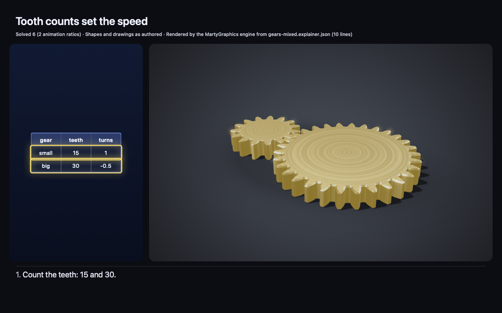

# Explainer examples

Three explainer documents: the authoring card's examples in [docs/EXPLAINER.md](../../docs/EXPLAINER.md). Each is one
JSON file that the engine checks with `--strict` (tests X1 and D2 keep the files, the card and the expected captions
equal). They are synthetic, hand-written examples (Apache-2.0), not the output of an AI model.

| File | Views | What it shows | Legend |
| --- | --- | --- | --- |
| [`planets-2d.explainer.json`](planets-2d.explainer.json) | 2D | A table of typed data with a `basis` note; one beat highlights two rows. | Given 1 |
| [`gears-3d.explainer.json`](gears-3d.explainer.json) | 3D | Two meshing gears; captions filled from engine facts (`{w.speed\|abs\|frac}`), a sign check, a spin. | Solved 5 (2 animation ratios) |
| [`gears-mixed.explainer.json`](gears-mixed.explainer.json) | both | The same gears plus a table whose cells show the 3D facts; each beat highlights a table row and a gear together. | Solved 6 (2 animation ratios) |

```sh
swift build --package-path Examples/Solid3D
B=Examples/Solid3D/.build/debug
$B/marty-solid check --strict Examples/Explainers/gears-mixed.explainer.json
$B/marty-solid render Examples/Explainers/gears-mixed.explainer.json /tmp/gears-mixed
```



The still above is `beat-1.png` of `marty-solid render` on `gears-mixed.explainer.json` (receipt:
[`docs/assets/explainer/provenance.json`](../../docs/assets/explainer/provenance.json)).

The 3D example in the open-vocabulary spec also shows a motion arrow and a centre-distance dimension. 3D annotations
(open-vocabulary PR 3a) now work in explainers; this card example keeps its facts in captions so the card stays small
(tests cover an explainer with a label and a dimension).
