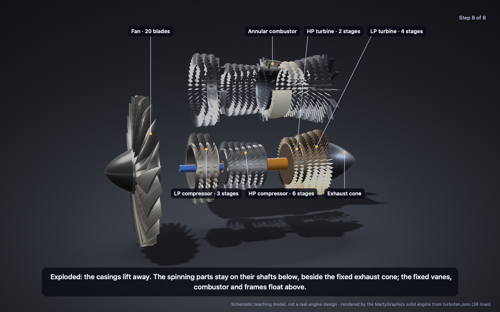
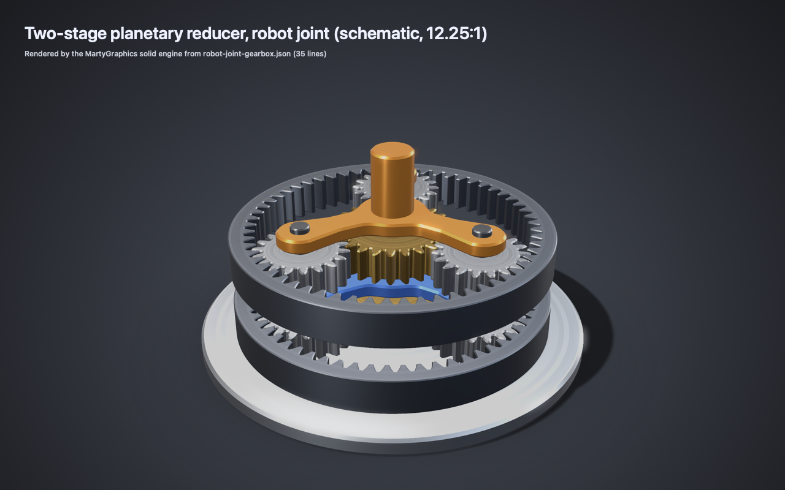
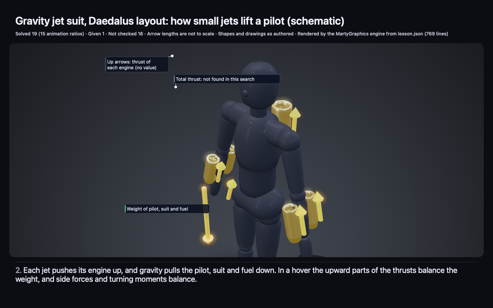

<div align="center">

# MartyGraphics

### Kinematically verified mechanism explainers from a prompt

Gear trains, slider-crank linkages and engine cutaways, as 3D stills, loops and step-by-step videos.

**Early preview** · macOS 14+ and iOS 17+ · No external packages · [Apache-2.0](LICENSE)

[Examples](docs/SHOWCASE.md) · [How it works](#how-it-works) · [Limits](#honesty-and-limits) · [Quick start](#quick-start) · [Contribute](CONTRIBUTING.md)

</div>

**What the engine checks:** gear meshing (tooth phase, centre distance and tooth interference), gear ratios, joint
motion and layout. In the strict check, the labels and arrows that a view shows pass the anchor and visibility checks;
a force or flow arrow whose part is hidden in a view is dropped from that view and reported as a warning.
**What it does not check:** whether the words are true. It checks motion and layout, not the truth of text claims.

**Image refresh (2026-11-12).** The built-in 3D stills and GIF previews now use the default `studio` look at engine
`fb604556`. They are MartyGraphics renders, not Blender output or hand-made images. Source documents are unchanged.
MP4 videos keep their original captures. [Commands, hashes and exceptions](docs/assets/STUDIO-RERENDER.md).

<p align="center">
  <a href="docs/assets/turbofan/exploded.png"></a>
</p>

**A turbofan cutaway, exploded here, from 38 lines of JSON.** The solid engine builds every blade row, casing and shaft of this
schematic two-spool turbofan. The HP spool turns three times for each turn of the fan; that ratio is authored as two
input drives, not solved from gears. The example's own check confirms that both spools turn about one axis and that
every rotor keeps at least 4.52 mm from the parts that do not turn with it. The JSON was written by hand in the
documented format, not from a prompt. A teaching model, not a real engine design. The labelled cutaway and the loop
name the spool speeds with the pilots' terms N1 (LP spool) and N2 (HP spool).
[Labelled cutaway](docs/assets/turbofan/labelled.png) · [Turning loop (GIF)](docs/assets/turbofan/turbofan-loop.gif) ·
[Video (MP4)](https://morrowdock.app/mg/turbofan/turbofan-loop.mp4) · [Its JSON](Examples/Turbofan/Sources/TurbofanKit/Models/turbofan.json) ·
[Run it](Examples/Turbofan/README.md) · [Render receipt](docs/assets/turbofan/provenance.json)

### Refused, then repaired: a robot-joint gearbox from a prompt

<p align="center">
  <a href="docs/assets/from-a-prompt/robot-joint/loop.gif"></a>
</p>

| | |
| --- | --- |
| Prompt | *"Show a two-stage planetary gearbox like in a robot joint."* Claude Haiku 5.5, no tools, only the public docs and worked examples. |
| Try 1 | Sun 20 teeth, three planets of 18, ring 56. |
| Refused | `constraint.gearMesh.phase` on part `ring1`. Why: 20 + 56 = 76 does not divide by 3, so three equally spaced planets cannot mesh with both the sun and the ring. |
| Try 2 | Sun 24, planets 18, ring 60: (24 + 60) ÷ 3 = 28. **Accepted.** This is the gear set of the worked planetary example in the docs that the model saw. |
| Solved | 19 parts, 12 gear meshes, output 4/49 of the input speed (12.25:1). Two tries, 121 seconds. |

The engine sent the model only the reason and the part; the "why" line is our note. At main `287bb17`,
`marty-solid check` still refuses try 1 with the same reason and accepts try 2. The engine rendered every frame
from the model's JSON, unedited. We picked this run after grading, from the runs that passed.
[Turning loop](docs/assets/from-a-prompt/robot-joint/loop.gif) · [Exploded](docs/assets/from-a-prompt/robot-joint/exploded.png) ·
[Refused first try](docs/assets/from-a-prompt/robot-joint/attempt-1-refused.json) ·
[Accepted JSON](docs/assets/from-a-prompt/robot-joint/robot-joint-gearbox.json) · [Run receipt](docs/assets/from-a-prompt/robot-joint/provenance.json)

## How it works

1. **An AI model writes JSON.** One assembly document: parts, joints, gear meshes, teaching steps, labels and arrows.
   MartyGraphics does not include a model; the host app or a harness calls one.
2. **The engine checks it and refuses with an exact reason.** The JSON is strictly parsed and checked (motion and
   layout, not content): closed keys, bounded sizes, no code. A refusal is one stable reason token and the part, for
   example `constraint.gearMesh.phase` on `ring1`. Every reason is in the [reason catalog](docs/REASONS.md).
3. **The model repairs the JSON.** It reads the reason and sends a new document. The test runs on this page allowed at
   most three repairs.
4. **The engine solves the motion and renders.** It renders stills, a loop and a story video. A caption takes its
   numbers from the solved values: the engine writes "at 16/23 of the input speed" from the gear mesh. In the v2
   format, a typed number in a caption is refused unless the caption is marked as not checked.

The format: [Solid 3D](docs/SOLID-3D.md) · [Explainer documents](docs/EXPLAINER.md) · [`marty-solid` tool](Examples/Solid3D/README.md)

## Honesty and limits

**Early preview.** APIs and the wire format may change. The first tagged release is v0.1.0; see the [changelog](CHANGELOG.md).

- **Reliability is not good enough yet.** In a 50-question test, Claude Haiku 5.5 got all 40 in-scope questions
  accepted within three repairs, but only 29 of 40 were fully correct in mechanics, and 46 of 50 explanations had no
  critical error (our target is 95%). [What the test found](docs/SHOWCASE.md#from-a-prompt)
- **"Solved" means an animation ratio, not a verified fact.** The legend on each still (for example "Solved 9 (3
  animation ratios)") counts what the engine computed from the model's joints, gears and drives. It is not a measured
  fact about the real object. "Not checked" items are shown as the author wrote them.
- **Not checked:** the meaning of words, strength, load, wear, friction, efficiency, air or gas flow, forces other than
  the gravity direction, and collisions between parts. Gear contact is checked in 2D at sampled angles. Linkages are
  limited to the slider-crank; there are no helical or bevel gears, belts or cams.
  [Full list](docs/SOLID-3D.md#limits)
- **Determinism.** In fresh processes with the same build and input, these are byte-identical: the parse and its
  refusals, the solved facts, the check reports, the cameras, the label layout, the story plan and its timing, and
  the snapshot JSON. The 3D pixels are not: SceneKit shading can differ a little between processes. Measured on
  2026-11-10 over 164 stills, at most 5.02 % of the pixels in a still differed. A cross-process test keeps the
  difference inside a measured bound.
  [Measurements](docs/SOLID-3D.md#determinism)

## An AI-written lesson, with its fact check

<p align="center">
  <a href="docs/assets/jet-suit-ai/story.mp4"></a>
</p>

**Asked: "How does the Gravity jet suit work?"** Claude Opus 5.5, through the [Marty](https://github.com/morrowdock/marty)
app with web research on, wrote the lesson JSON. The engine refused its first two tries, each with one reason, accepted
the third, and rendered 9 beats and a 78-second story video. **The lesson is shown unedited, with its errors listed.**
An independent fact check by two AI models found **1 wrong sentence and 12 corrections**. The wrong sentence (beat 7)
says the hot gas spins the turbine "at 1 turn per input turn". The engine solved only the 1:1 shaft link, not the gas
flow, and it does not check what a sentence means. We asked the same question in 4 runs: 3 lessons were accepted, and
1 of 4 met our showcase bar (this one).
[Fact-check panel](docs/SHOWCASE.md#independent-fact-check) · [Fact check](docs/assets/jet-suit-ai/FACT-CHECK.md) ·
[All 9 beats](docs/SHOWCASE.md#jet-suit-from-a-prompt-ai-written-unedited) · [Prompt and every try](docs/assets/jet-suit-ai/PROMPT.md) ·
[Story video (MP4)](docs/assets/jet-suit-ai/story.mp4) · [Render receipt](docs/assets/jet-suit-ai/provenance.json)

## Quick start

Use **Swift 6 on macOS 14+**. No external packages, credentials or network services are needed.

```sh
git clone https://github.com/morrowdock/martygraphics.git
cd martygraphics
swift build && swift test
swift build -c release --package-path Examples/Solid3D
B=$(swift build -c release --package-path Examples/Solid3D --show-bin-path)
$B/marty-solid check --strict Examples/Solid3D/Sources/MartySolid3D/Models/idler-gearbox.json
$B/marty-solid render Examples/Solid3D/Sources/MartySolid3D/Models/idler-gearbox.json NEW_DIR
```

`check` prints a JSON report: the solved ratios, the checks and the legend, or the refusal reason and part. `render`
writes the stills, the loop and the story video. More commands: [`marty-solid`](Examples/Solid3D/README.md). To use
the library in an app, add a local checkout as a path dependency; see the [tutorial](docs/GETTING-STARTED.md).

## Scope and status

This is the engine, not a complete learning app or a course collection. The renderers need Apple frameworks; Windows,
Linux and browser builds are not supported. No model, hosted generation API or code executor is bundled. See the
[public versus app matrix](docs/CAPABILITIES.md) and the [quality plan](docs/QUALITY.md). Every pull request must
pass the hosted `CI` check `hygiene`; the hosted `macos` tests run on every pull request too ([hosted CI](docs/VERIFY-ON-MAC.md#hosted-ci-required-merge-gate)).
Use [local maintainer validation](docs/LOCAL-VALIDATION.md) for Gitleaks and receipts; the
[Mac verification steps](docs/VERIFY-ON-MAC.md) cover Apple-framework builds and the local GPU and iOS receipts that
hosted runners cannot give.

## Also in this repo

- **More mechanism examples (hand-built):** [idler gearbox cutaway with engine-filled numbers](docs/SHOWCASE.md#cutaways-and-honest-numbers) ·
  [winch with measured dimensions](docs/SHOWCASE.md#labels-arrows-and-measured-dimensions) ·
  [planetary gear set and slider-crank](docs/SHOWCASE.md#solid-3d-from-json) ·
  [hand-built jet-suit lesson](docs/SHOWCASE.md#jet-suit-hand-built-fact-checked)
- **2D scene engine and packs:** trees, arrays, diagrams, plots and the opt-in shortest-path graph pack
  ([native scenes](docs/SHOWCASE.md#native-scenes), [tutorial](docs/GETTING-STARTED.md), [protocol](docs/PROTOCOL.md))
- **Beat-by-beat lessons:** [lesson format](docs/LESSONS.md) · [rotation lesson](docs/SHOWCASE.md#beat-by-beat-lessons)
- **Path tracer:** a separate `MartyGraphicsPathTracer` library ([gearbox example](docs/SHOWCASE.md#path-traced-gearbox))
- **3D inspection:** select, dim and orbit parts ([key switch example](Examples/KeySwitch3D/README.md))
- **Tools and process:** [scene file validator](tools/SceneValidator/README.md) · [source provenance](docs/EXPORT.json) ·
  [third-party inventory](docs/THIRD-PARTY.md) · [public sync](docs/PUBLIC-SYNC.md) · [distribution gates](docs/DISTRIBUTION.md) ·
  [changelog](CHANGELOG.md)
- [Apache-2.0 license](LICENSE) · [Notice](NOTICE) · [Contributing and DCO](CONTRIBUTING.md) ·
  [Code of conduct](CODE_OF_CONDUCT.md) · [Security](SECURITY.md)

[Morrowdock](https://morrowdock.app) is the host application's website. Its browser demonstrations are separate
implementations, not this Swift package running in a browser.
