<div align="center">

# MartyGraphics

### Make the idea visible.

Validated JSON → native diagrams, walkthroughs, and animation in SwiftUI.

**Early preview** · macOS 14+ and iOS 17+ · No external packages · [Apache-2.0](LICENSE)

[Examples](docs/SHOWCASE.md) · [Quick start](#quick-start) · [Tutorial](docs/GETTING-STARTED.md) · [Contribute](CONTRIBUTING.md)

</div>

<p align="center">
  <a href="docs/assets/jet-suit/story.mp4">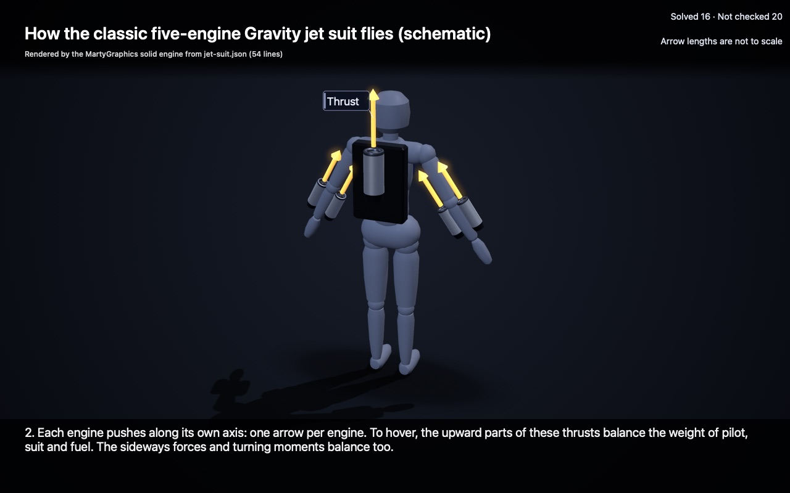</a>
</p>

**Hand-built example (written by a Claude agent from fact-checked research, not generated from a prompt by the
engine's AI loop).** A jet suit, explained in 7 steps and a 63-second story video. The version is the classic
five-engine Gravity suit, as described 2020–2022; the current Mk4 is different and is not shown. The engine rendered
every frame from [54 lines of JSON](docs/assets/jet-suit/jet-suit.json), unedited.

**How the classic five-engine suit flies.** The suit has five micro gas turbines: two on each forearm and one on the
back. To hover, the upward components of their thrusts balance the weight of pilot, suit and fuel, and the sideways
forces and turning moments balance too. The pilot steers by moving the arms, which aims the thrust. Inside a
JetCat-style micro turbojet (a schematic example, not confirmed Gravity hardware), the compressor squeezes the air,
fuel burns with oxygen in the compressed air, the hot gas drives the turbine, which turns the compressor, and the gas
leaves the nozzle fast; the reaction is thrust. Mk4 note: the current Mk4 has three back turbines, and its total
engine count is not published.

Every fact has a label (VERIFIED, CLAIM or PLAUSIBLE), a source and a date, from two independent AI model
fact-checks (GPT-6.1 Sol and Gemini 3.8 Flash). The legend in each still, **Solved 16 · Not checked 20**, tells you
what the engine computed (the engine motion and the weight direction) and what it only shows (the reported figures).
[Story video (MP4)](docs/assets/jet-suit/story.mp4) · [Sources](docs/assets/jet-suit/SOURCES.md) ·
[All 7 steps](docs/SHOWCASE.md#jet-suit-hand-built-fact-checked) · [Render receipt](docs/assets/jet-suit/provenance.json)

<sub>The picture is the step 2 still. Click it to open the story video: 1280×800 at 30 frames per second, H.264,
6.4 MB. GitHub shows GIFs at a lower frame rate, and it does not play a video file from the repository inside a
README, so this example has no GIF.</sub>

<p align="center">
  <a href="docs/assets/from-a-prompt/robot-joint/exploded.png">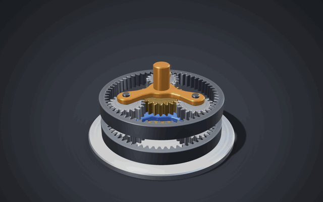</a>
</p>

**From a prompt, written by an AI.** We asked Claude Haiku 5.5 one question:
*"Show a two-stage planetary gearbox like in a robot joint."* It saw only the public docs and
worked example models, no tools. Its first JSON used a 20-tooth sun, 18-tooth planets and a 56-tooth ring. MartyGraphics
refused it with one reason, `constraint.gearMesh.phase` on `ring1`: 20 + 56 = 76 does not divide
by 3, so three equally spaced planets cannot mesh with both gears. The model read that reason,
changed to 24 / 18 / 60 ((24 + 60) ÷ 3 = 28), the same gear set as the worked planetary example
in its docs, and the engine accepted it: 19 parts, 12 gear meshes,
solved output 4/49 of the input (12.25:1). Two attempts, 121 seconds. The engine rendered every frame from the model's JSON, unedited.
We picked this example after grading, from the runs that passed.
[Exploded](docs/assets/from-a-prompt/robot-joint/exploded.png) · [Its JSON](docs/assets/from-a-prompt/robot-joint/robot-joint-gearbox.json) ·
[Refused first try](docs/assets/from-a-prompt/robot-joint/attempt-1-refused.json) · [Run receipt](docs/assets/from-a-prompt/robot-joint/provenance.json)

**How it works (the model's own steps).** A robot joint needs a big speed reduction in a small
space. The motor turns sun gear 1. The planets roll between the sun and the fixed ring, so carrier 1
turns at 24 ÷ (24 + 60) = 2/7 of the input speed. Carrier 1 carries sun gear 2, and the same 2/7
repeats in stage 2: (2/7)² = 4/49. The model labels the motor, bearings and housing walls as not
modelled. An independent grader model (Claude Opus 5.5) checked the ratio, the text and the labels against the solved
model: all pass. In the same 50-question test, Haiku got all 40 in-scope questions accepted
within three repairs, but only 29 of 40 fully correct in mechanics and 46 of 50 explanations
without a critical error (our target is 95%), so it is not reliable yet.
[What the test found](docs/SHOWCASE.md#from-a-prompt)

<p align="center">
  <a href="docs/assets/turbofan/pathtraced-hero.png">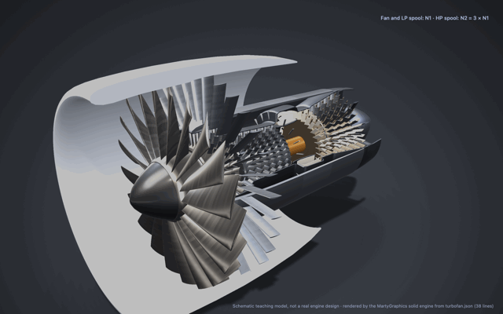</a>
</p>

<p align="center"><sub><b>About the 3D loops on this page.</b> GitHub shows them as GIF images, not video. A GIF
has at most 256 colours, and these previews are 480 to 640 pixels wide at 10 to 12 frames per
second, so they look rougher and less smooth than the real output. The turbofan and gearbox source videos are
1280 pixels wide at 30 and 24 frames per second: <a href="https://morrowdock.app/mg/turbofan/turbofan-loop.mp4">turbofan (MP4)</a> ·
<a href="https://morrowdock.app/mg/pathtrace/gearbox-loop.mp4">path-traced gearbox (MP4)</a>. Run an example to see the engine live.</sub></p>

**A turbofan, cut away, from 38 lines of JSON.** The solid engine builds every blade row,
casing and shaft of this schematic two-spool turbofan from
[`turbofan.json`](Examples/Turbofan/Sources/TurbofanKit/Models/turbofan.json) and renders
the 12-second loop with its real-time renderer, about 0.04 seconds per frame (shown here as a
640×400 GIF at 10 frames per second; the [source video](https://morrowdock.app/mg/turbofan/turbofan-loop.mp4) is 1280×800 at 30). The fan and LP spool turn once
while the HP spool turns three times (N2 = 3 × N1). The cut faces are real capped solids,
so the same model path traces too: [path-traced still](docs/assets/turbofan/pathtraced-hero.png)
(1920×1080, 768 samples per pixel, about 4.3 minutes on an M1). A teaching model, not a real
engine design; no images, models or stock assets.
[Labelled cutaway](docs/assets/turbofan/labelled.png) · [Exploded](docs/assets/turbofan/exploded.png) ·
[Run it](Examples/Turbofan/README.md) · [Render receipt](docs/assets/turbofan/provenance.json)

**How a turbofan works.** The big fan at the front pulls in a huge flow of air. A small part of
it goes into the core, where rows of spinning blades and fixed vanes squeeze it to many times its
intake pressure. Fuel burns steadily in the ring-shaped combustor, and the hot gas rushes through
the turbines and spins them. The HP turbine drives the HP compressor, and the LP turbine drives
the fan through a shaft that runs inside the HP shaft. Most of the fan's air goes around the
core, and in a high-bypass engine like this it gives most of the thrust.

<p align="center">
  <a href="docs/assets/lessons/beat-5.png">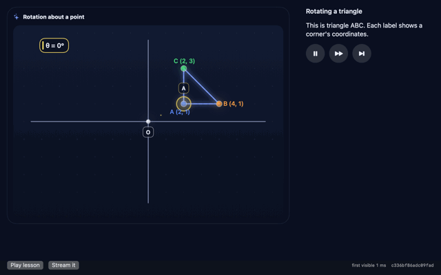</a>
</p>

**Beat-by-beat lessons.** A lesson is a list of beats. Each beat has one line of narration and the board changes for that
line. The host can load the whole lesson, or it can stream it one statement at a time, as a model reply arrives.
The engine checks each statement when it arrives, and the figure appears as soon as the scene statement is valid.
A refused statement changes nothing. When a beat binds a slider, the
learner can move it. A slider move sends the same `params` command that a scripted beat sends.

**How it teaches rotation.** Triangle ABC turns about the origin O. The engine computes each rotated corner in
Swift, so a 90° turn takes A from (2, 1) to (-1, 2) and its distance to O stays 2.24. The coordinate labels and the
numbers in the spoken lines come from these engine values. They are not typed text. The turn plays as engine
keyframes at most 5° apart. Each keyframe is a true rotation with its own labels. Then the learner drags the
slider (in the loop, a scripted learner). In the last beat the lesson turns the triangle to 180°, where every coordinate changes sign. That beat
checks A = (-2, -1) on the engine values before its line is shown.

The loop above is one 26.8-second run on the demo's default pacing (2.5 words per second). Each frame is the live
demo view, recorded offscreen and shown for the time the pacing schedules it. The learner's slider moves are
scripted by the capture tool (640×400 GIF; the [stills](docs/SHOWCASE.md#beat-by-beat-lessons) are full size).
The footer of the demo view ("first visible 18 ms" in the stills) is the live view's own reading in the capture
window. It is not the benchmark. The benchmark (`lesson-demo --timing`, release build, on an Apple M1 Mac, not an
iPad): a scene statement reaches the first offscreen frame (1024×768) in 0.52 ms, median of 30 runs. A slider tick
commits new state in 0.14 ms, median of 500 runs. The first figure needs 136 bytes of stream.
**This lesson was written by hand for the demo.** It is not the output of an AI model from a prompt.
[Lesson format](docs/LESSONS.md) · [Run it](Examples/LessonDemo/README.md) ·
[Capture receipt](docs/assets/lessons/provenance.json)

<p align="center">
  <a href="docs/SHOWCASE.md#cutaways-and-honest-numbers">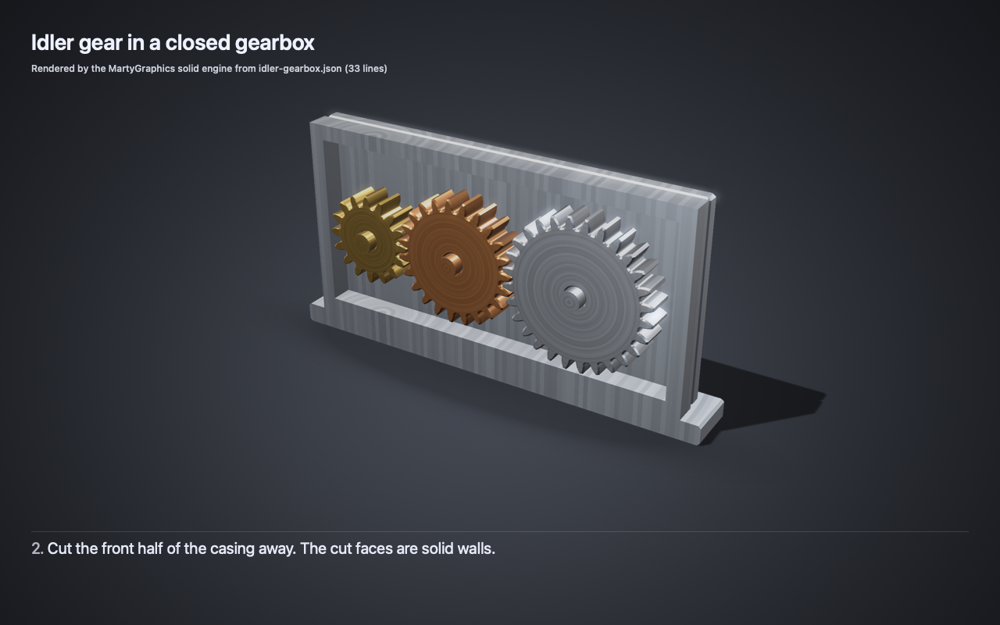</a>
</p>

**Cutaways and honest numbers.** A model can cut a part open at a plane (the cut faces are capped, so walls look solid)
or draw it as a see-through ghost. The idler-gearbox example does both. Its captions hold placeholders, and the engine
fills them in: step 4 says the idler turns the other way "at 16/23 of the input speed", a number the engine solved from the
gear mesh. The model was written by hand for the docs; it is not an AI prompt run.
[The three steps and the numbers](docs/SHOWCASE.md#cutaways-and-honest-numbers)

<p align="center">
  <a href="docs/SHOWCASE.md#labels-arrows-and-measured-dimensions">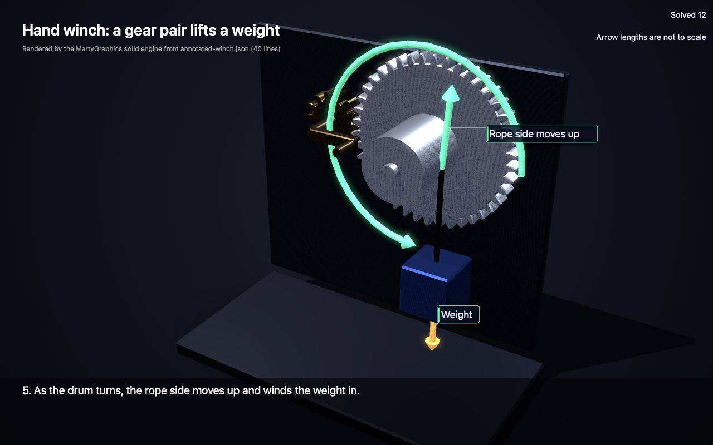</a>
</p>

**Labels, arrows and measured dimensions.** A model can label parts, draw arrows and show measured distances. The engine
works out the direction of each motion arrow from the motion, and it measures each dimension: the winch example says "Centres
56 mm" without that number in the model. The legend says "Arrow lengths are not to scale". The model was written by hand
for the docs; it is not an AI prompt run.
[How the winch works and what the engine checks](docs/SHOWCASE.md#labels-arrows-and-measured-dimensions)

<p align="center">
  <a href="docs/assets/pathtrace/hero.png">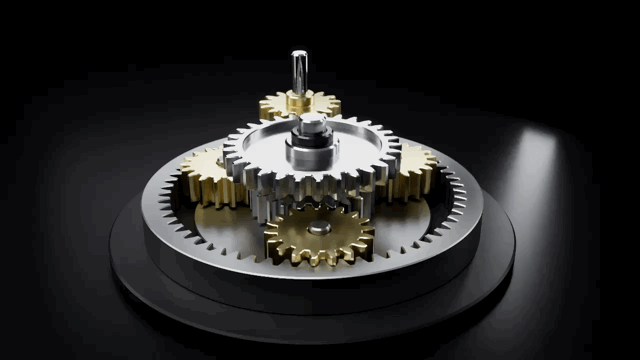</a>
</p>

**Path traced on an M1 GPU by MartyGraphics.** A procedurally generated gearbox
(15:30 spur, then a 24/18×3/60 planetary stage, 7:1 overall), rendered with the
Metal path tracer. The loop above is a 640×360, 10-second GIF at 12 frames per second, cut down
from the [1280×720, 24 frames per second video](https://morrowdock.app/mg/pathtrace/gearbox-loop.mp4) (112 samples per pixel). The [still](docs/assets/pathtrace/hero.png) is 1920×1080
at 768 samples per pixel, about 2.5 minutes on an M1. No images, models or stock assets.
[Exploded view](docs/assets/pathtrace/exploded.png) ·
[Code beside the render](docs/assets/pathtrace/side-by-side.png) ·
[Run it](Examples/PathTrace/README.md) · [Render receipt](docs/assets/pathtrace/provenance.json)

**How it works.** The input shaft turns the small 15-tooth pinion. It drives a 30-tooth gear,
which turns half as fast (30 ÷ 15 = 2:1). That gear spins the 24-tooth sun gear in the middle
of a planetary set. Three 18-tooth planet gears mesh with the sun and with the 60-tooth ring
around them. The ring is fixed, so the planets roll around inside it and turn the carrier that holds
them, slowly. The carrier turns once for every 1 + 60 ÷ 24 = 3.5 turns of the sun.
Together: 2 × 3.5 = 7 turns of the input for one turn of the output. Planetary sets are
used where a big reduction must fit in a small space, such as in car automatic
transmissions, power drills and helicopter rotor gearboxes.

<p align="center">
  <a href="docs/assets/solid/planetary-loop.gif">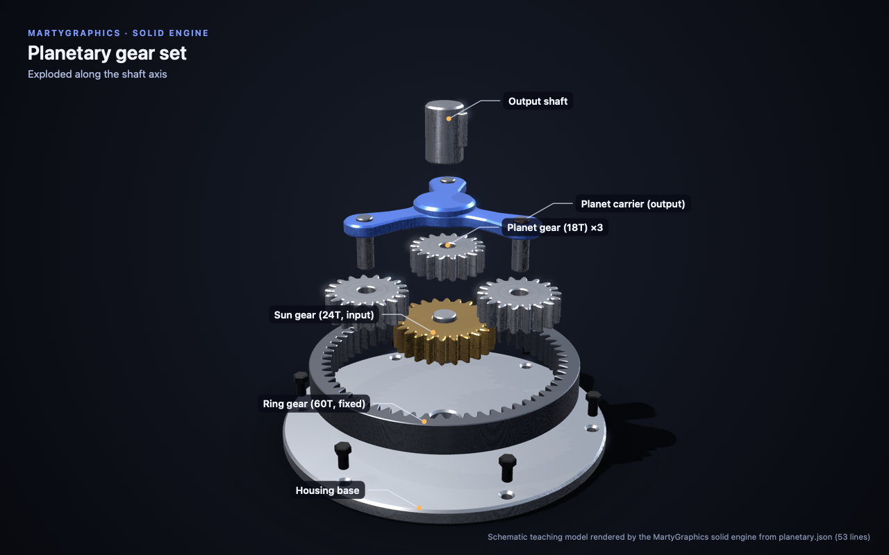</a>
</p>

**Real-time solid 3D from 53 lines of JSON.** The new solid engine builds every part
(involute gears, the ring, the carrier, the housing) from
[`planetary.json`](Examples/Solid3D/Sources/MartySolid3D/Models/planetary.json), solves how
the gears turn from the gear meshes, and renders the scene with SceneKit studio lighting in
about 0.04 seconds per frame. Because the model is validated JSON with exact error reasons,
an AI model can write a new one for a new question.
[Watch it turn and explode](docs/assets/solid/planetary-loop.gif) ·
[Assembled](docs/assets/solid/hero.png) · [Slider-crank cutaway](docs/assets/solid/slider-crank-section.png) ·
[Format](docs/SOLID-3D.md) · [Run it](Examples/Solid3D/README.md) · [Render receipt](docs/assets/solid/provenance.json)

**How a planetary gear set works.** The sun gear (24 teeth) sits in the middle and is the
input. Three planet gears (18 teeth) mesh with it and with the ring gear (60 teeth) around
them. The ring is held still, so when the sun turns, the planets are pushed around inside
the ring. Their pins sit on the blue carrier, and the carrier is the output. It turns once
for every (24 + 60) ÷ 24 = 3.5 turns of the sun: slower, but with 3.5 times the torque.
The labelled exploded view shows each part, in the order they stack on the shaft.

<p align="center">
  <a href="docs/SHOWCASE.md">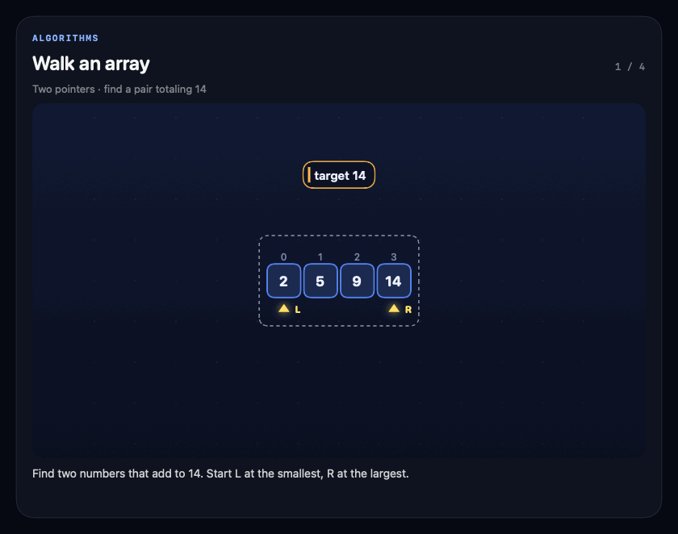</a>
</p>

**An array walkthrough, rendered by the 2D engine.** Four native frames,
1.2 seconds each (4.8-second loop; 53 KiB).
[Still alternative](docs/assets/native/two-pointers.png) ·
[Scene source](Examples/Showcase/Sources/MartyShowcase/Scenes/two-pointers.json) ·
[Run it](Examples/Showcase/README.md) · [Capture receipt](docs/assets/native/provenance.json)

Follow a tree search, move pointers through an array, trace a message between nodes,
or plot the samples you supply. MartyGraphics handles validation, layout, rendering,
steps, and motion. Your application supplies the content and decides what happens next.

## Small scenes, different ideas

| Explore | What the public package does | Source |
| --- | --- | --- |
| **Algorithms** | Follow a binary search tree or move two pointers toward a matching pair. | [Tree](Examples/Showcase/Sources/MartyShowcase/Scenes/tree.json) · [Array](Examples/Showcase/Sources/MartyShowcase/Scenes/two-pointers.json) |
| **Systems** | Draw nodes, directed edges, and step-controlled highlights for an illustrative message handoff. | [Handoff](Examples/Showcase/Sources/MartyShowcase/Scenes/handoff.json) |
| **Math** | Draw a function from supplied points, with labeled axes. The engine plots the data; it does not solve equations. | [Sampled function](Examples/Showcase/Sources/MartyShowcase/Scenes/function.json) |
| **Data** | Compare explicit quantities with labeled bars. These counts are invented. | [Synthetic counts](Examples/Showcase/Sources/MartyShowcase/Scenes/counts.json) |
| **Motion** | Animate a geometric marker using the engine timeline. | [Moving marker](Examples/Showcase/Sources/MartyShowcase/Scenes/motion.json) |
| **Solid 3D** | Build closed 3D parts (gears, ring gears, blades, blade rows, lathe-turned shapes and capped cutaway casings), connect them with joints and gear meshes in validated JSON, explode them, cut them open and render them in real time or path trace them. | [Turbofan cutaway](Examples/Turbofan/README.md) · [Planetary gear set](Examples/Solid3D/README.md) |
| **Path tracing** | Render generated 3D models with film-style lighting on the GPU: brushed metals, glass, soft shadows, depth of field. Separate `MartyGraphicsPathTracer` library. | [Gearbox example](Examples/PathTrace/README.md) |
| **3D inspection** | Click a part of a 3D model to select it, dim the rest, orbit, and reset the view. Opt-in per board; checked on macOS. | [Key switch example](Examples/KeySwitch3D/README.md) |
| **Graphs** | Compute the cheapest route through a weighted network, one Dijkstra step at a time. Opt-in graph pack. | [Router latency](Examples/Showcase/Sources/MartyShowcase/Scenes/shortest-path.json) |

[Open the showcase and its capture recipe →](docs/SHOWCASE.md)

### A few different ways to explain

**Find the cheapest route.** The opt-in graph pack computes shortest paths locally.
Each step settles the closest node, relaxes its links and updates the distance table.
Change one link weight with a `params` patch, and the engine recomputes the whole
walkthrough and its narration. Here the cheapest route is 0→2→1→3→4→5 at cost 13,
not the shorter-looking 0→1→3→5 at cost 15.

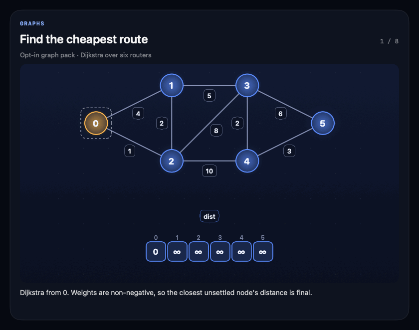

8 native frames, 1.2 seconds each (9.6-second loop; 125 KiB).
[Still alternative](docs/assets/native/shortest-path.png) ·
[Scene source](Examples/Showcase/Sources/MartyShowcase/Scenes/shortest-path.json) · [Run](Examples/Showcase/README.md)

**Trace a handoff.** Nodes, directed edges and step-controlled highlights illustrate
Source → Queue → Worker; the diagram does not execute a queue.

[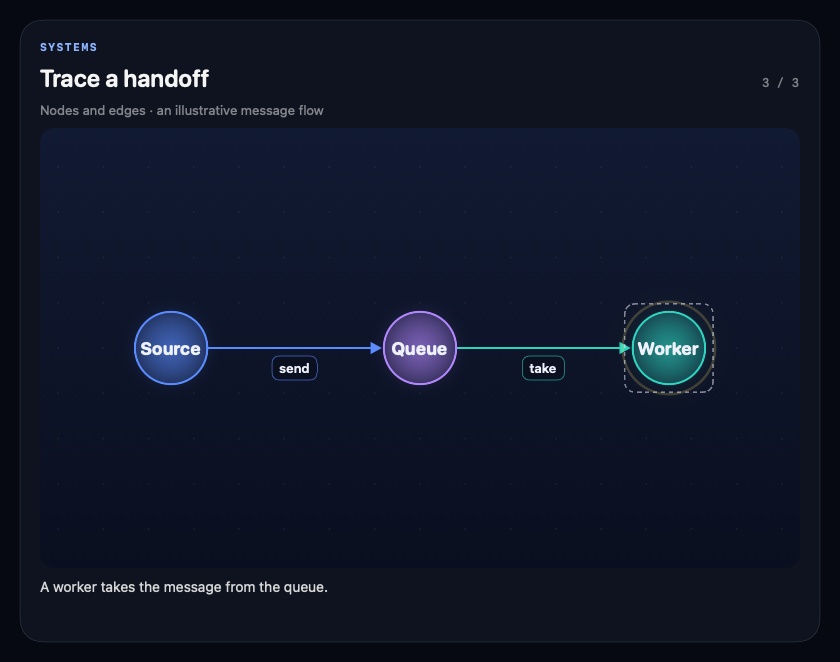](docs/assets/native/handoff.png)

[Scene source](Examples/Showcase/Sources/MartyShowcase/Scenes/handoff.json) · [Run](Examples/Showcase/README.md)

**Plot the points you supply.** Seven samples sketch y = x². The engine draws them;
it does not solve the function.

[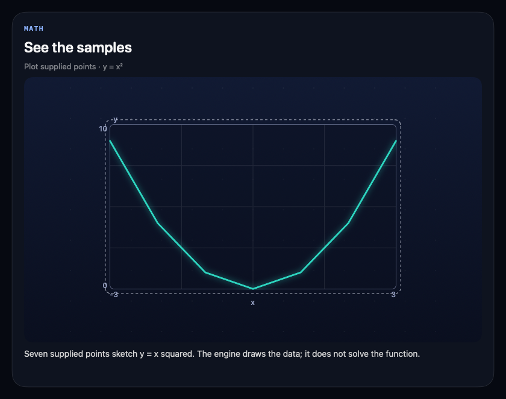](docs/assets/native/function.png)

[Scene source](Examples/Showcase/Sources/MartyShowcase/Scenes/function.json) · [Run](Examples/Showcase/README.md)

**Compare quantities.** Alpha 18, Beta 30 and Gamma 24 are invented counts.

[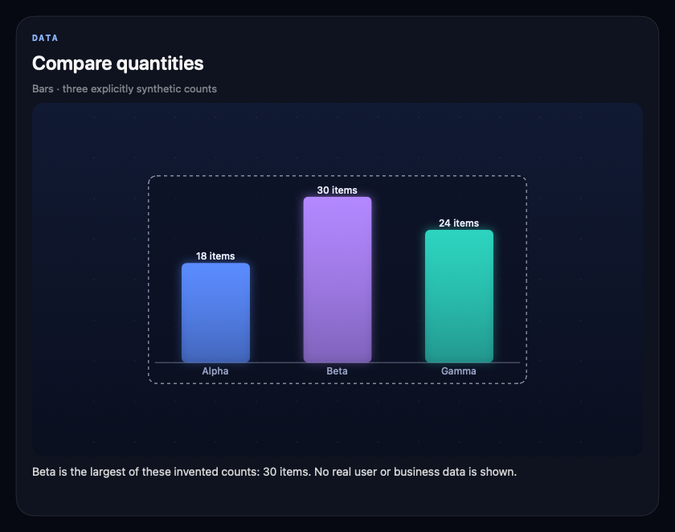](docs/assets/native/counts.png)

[Scene source](Examples/Showcase/Sources/MartyShowcase/Scenes/counts.json) · [Run](Examples/Showcase/README.md)

<details>
<summary>More native examples: tree search and timeline animation</summary>

**Follow a search.** Find 8 through the path 12 → 5 → 8.

[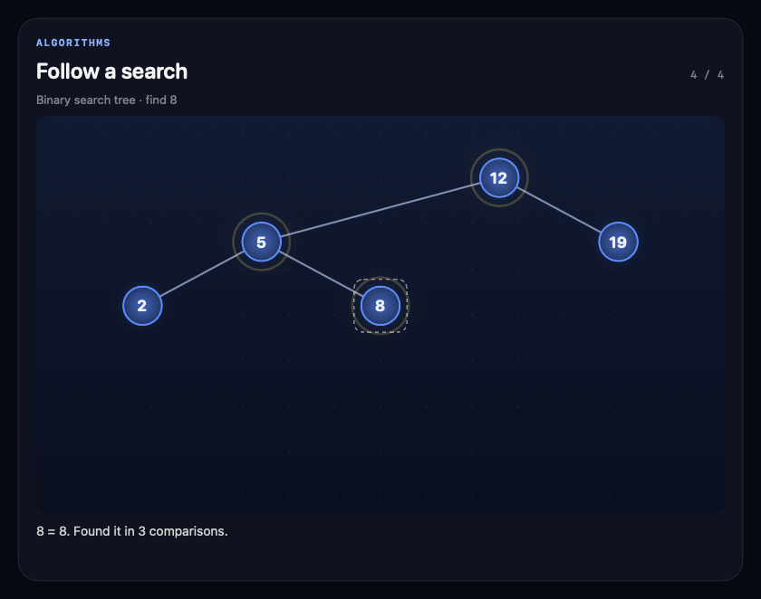](docs/assets/native/tree.png)

[Scene source](Examples/Showcase/Sources/MartyShowcase/Scenes/tree.json) · [Run](Examples/Showcase/README.md)

**Move through a scene.** A geometric marker travels between A and B on the engine
timeline. This is animation, with no force simulation.

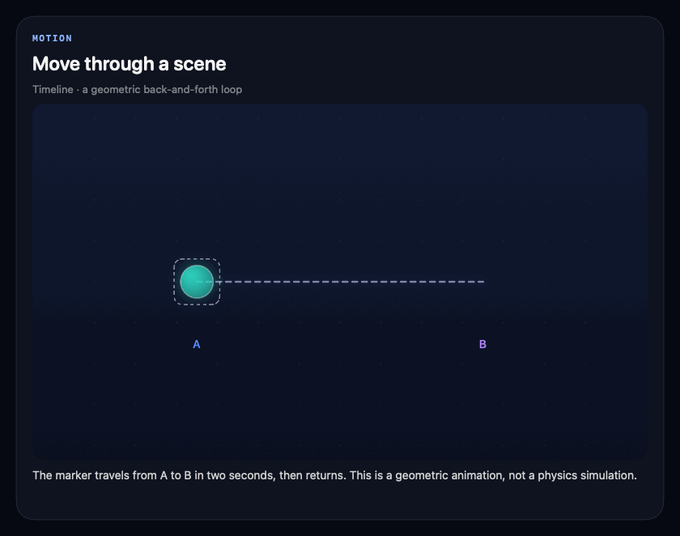

32 frames; stored GIF delay 0.13 seconds per frame, **4.16 seconds per loop**
(about 7.69 fps; 124 KiB).
[Still alternative](docs/assets/native/motion.png) ·
[Scene source](Examples/Showcase/Sources/MartyShowcase/Scenes/motion.json) · [Run](Examples/Showcase/README.md)

</details>

[Seven-scene overview](docs/assets/native/overview.png) · [Full static gallery](docs/SHOWCASE.md#static-gallery)

These are **native SwiftUI ImageRenderer exports** of `MGCanvasRenderer` /
`MGTimeline`, with a small SwiftUI caption wrapper. They are not full-app
screenshots or browser recreations. All are original synthetic examples under
[Apache-2.0](LICENSE). Individual views provide larger labels than the overview;
open any still at full size. GitHub controls GIF playback; static alternatives
are available for every animated example.

## Why use it?

- **Validate before drawing.** Closed keys, bounds, references, text limits, and
  highlight-cycle checks reject invalid scenes. Failed patches preserve the old scene.
- **Explain one step at a time.** Reveal items, move pointers, focus a node, and
  apply validated edits without replacing the whole explanation.
- **Keep the host in control.** Use `MartyGraphicsView` for a native board or
  `MGCanvasRenderer` / `MGTimeline` for deterministic frame generation.
- **Extend the format.** Register templates through the validated pack API.
  The built-in templates are `bst` and `two_pointers`. The opt-in graph pack adds
  `shortest_path`, with record-list parameters such as weighted edges.

## Quick start

Use **Swift 6 on macOS 14+**. The library can also be embedded in an iOS 17+ app.
There are no external Swift package dependencies, credentials, or network services
needed to build the engine or run these examples.

```sh
git clone https://github.com/morrowdock/martygraphics.git
cd martygraphics
swift build && swift test
swift run --package-path Examples/Showcase marty-showcase --verify
```

`--verify` validates seven bundled synthetic scenes, the core pack and the graph pack.
Build, 95 tests, verification and native export passed at the [capture source revision](docs/assets/native/provenance.json).
To open the interactive gallery, run
`swift run --package-path Examples/Showcase marty-showcase --preview`.
Interactive control/accessibility testing remains pending; the capture receipt
covers offscreen export. See [the runnable example](Examples/Showcase/README.md)
for the export command and platform details.

For an existing app, there is no tagged release yet: add a local checkout as a path
dependency, as the [showcase package](Examples/Showcase/Package.swift) does. Then use the
`MartyGraphics` product and parse a scene:

```swift
import Foundation
import MartyGraphics

let json = #"{"v":1,"template":"bst","params":{"values":[12,5,19,2,8],"find":8}}"#
let scene = try MGParser.scene(data: Data(json.utf8)).get()
// In your SwiftUI view body:
MartyGraphicsView(scene: scene)
```

The [tutorial](docs/GETTING-STARTED.md) connects scenes, safe patches, streams, and
the host view. The [protocol reference](docs/PROTOCOL.md) lists the exact limits.

## Scope and status

**Early preview.** APIs and the wire format may change. This is the scene engine,
not a complete learning app or a collection of courses.

| In this public package | Boundary |
| --- | --- |
| SwiftUI Canvas and a SceneKit renderer for supported 3D primitives | Current renderers require Apple frameworks; Windows/Linux builds and native Swift browser execution are unsupported. This is a current implementation choice, not a requirement imposed by iPad. |
| Parser, grammar, patches, streams, layout, timeline, steps, template/pack API | The host supplies JSON and interaction. No model, hosted generation API, screen overlay agent, equation solver, or arbitrary code executor is bundled. |
| BST and two-pointer built-ins; opt-in `shortest_path` graph pack; generic primitives for custom scenes | No course catalog, premium pack, private app adapter, or removed mechanics walkthrough is included. |
| Seven synthetic 2D examples, a local native showcase, a schematic 3D key-switch example, a solid 3D planetary gear set and a path-traced gearbox example | A flow diagram does not run a queue; sample plots/counts are supplied data. The gallery is not evidence of a complete app or measured 3D performance. |

See the [public versus app matrix](docs/CAPABILITIES.md),
[quality and measurement plan](docs/QUALITY.md), and
[portable-core proposal](docs/PORTABILITY-PROPOSAL.md).
Use [local maintainer validation](docs/LOCAL-VALIDATION.md) for hygiene and DCO;
hosted Ubuntu checks are manual opt-in. The [Mac verification steps](docs/VERIFY-ON-MAC.md)
cover Apple-framework builds. Each candidate needs reviewed evidence and its own
authenticated maintainer status.

## What's next

These are **plans, not shipped features**. Each one lands only after tests, review and
real evidence:

- **One scene, two renderers.** Render the same JSON model interactively and with the
  path tracer.
- **Questions to 3D explainers.** An AI model writes the JSON for a new question, the engine
  validates it, and the explainer adapts to follow-up questions.
- **Aerospace and drone models.** A jet-engine cutaway and a quadcopter built from the
  existing blade, casing and rotor parts.
- **Accessible graph states.** Show edge status with more than colour.
- **More teaching packs.** Reusable assemblies and linked plots with narration.

See the [quality and measurement plan](docs/QUALITY.md) for what is still unverified.

## Read, build, contribute

- [Showcase and original example sources](docs/SHOWCASE.md)
- [Tutorial](docs/GETTING-STARTED.md) · [Protocol](docs/PROTOCOL.md) · [Structural grammar](Sources/MartyGraphics/MGGrammar.swift)
- [Template API](Sources/MartyGraphics/MGTemplates.swift) · [Pack API](Sources/MartyGraphics/MGPack.swift)
- [Beat-by-beat lessons](docs/LESSONS.md): lesson format, commands, streaming lane and timing events · [Rotation lesson example](Examples/LessonDemo/README.md)
- [Explainer documents](docs/EXPLAINER.md): one document with a 2D board, a 3D solid or both, one beat timeline and one legend · [Examples](Examples/Explainers/README.md)
- [Scene file validator](tools/SceneValidator/README.md): a macOS-only command-line parser
  check for scene JSON files; it does not render scenes or review visual quality
- [Source provenance](docs/EXPORT.json) · [Third-party inventory](docs/THIRD-PARTY.md)
- [Public sync ownership and review process](docs/PUBLIC-SYNC.md)
- [Versioned installation and discovery gates](docs/DISTRIBUTION.md)
- [Apache-2.0 license](LICENSE) · [Notice](NOTICE)
- [Contributing and DCO](CONTRIBUTING.md) · [Code of conduct](CODE_OF_CONDUCT.md) · [Security](SECURITY.md)

[Morrowdock](https://morrowdock.app) is the host application's website. Its browser
demonstrations are separate implementations, not this Swift package running in a browser.
