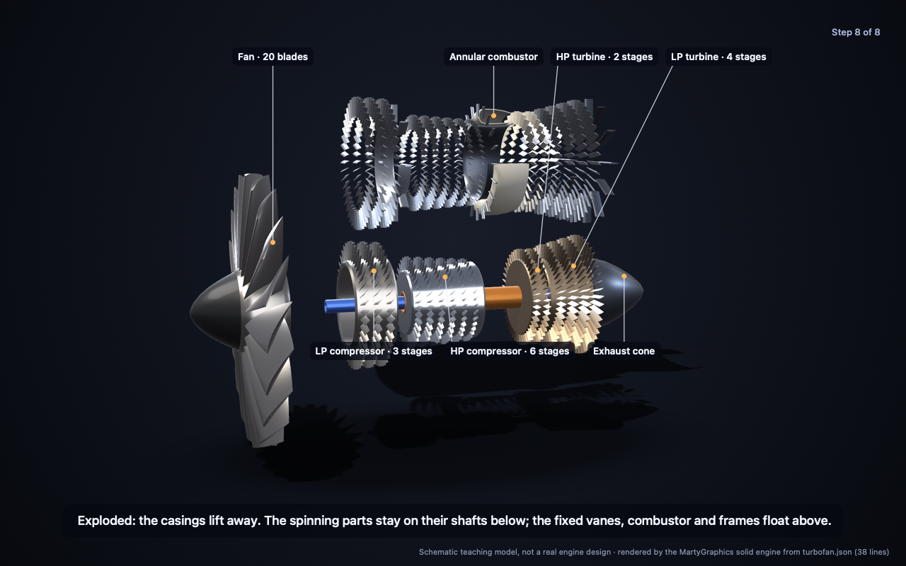

# MartyGraphics

MartyGraphics is a Swift package that draws teaching visuals from small JSON documents. It checks each completed
document before it draws it. A document that breaks a rule is refused with a short reason code. While a scene is
still streaming in, a host can show provisional previews; the full check runs when the stream ends.

- **2D scenes:** diagrams, plots, bar charts, arrays, tables, trees and graphs, with step-by-step narration (SwiftUI).
- **3D mechanisms:** gear trains, slider-cranks and cutaways. The engine solves their motion and checks the gear
  meshes.
- **It checks structure, motion and layout. It does not check facts.** The words in a document are the author's.

**Status: early preview.** The first tag is `v0.1.0` (2026-11-11); `main` has changed since then. The package targets
macOS 14 or later, and its tests run on hosted macOS runners. iOS 17 or later is declared in the package but not yet
accepted on a device. Windows, Linux and web browsers are not supported. No external packages. [Apache-2.0](LICENSE).

[Quick start](#quick-start) · [Concepts](docs/CONCEPTS.md) · [Cookbook](docs/COOKBOOK.md) ·
[Gallery](docs/GALLERY.md) · [FAQ](docs/FAQ.md) · [For teachers](docs/FOR-TEACHERS.md) · [Contribute](CONTRIBUTING.md)

<p align="center">
  <a href="docs/assets/turbofan/exploded.png"></a>
</p>

**A schematic turbofan from 38 lines of JSON.** The solid engine built every blade row, casing and shaft in this
exploded view. The example's own check confirms that both spools turn about one axis and that every rotor stays at
least 4.52 mm from the parts that do not turn with it. A coding agent wrote the JSON directly in the documented
format; it is not the output of a prompt. It is a teaching model, not a real engine design.
[Its JSON](Examples/Turbofan/Sources/TurbofanKit/Models/turbofan.json) · [Run it](Examples/Turbofan/README.md) ·
[Render receipt](docs/assets/turbofan/provenance.json) · [More examples](docs/GALLERY.md)

## Quick start

You need a Mac with macOS 14 or later and a Swift 6 toolchain (for example, from Xcode). No account, key or network
service is needed after the clone.

### 1. See the examples

```sh
git clone https://github.com/morrowdock/martygraphics.git
cd martygraphics
swift run --package-path Examples/Showcase marty-showcase --preview
```

A window opens with seven example boards: a search tree, an array walk, a flow diagram, a plot, a bar chart, a moving
marker and a shortest-path graph. Pick one and use its step and play controls. `--verify` checks the seven scenes
without opening a window. More: [showcase instructions](Examples/Showcase/README.md).

### 2. Draw your own scene

Make a new package next to the `martygraphics` folder:

```sh
cd ..
mkdir -p FirstBoard/Sources/FirstBoard
cd FirstBoard
```

Save this as `Package.swift`. It uses your local checkout, the same way the repository's own examples do:

```swift
// swift-tools-version: 6.0
import PackageDescription

let package = Package(
    name: "FirstBoard",
    platforms: [.macOS(.v14)],
    dependencies: [.package(name: "MartyGraphics", path: "../martygraphics")],
    targets: [.executableTarget(name: "FirstBoard",
                                dependencies: [.product(name: "MartyGraphics", package: "MartyGraphics")])],
    swiftLanguageModes: [.v5]
)
```

Save this as `Sources/FirstBoard/RenderFirstBoard.swift`. It parses a two-item scene and saves one frame as a PNG,
with the same calls as the [showcase exporter](Examples/Showcase/Sources/MartyShowcase/Showcase.swift):

```swift
import AppKit
import Foundation
import ImageIO
import MartyGraphics
import SwiftUI
import UniformTypeIdentifiers

@main struct RenderFirstBoard {
    static let sceneJSON = #"""
    {"v": 1, "title": "My first board",
     "items": [
      {"id": "dot", "k": "body", "at": [4, 4], "shape": "ball", "size": 1, "color": "teal"},
      {"id": "note", "k": "text", "at": [8, 4], "text": "A ball at x = 4, y = 4", "style": "callout"}
     ]}
    """#

    @MainActor static func main() {
        // 1. Check the scene. A refused scene draws nothing.
        let scene: MGScene
        switch MGParser.scene(data: Data(sceneJSON.utf8)) {
        case .success(let checked): scene = checked
        case .failure(let error):
            print("The scene was refused: \(error.reason)")
            return
        }

        // 2. Lay out step 0 at time 0 on a 600 × 400 point board.
        let size = CGSize(width: 600, height: 400)
        let items = MGTimeline.frame(scene, items: MGTimeline.items(scene, step: 0), time: 0)
        let viewport = MGViewport(size: size, width: scene.width, height: scene.height, camera: scene.camera)
        let input = MGRenderInput(scene: scene, items: items, viewport: viewport)
        let board = Canvas { context, _ in MGCanvasRenderer.draw(input, in: context) }
            .frame(width: size.width, height: size.height)

        // 3. Render offscreen and save a PNG.
        _ = NSApplication.shared
        let url = URL(fileURLWithPath: "first-board.png")
        guard let image = ImageRenderer(content: board).cgImage,
              let file = CGImageDestinationCreateWithURL(url as CFURL, UTType.png.identifier as CFString, 1, nil)
        else { print("Could not render the board"); return }
        CGImageDestinationAddImage(file, image, nil)
        print(CGImageDestinationFinalize(file) ? "Wrote first-board.png" : "Could not write the PNG")
    }
}
```

Run it, then open the image:

```sh
swift run
open first-board.png
```

The PNG is one frame: step 0 at time 0. It has no narration, no step focus and no playback. To see reveals, step
edits and timed motion, show the scene in a SwiftUI app with `MartyGraphicsView(scene: scene)`; the
[tutorial](docs/GETTING-STARTED.md) shows a complete host with live updates.

Change `"at": [4, 4]` to `[40, 4]` and run again: the point is outside the board, so the parser refuses the scene
and prints its reason, `body.at`, instead of drawing it.

**Using the tag instead of a checkout.** Replace the dependency with
`.package(url: "https://github.com/morrowdock/martygraphics.git", exact: "0.1.0")` and the product with
`.product(name: "MartyGraphics", package: "martygraphics")`. The project has not yet recorded a remote-install check
at that tag ([release gates](docs/DISTRIBUTION.md)), and the tag does not include changes made on `main` since.

### 3. Check scene files without an app

```sh
cd ../martygraphics
swift build -c release --package-path tools/SceneValidator
BIN="$(swift build -c release --package-path tools/SceneValidator --show-bin-path)"
"$BIN/marty-scene-validate" -- docs/cookbook/*.scene.json
```

Each file prints `valid` or `invalid:` with the reason code. It runs the same parser an app runs
([validator guide](tools/SceneValidator/README.md)). Next: [ten copyable recipes](docs/COOKBOOK.md).

## How it is used

1. **A person or an AI model writes the JSON.** MartyGraphics does not include a model; a host app or a script calls
   one if it wants to.
2. **The engine checks the document.** Keys are closed, sizes are bounded, references must exist, and no code runs. A
   refusal is one stable reason, for example `bars.bars` (too many bars) or `constraint.gearMesh.phase` on part
   `ring1` (gears that cannot mesh). See the [reason catalog](docs/REASONS.md).
3. **The author repairs it,** using the reason.
4. **The engine draws it:** a native SwiftUI board, or, for 3D documents, stills, a loop and a story video. In 3D
   documents, a caption can take its numbers from solved values instead of typed text.

## What it checks and what it does not

- **Checked (2D scenes):** document shape, value ranges, unique ids, references between items, text rules (no markup,
  no links) and size limits. See [Concepts](docs/CONCEPTS.md#limits).
- **Checked (3D mechanisms):** gear meshing (tooth phase, centre distance and tooth interference in 2D at sampled
  angles), gear ratios and joint motion. The standard check warns when a label or arrow is hidden or untested in a
  step that shows it; `--strict` refuses the document. A force or flow arrow that a part hides can be left out of a
  still, with a warning.
- **Not checked:** whether the words are true; strength, load, wear, friction, efficiency, air or gas flow; forces
  other than the gravity direction; collisions between parts. The engine can solve slider-crank motion. It has no
  general linkage solver and no cam-contact solver, and there are no helical or bevel gears or belts
  ([full list](docs/SOLID-3D.md#limits)).
- **"Solved" is not "verified".** A "Solved" count in a 3D legend counts values the engine computed from the author's
  joints, gears and drives. It is not a measured fact about a real object.
- **AI authoring is not reliable enough yet.** In a 50-question development test, Claude Haiku 5.5 got all 40 in-scope
  questions accepted within three repairs, but only 29 of 40 were fully correct in mechanics, and 46 of 50 explanations
  had no critical error (the target is 95 %). The set was used to tune the engine, so this is not held-out evidence
  ([run receipt](docs/assets/from-a-prompt/robot-joint/provenance.json), [details](docs/SHOWCASE.md#from-a-prompt)).
- **Determinism.** With the same build and input, parse results, refusals, check reports, layout and snapshots are
  byte-identical across processes. 3D pixels are not: in a 2026-11-10 measurement over 164 stills, at most 5.02 % of the
  pixels in a still differed ([measurements](docs/SOLID-3D.md#determinism)).

## Scope and status

This repository is the engine and its examples. It is not a learning app or a course collection. "Tested" below means
the area has automated tests in this repository; they passed in the hosted `macos` CI run for `main` at `5e4952e`
(2026-11-18). It does not mean device, accessibility or performance acceptance.

| Capability | Where | Status | In `v0.1.0` |
| --- | --- | --- | --- |
| 2D scenes: 19 item kinds, steps, camera | `MartyGraphics`: `MGParser`, `MartyGraphicsView`, `MGCanvasRenderer` | Tested. Offscreen exports in the [showcase](docs/SHOWCASE.md#native-scenes). Keyboard, VoiceOver and frame rate not accepted. | Yes |
| Patches, revisions and streaming | `MGPatch`, `MGSceneController`, `MGStreamParser` | Tested. | Yes |
| Templates | Built in: `bst`, `two_pointers`. Opt-in: `shortest_path` graph pack | Tested. The graph pack is off by default and has no visual or accessibility acceptance. | Yes |
| 3D mechanisms (assemblies) | `marty-solid` ([Solid 3D](docs/SOLID-3D.md)) | Tested on macOS. Schematic models only. iOS rendering not checked. | Yes |
| Explainer documents (2D board + 3D solid) | `MGExplainer` ([format](docs/EXPLAINER.md)) | Tested. | Yes |
| Beat-by-beat lessons | `MGLesson` ([format](docs/LESSONS.md), [example](Examples/LessonDemo/README.md)) | Tested on macOS. The example documents an iPad simulator test run. No device timing. | Yes |
| ML explainer boards (opt-in library) | `MartyGraphicsMLKit` ([format](docs/ML-EXPLAINER.md)) | Tested. 2D only. | No, `main` only |
| Programmatic 2D video (`layer2d`) | `MGProgrammaticVideo` ([protocol](docs/PROTOCOL.md)) | Experimental and opt-in. | No, `main` only |
| Path tracer (opt-in library) | `MartyGraphicsPathTracer` ([example](Examples/PathTrace/README.md)) | Example with a render receipt. Needs Apple-silicon Metal ray tracing. Not run on iOS. | Yes |
| 3D tap selection and orbit | `inspects3D` ([example](Examples/KeySwitch3D/README.md)) | Checked by hand on macOS on 2026-11-06. iOS touch and VoiceOver not checked. | Yes |
| glTF export and Blender video | `marty-solid export-gltf`, [render tool](tools/render-blender/README.md) | Tested exporter. The Blender render is cosmetic; the motion comes from the engine. | No, `main` only |
| Scene file checker | `marty-scene-validate` ([guide](tools/SceneValidator/README.md)) | Tested. macOS only. Does not load opt-in packs. | Yes |
| Remote SwiftPM install at `v0.1.0` | [Release gates](docs/DISTRIBUTION.md) | Not yet verified. | — |
| AI model or hosted generation | — | Not included. | — |
| Windows, Linux, web browser | [Portability proposal](docs/PORTABILITY-PROPOSAL.md) | Not supported. Planned, not started. | — |

Every pull request must pass the hosted `CI` check `hygiene` and the `maintainer/local-validation` status. The hosted
`macos` tests run separately on every pull request and do not block a merge
([CI details](docs/VERIFY-ON-MAC.md#hosted-ci-required-merge-gate)). The [capability matrix](docs/CAPABILITIES.md)
and the [quality plan](docs/QUALITY.md) list what is still pending.

## Documentation

- **Start here:** [Concepts](docs/CONCEPTS.md) · [Cookbook](docs/COOKBOOK.md) · [Gallery](docs/GALLERY.md) ·
  [FAQ](docs/FAQ.md) · [For teachers](docs/FOR-TEACHERS.md)
- **Build with it:** [Tutorial](docs/GETTING-STARTED.md) · [Scene protocol](docs/PROTOCOL.md) ·
  [Reason catalog](docs/REASONS.md) · [Solid 3D](docs/SOLID-3D.md) · [Explainers](docs/EXPLAINER.md) ·
  [Lessons](docs/LESSONS.md) · [ML explainers](docs/ML-EXPLAINER.md) · [glTF export](docs/GLTF-EXPORT.md) ·
  [Visual style](docs/VISUAL-STYLE.md)
- **Examples:** [Showcase](Examples/Showcase/README.md) · [Solid 3D](Examples/Solid3D/README.md) ·
  [Turbofan](Examples/Turbofan/README.md) · [Explainers](Examples/Explainers/README.md) ·
  [Lesson demo](Examples/LessonDemo/README.md) · [Key switch](Examples/KeySwitch3D/README.md) ·
  [Path tracer](Examples/PathTrace/README.md) · [Full showcase page](docs/SHOWCASE.md)
- **Project:** [Capabilities](docs/CAPABILITIES.md) · [Quality](docs/QUALITY.md) ·
  [Distribution](docs/DISTRIBUTION.md) · [Local validation](docs/LOCAL-VALIDATION.md) ·
  [Verify on Mac](docs/VERIFY-ON-MAC.md) · [Public sync](docs/PUBLIC-SYNC.md) · [Third-party inventory](docs/THIRD-PARTY.md) ·
  [Source provenance](docs/EXPORT.json) · [Changelog](CHANGELOG.md) · [History](docs/HISTORY.md)
- [Apache-2.0 license](LICENSE) · [Notice](NOTICE) · [Contributing and DCO](CONTRIBUTING.md) ·
  [Code of conduct](CODE_OF_CONDUCT.md) · [Security](SECURITY.md) · [Trademarks](TRADEMARKS.md)

[Morrowdock](https://morrowdock.app) is the host application's website. Its browser demonstrations are separate
implementations, not this Swift package running in a browser.
