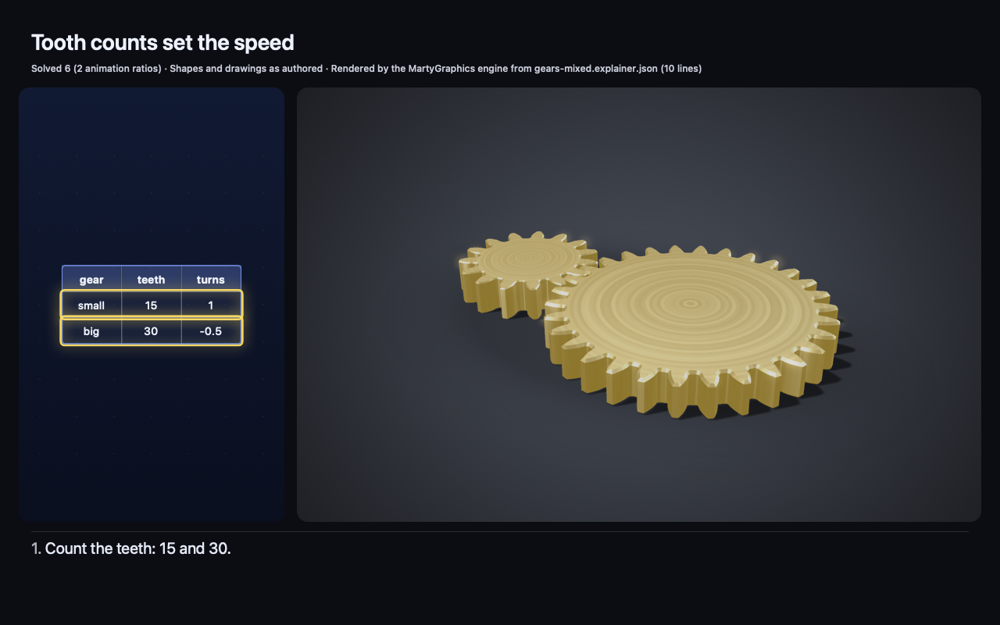

# Explainer documents (2D, 3D or both)

An explainer is one document that answers one question with a 2D board (a v1 scene), a 3D solid (an assembly v2), or
both. ONE list of beats drives both views, ONE id namespace covers 2D items and 3D parts, and ONE legend counts every
claim. The board, lesson and assembly formats do not change meaning; an explainer only combines them.

Status: preview (unreleased, wire `v: 1` of the explainer format). Examples: [`Examples/Explainers`](../Examples/Explainers/README.md).

<!-- card:start -->
### Choose 2D, 3D or both

Write one explainer document: `{"v":1,"kind":"explainer",…}`. Pick the form per question.

| The answer is mainly… | Use | Key |
| --- | --- | --- |
| a table, chart, graph, step list or formula | 2D | `board` |
| a machine, a shape in space, a mechanism | 3D | `solid` |
| a 3D thing plus its numbers or a comparison | both | `board` and `solid` |

Rules:
1. Beats drive both views. 2D changes add up. The 3D `view` is set fresh in each beat.
2. One id namespace for 2D items and 3D parts. `t.r2` is row 2 of table `t`.
3. No typed digits in `say` or 2D text. Show numbers with `{name}` (2D values) or `{part.fact}` (3D facts).
   Typed data needs a note: `"notes":{"t":{"basis":"where it is from"}}`.
4. Run `marty-solid check --strict FILE.json`. Fix the first `reason`. Check again.

2D only:
```json
{"v":1,"kind":"explainer","title":"Inner planets by width","notes":{"t":{"basis":"NASA fact sheet"}},
 "board":{"v":1,"items":[{"id":"t","k":"table","at":[6,4],"header":true,
  "cells":[["Planet","km"],["Mercury",4879],["Venus",12104],["Earth",12756],["Mars",6792]]}]},
 "beats":[{"say":"Venus and Earth are almost the same width.","highlight":["t.r2","t.r3"]}]}
```

3D only:
```json
{"v":1,"kind":"explainer","title":"A small gear turns a big gear",
 "solid":{"v":2,"parts":[
  {"id":"p","shape":{"gear":{"teeth":15,"module":2,"width":8}},"joint":{"revolute":[0,0,1]},"drive":{"input":1}},
  {"id":"w","at":[45,0,0],"shape":{"gear":{"teeth":30,"module":2,"width":8}},"joint":{"revolute":[0,0,1]}}],
  "constraints":[{"gearMesh":{"a":"p","b":"w"}}]},
 "beats":[{"say":"The small gear has {p.teeth} teeth; the big gear has {w.teeth}.","highlight":["p","w"]},
  {"say":"The big gear turns {w.speed|abs|frac} of a turn, the other way.",
   "check":[{"value":"w.speed","lt":0}],"highlight":["w"],"view":{"spin":1}}]}
```

Both (the same gears, plus a table of their facts):
```json
{"v":1,"kind":"explainer","title":"Tooth counts set the speed",
 "board":{"v":1,"items":[{"id":"t","k":"table","at":[6,4],"header":true,
  "cells":[["gear","teeth","turns"],["small","{p.teeth}","{p.speed}"],["big","{w.teeth}","{w.speed}"]]}]},
 "solid":{"v":2,"parts":[
  {"id":"p","shape":{"gear":{"teeth":15,"module":2,"width":8}},"joint":{"revolute":[0,0,1]},"drive":{"input":1}},
  {"id":"w","at":[45,0,0],"shape":{"gear":{"teeth":30,"module":2,"width":8}},"joint":{"revolute":[0,0,1]}}],
  "constraints":[{"gearMesh":{"a":"p","b":"w"}}]},
 "beats":[{"say":"Count the teeth: {p.teeth} and {w.teeth}.","highlight":["t.r1","t.r2","p","w"]},
  {"say":"So the big gear turns {w.speed|abs|frac} of a turn.","check":[{"value":"w.speed","lt":0}],
   "highlight":["t.r2","w"],"view":{"spin":1}}]}
```
<!-- card:end -->

The section above is the authoring card. A test keeps it at most 3,072 bytes, parses each JSON block, checks that it
equals the example file and runs it with `--strict`.

Expected results (test X1): the 2D example shows "Venus and Earth are almost the same width." and the legend
"Given 1" (the table is data as given; the caption shows no engine number, so it has no tier). The 3D example shows
"The small gear has 15 teeth; the big gear has 30." and "The big gear turns 1/2 of a turn, the other way." with the
legend "Solved 5" (2 motion claims, 2 captions, 1 check). The mixed example fills the table cells "15", "1", "30" and
"-0.5", shows "Count the teeth: 15 and 30." and "So the big gear turns 1/2 of a turn." and its legend is "Solved 6"
(2 motion claims, the table, 2 captions, 1 check).



## Document

```json
{"v": 1, "kind": "explainer", "title": "…", "primary": "solid",
 "notes": {"t": {"basis": "NASA fact sheet"}},
 "board": { …v1 scene… },
 "solid": { …assembly v2… },
 "beats": [ {"say": "…", "unchecked"?: "…", "ops"?: […], "check"?: […], "highlight"?: […], "view"?: {…}} ]}
```

| Key | Required | Rule | Refusal |
| --- | --- | --- | --- |
| `v` | yes | 1 (the explainer format version) | `explainer.version` |
| `kind` | yes | `"explainer"` | `explainer.kind` |
| `title` | no | plain text; 1–80 characters after 3D facts fill it; placeholders name 3D facts only; typed digits make the title Described | `explainer.title` |
| `primary` | no | `"board"` or `"solid"`: the larger pane. Default: `solid` when there is one. It must name a present view. | `explainer.primary` |
| `notes` | no | 1–24 entries; key = a 2D item id; value = exactly one of `{"basis": "…"}` or `{"unchecked": "…"}`, 1–60 characters | `notes.object`, `notes.count`, `notes.entry.<id>`, `notes.text.<id>` |
| `board` | one of the two | a v1 scene without `steps`, `title` or `"dim": "3d"` | `explainer.board`, `explainer.board.steps`, `explainer.board.title`, `explainer.board.dim`, inner scene reasons |
| `solid` | one of the two | an assembly `"v": 2` without `steps` or `title`; `kind` may be left out | `explainer.solid`, `explainer.solid.version`, `explainer.solid.steps`, `explainer.solid.title`, inner assembly reasons |
| `beats` | yes | 1–16 beats | `explainer.beats`, `explainer.beats.count` |

Other refusals: `explainer.json` (not UTF-8 JSON text), `explainer.object`, `explainer.unknown.<keys>` (sorted
author segments), `explainer.empty` (neither view), `explainer.bytes`, `explainer.depth`, `explainer.number` (NaN or
an infinity in a value built in code). A key named `tier` anywhere is `tier.key`, inside `board` too.

Beat keys:

| Key | Rule | Refusal |
| --- | --- | --- |
| `say` | 1–200 characters; placeholders as below; rule N1 | `beat.missing`, `stmt.say`, `text.number.beat.<n>` |
| `unchecked` | 1–60 characters; the caption may type numbers and is Described ("Not checked") | `beat.unchecked.<n>` |
| `ops` | 0–12 lesson commands (`add`, `set`, `remove`, `params`, `camera`, `animate`, `bind`, `unbind`); needs `board` | lesson reasons, `explainer.op.title`, `explainer.board.missing`, `beat.ops`, `beat.ops.count` |
| `check` | 0–8 checks `{"value", "eq" \| "lt" \| "gt", "tol"?}`. A plain name is a 2D value (lesson semantics); a dotted name is a 3D fact (#21 semantics) | `beat.check`, `beat.checks.count`, lesson reasons (`check.<name>`, `check.unknown.<name>`), `check.fact.<name>`, `check.failed.<name>` |
| `highlight` | 1–16 ids of the namespace or table sub-addresses; presentation only | `beat.highlight`, `beat.highlight.count`, `beat.highlight.ref.<id>` |
| `view` | the 3D view of the beat: `focus`, `explode`, `camera`, `orbit`, `spin`, `section`, `ghost` (step rules); needs `solid` | `view.object`, `view.unknown.<keys>`, step reasons renamed `step.` → `view.` (`view.section.parts`, `view.camera`), `ref.unknown.<id>`, `section.*`, `assembly.budget`, `explainer.solid.missing` |

Beat numbers in reasons are 1-based (`text.number.beat.2` is the second beat). `MGExplainerIssue.beat` is 0-based.
A 3D check's shape reasons use the lesson names: `step.check.unknown.<keys>` of an assembly is `check.unknown.<keys>`
in an explainer.

## One beat timeline

```
 explainer
   ├─ board + beats[].say/ops/check (plain names) ──► MGLessonSession: 2D state, pacing, lines, events
   ├─ solid                                       ──► MGSolidDocument, compiled with every kept beat's view as a step
   ├─ beats[].check (dotted names)                ──► MGSolidClaimCheck against the 3D facts
   └─ beats[].highlight                           ──► 2D emphasis, table rows and cells, 3D part highlight
                          │
                          ▼
 MGExplainerSession: one beat cursor, one caption, one legend, one event history
```

1. One cursor. `MGExplainerSession` wraps one `MGLessonSession`; the lesson owns pacing, lines, pause and resume.
2. A 3D-only explainer runs the lesson on an empty board built in code (no wire statement can make one). Commands are
   refused there (`explainer.board.missing`), and there is no `boardPresented`.
3. 2D changes add up (lesson rule). The 3D view is set fresh in each beat: a beat without `view` shows the default view.
4. Highlight is presentation: it changes no state and is never a claim. At presentation every id is resolved again; an
   id that no longer resolves is dropped and recorded in `hostIssues` (`beat.highlight.stale.<id>`).
5. A beat settles when its 2D transition settles and its 3D `spin` has played (4 s per input turn,
   `MGExplainerLimits.spinSecondsPerTurn`). `.immediate` pacing skips motion in both views.
6. A failing check, 2D or 3D, refuses the whole beat: the 2D state goes back to the beat's start, the beat's view,
   highlight and 3D checks are dropped (a dropped view releases its cut budget), and its later statements are
   cascades (`beat.refused`). A refused `view`, `highlight` or command is refused alone; the beat keeps the rest.
7. A refused statement changes nothing: 2D state, 3D views, cut cache, budget counters, legend, timers. A refused
   beat leaves no claim: an item that only a refused beat added or changed is not counted (see "What the legend
   counts").
8. A beat's `view.section` is cut when its statement is accepted. The cut counts toward the document's mesh budget
   (`assembly.budget`) and section work budget (`section.budget`) with every other kept view.
9. A claim holds at every state its beat can show. After a learner change (a slider) or a host `apply`, `caption` is
   the presented beat's line filled again from the state shown now (live engine values, never a stale number), and a
   2D check of the presented beat that no longer holds is not current (`notCurrent`): it leaves `claims` and the
   legend until the state makes it true again. It is never kept as "Checked" on a false state.
10. A number-bearing caption and its checks show only when the board shows the state they describe. While the board
    still moves to it (the beat's `animate` keyframes play, or a blend changes drawn items; `boardSettled`,
    `motionRemaining`), the caption shows each 2D number as "…", and the caption claim and the beat's 2D checks are
    pending (`pendingClaims`): out of `claims` and the legend. They appear when the motion has played; paused time
    does not count, and `nextWake` wakes the host then. `.immediate` pacing and `finishNow()` play no motion: the board
    gets the end state as a direct change in the same step (`finishNow` publishes a new direct change if a motion was
    still playing), so state and text match at once. 3D facts are rates per input turn, tooth counts, travel over a
    full turn and dimension facts (`dim.<id>`). The first three hold at every pose. A dimension fact is measured at
    one pose, so the assembly's rule for shown text applies unchanged: a caption, the title or board text may show
    `dim.<id>` only when that dimension holds at every pose its view can show (`text.pose.beat.<n>`,
    `text.pose.title`, `text.pose.board`; `MGSolidAnnotationEngine.dimensionHolds`). Host `apply` batches and learner
    changes pass the same rule as one transaction, on each command and on the resulting board; a refused change keeps
    the board, the claims and the motion. Every shown 3D number therefore
    holds at every pose of a `spin`, and the host shows a view's first pose at once (`show(document:view:)` poses the
    parts and attaches the annotations in one transaction), so no 3D number has to wait.
11. Speech is learner-visible. A beat's `lineDue` (the line a host speaks) never carries a 2D engine number before
    the board shows the state it describes: when such a line is due while the board still moves, `lineDue` waits and
    fires when the motion settles, filled from the state shown then (the simpler of the two options; there is no
    number-free first version). A line without a 2D engine number fires as before. With `.estimate` pacing the
    line's time starts when it is due; a line the host ends before it is due is dropped, never spoken late;
    `finishNow()` makes a waiting line due at once. The wait applies to every 2D engine placeholder in a line,
    whatever the beat's word tier (an `unchecked` line that shows `{theta}` waits too). A host adopts the board once
    per call, so when one call presents several beats (`finishNow()`, `.immediate` over a whole document or one large
    chunk), only the line of the last beat, the one the board then shows, is due; the skipped beats' lines are not
    returned (the history keeps them, and the report keeps their captions). The same holds across documents: when a
    header in the same call starts a new explainer, the earlier explainer's due lines are not returned. `lineQueued`
    is for prefetch only: do not speak it.

## One id namespace

One namespace holds 2D item ids (after template build and `hide`, and every id an `add` op introduces), 2D control
ids, and 3D part ids, `repeat` copy ids, `repeat` base ids, component instance ids and anchor names. Ids are
case-sensitive. Collisions are refused with `explainer.id.duplicate.<id>`:

* when the second of `board` and `solid` arrives: each id of the arriving view, in its canonical order (2D: resolved
  item order; 3D: for each resolved part its instance ids, its `repeat` base and its own id, then anchor names sorted),
  is checked against the other view; the first collision refuses the statement;
* when a command introduces a 2D id (any command, also a `params` change that builds new template items) or a control
  (`bind`): against the 3D ids and the controls. Controls join the namespace here; in a plain lesson they have their own.

A 2D command that names a 3D id (`set`, `remove`) is `explainer.id.view.<id>`; a note that names a 3D id is
`notes.view.<id>`. A table sub-address is valid in `highlight` only: `<table>.r<k>` (row `k`, 0-based, the header is
row 0) and `<table>.r<k>c<j>` (one cell), decimal without a sign or a leading zero, inside the table's size at that beat.

3D annotations (open-vocabulary PR 3a) work inside an explainer exactly as in an assembly v2: the solid's
`annotations` (labels, arrows, dimensions) and each beat view's `annotate` (`view.annotate`, `view.annotate.count`,
`view.annotate.ref.<id>`) follow the assembly rules, including visibility, the linear-motion rule and the pose rules,
because every beat view compiles as a solid step. Annotation ids join this namespace after the anchor names, in
authored order (a 2D id equal to one is `explainer.id.duplicate.<id>`). A beat may highlight an annotation id (drawn
bright). Annotation claims join the one legend after the motion claims, and the solid's legend notes ("Arrow lengths
are not to scale") join its notes. Hosts draw annotations only through the assembly's one gate
(`MGSolidDocument.checkedAnnotations`): the renderer is loaded from the compiled solid (`MGSolidRenderer(document:)`,
`setDocument(_:)` after each recompile) and shows each beat with `show(document:view:)`; the SwiftUI pane and
`marty-solid render` lay out labels with `MGSolidAnnotations.frame` at the pose shown, and the pane keeps the engine's
camera when the solid has annotations, so the overlay matches the picture. Compiled documents and views stay
read-only.

## Numbers, tiers and the legend

The dot rule: a placeholder name **without** a dot is a 2D engine value (`MGScene.values`); a name **with** a dot is a
3D fact (`MGSolidDocument.fact`). There is no lookup order.

| Text | Names | Modifiers | Filled from |
| --- | --- | --- | --- |
| beat `say` | plain and dotted | #21 set on 3D facts; `abs` needs a check of the same beat that proves the sign (`text.sign.<name>`); a plain name takes none (`text.modifier.<mod>.<name>`) | the presented 2D state and the 3D facts |
| 2D item text, table string cells, node text | plain and dotted | #21 set on 3D facts; `abs` is refused (`text.sign.<name>`) | 3D facts, at each board parse and patch |
| `title` | dotted only | #21 set; `abs` refused | 3D facts, when the views are fixed (the first beat) |

Inside an explainer the text limit applies to the filled text; the raw text may be up to four times the limit (a table
cell `"{p.teeth}"` must fill to at most 12 characters, else `table.cell`). 3D facts use the #21 formatter, which never
shows a non-zero value as "0" (`text.rounding.<name>`); 2D values keep `MGValue.text`.

Rule N1 (owner decision D2): every number character the learner sees in author text comes from a placeholder. Every
Unicode scalar counts (the #21 number test). It applies to beat captions (except with `unchecked`:
`text.number.beat.<n>`), and to 2D item text, table and array cells, bar values, plot ranges, `over` values and the
strings of `set` and `add` commands, unless the item has a note (`text.number.item.<id>`). A control label may not
type a number (`text.number.control.<id>`); a raw template's params may not carry a string with one
(`text.number.template`). Inside an explainer the lesson's decimal rule (`text.literal`) is off: N1 replaces it.

| Source | Tier | Chip |
| --- | --- | --- |
| A template value (`board.template`) | Solved; Built when the template marks a value as data (`MGTemplateBuild.builtValues`) | "Solved" / "Data as given" |
| A 2D item with a `basis` note | Built | "Data as given" |
| A 2D item with an `unchecked` note | Described | "Not checked" |
| A 2D item whose numbers all come from placeholders | the lowest tier of its placeholders | as captions |
| A 2D item with no numbers and no note (shapes, plot points, regions) | no claim | "Shapes and drawings as authored" |
| A caption | Described with `unchecked`; else the lowest tier of its placeholders; none without a placeholder | "Numbers solved", "Schematic", "Not checked" |
| A check | the tier of its value | "Checked" |
| 3D motion | the #21 motion tier | as in the assembly |

`MGExplainerSession.claims` lists the claims in this order: 3D motion (part order), 3D annotations (authored order), the title,
`board.template`, 2D items `item.<id>` (first-shown order, below), then per presented kept beat `beat.<n>` and its checks
`beat.<n>.check.<k>`. The one legend (`MGExplainerLegend`, owner D4) shows `Solved N · Schematic N · Given N · Not
checked N` (each group only when non-zero). `Schematic` counts Built claims of every kind except `data`; `Given`
counts Built `data` claims (noted 2D items), so a 3D-only explainer has its assembly's own legend text (test T9).
Notes: "Some motion is schematic" when a motion claim is below Solved; "Shapes and drawings as authored", always.

### What the legend counts (presented-only)

The legend counts the claims of exactly what the learner was shown, from the states that were actually presented. A
state is presented when it becomes the shown state (`state`): the board's scene statement, each set-up command, each
presented beat (as presented, so a command that is refused alone at presentation changes nothing), and each accepted
host `apply` or learner change. The lesson hands every such state to the explainer as it is shown (also when one call
presents several beats), and the explainer freezes the claims of its 2D items at that moment (internal
`MGShownItems`): each item id in first-shown order, with the set of tiers its displayed numbers had. The displayed
content is the effective one: the item's wire entry with the scene's `over` entries for it applied in order, so an
override that a later one supersedes was never displayed and does not count. Each placeholder takes the tier of that
state (a 2D value is Built when that state's template marks it as data, else Solved; a 3D fact has its own tier).
Nothing is recomputed later. The record only grows: at most 1024 ids (the lesson's id history cap) with at most 3
tiers each.

1. A 2D item claim counts for every item in the record, also when a later beat or host change removes it (a noted
   table that beat 1 adds and beat 2 removes counts as `Given 1`). Its tier is the lowest tier it showed, as frozen
   then: a later change of the board (a template that no longer marks the value as data, a value that is gone) does
   not change it.
2. A caption claim and the check claims of a beat count once the beat is presented (and, as before, while the board
   still moves to it they wait: `pendingClaims`). The presented (current) beat's caption and checks are live: their
   tiers follow the state shown now, and a 2D check that the state shown now breaks leaves the legend (`notCurrent`).
   A past beat's are frozen (internal `MGShownBeats`): on its presentation and on every state shown while it was the
   presented beat (host or learner changes), the engine records the tier its caption had and the tier each check's
   value had, with that state's built values. A past beat's caption and checks take the lowest frozen tier ("Checked"
   with that tier) and are never recomputed from a later board.
3. Nothing else counts: not a beat that waits to be shown (queued), not a beat that is still open while it streams,
   not a paused lesson's next beat, not a refused beat, command or batch, not the middle of one beat's commands, not a
   note whose item never appears (`notes.unused.<id>`), and no replay of the script. `finishNow()` presents the
   waiting beats, so they count after it runs.

The title and `board.template` count when they are shown (the title from the first beat on, the template with the
board). 3D motion and annotation claims come from the whole compiled solid; they do not depend on the beat shown.
One function (`claims`) serves `legend`, `MGExplainerReport` (`marty-solid check`, which presents every beat),
`snapshot check` and `MartyGraphicsExplainerView`; `marty-solid render` draws the legend of a copy of the session after
`finishNow()` (every beat presented) in each still and in the manifest.

`describe(_:)` routes by member: a 2D id gives the lesson's describe, a table sub-address the table's plus `row` (and
`column`), a 3D part, anchor or `repeat` base the solid's describe, an instance its parts; an unknown id gives nil.

## Statement stream

`MGExplainerSession.feed(_:)` takes raw text; `MGExplainer.statements` flattens a document into the same stream (both
give the same final state, test S1). Fixture: [`explainer-mixed.statements.ndjson`](fixtures/v1/explainer-mixed.statements.ndjson).

| Statement | Form | Rule |
| --- | --- | --- |
| header | `{"explainer": {"v": 1, "title"?, "primary"?, "notes"?}}` | Required first statement of a new stream (`explainer.header`). A header in a later stream replaces the explainer. |
| keep | `{"keep": true}` | First statement of a follow-up stream. State, ids, views and controls stay; beat numbers continue. |
| board | `{"board": {…}}` | Once, before the first `say` (`stmt.order`); at most 4 KiB. A board that shows a 3D fact must come after the solid. |
| solid | `{"solid": {…}}` | Once, before the first `say` (`stmt.order`); up to 64 KiB. |
| say | `{"say": "…", "unchecked"?: "…"}` | Starts a beat. The first `say` fixes the views and fills the title. |
| op | `{"op": …}` | A 2D command for the open beat (or set-up before the first `say`). |
| check | `{"check": {…}}` | Plain name: the lesson checks it. Dotted name: the explainer checks it against the 3D facts. |
| view | `{"view": {…}}` | The open beat's 3D view; at most one per beat (`stmt.view.twice`). |
| highlight | `{"highlight": ["…"]}` | At most one per beat (`stmt.highlight.twice`). |
| end | `{"end": true}` | Optional; `endStream()` does the same. |

Anything else is `stmt.kind`. The lesson stream rules apply: a statement is complete at the closing bracket of a
top-level value and is validated at once; a refused statement changes nothing; a beat is presented only when it is
complete; text between statements that is not whitespace is skipped and reported once (`stmt.json`). Every issue names
the explainer's statement index. A document flattens to: header, the board (when it shows no 3D fact), the solid, the
board (when it does), then per beat `say`, commands, checks, `view`, `highlight`, and `end`.

### Events and time to first visible

`MGExplainerEvent`: `accepted`, `refused`, `boardPresented`, `solidCompiled`, `solidPresented`, `lineQueued`,
`lineDue`, `lineStarted`, `lineEnded`, `beatPresented`, `streamEnded`, `explainerComplete`, each with a time from the
injected `MGLessonClock` (`history`).

| # | Measure | From → to | Where |
| --- | --- | --- | --- |
| TE1 | board, core | board statement complete → `boardPresented` | `MGExplainerTiming.boardCore` |
| TE2 | board, frame | request → first Canvas frame of the board | `MGExplainerRunTiming.boardFrame` |
| TE3 | solid, core | solid statement complete → `solidCompiled` | `MGExplainerTiming.solidCore` |
| TE4 | solid, frame | request → first frame of the solid pane | `MGExplainerRunTiming.solidFrame` |
| TE5 | first visible | request → the earlier of TE2 and TE4 | `MGExplainerRunTiming.firstVisible` |
| TE6 | complete | request → `explainerComplete` | `MGExplainerRunTiming.complete` |

`MGExplainerController` (SwiftUI) records TE1–TE6 and writes signposts (subsystem `MartyGraphics`, category
`explainer`: `statement`, `beat`, `solidCompile`). TE4 is the first frame SceneKit renders in the solid pane (a scene
renderer delegate). `MartyGraphicsExplainerView` shows the two panes (the `primary` one larger; side by side when wide,
stacked when tall), the caption, a slider for every bound control and the legend with its notes.

- The board pane is `MartyGraphicsView` on the controller's `MGSceneController`: it plays the lesson's blends and
  keyframes and holds them while paused. It draws its frames on the session's clock
  (`MGSceneController.presentationClock`), so the drawn frame and the session's `motionRemaining` come from one
  monotonic clock: a wall-clock jump can never show an earlier frame while the session says the board has settled. Highlighted items and table rows and cells glow (`emphasis`,
  `tableEmphasis(rows:cells:)`).
- The solid pane plays each beat's `spin` over time from the beat's start (`MGExplainerLimits.spinSecondsPerTurn` per
  input turn; `solidPose(at:)`, `spinProgress(at:)`). `pause()` freezes the pose it shows; `resume()` continues from
  there. `.immediate` pacing and `finishNow()` show the end pose. Each beat's `camera` preset and `orbit` frame the
  camera, as `marty-solid render` does.
- Highlighted 3D parts use the renderer's `.strong` emphasis (`MGSolidRenderer.emphasis`): the 2D emphasis colour as a
  glow, other parts dimmed. The default `.subtle` style of plain assemblies is unchanged. No device budget is claimed: a
physical-device receipt is pending. Authoring advice: write the view the learner needs first, keep the board small,
and put a large solid after a small board.

### Persistence

`snapshot()` holds engine data only: the header, the views as authored (as JSON text), the set-up commands, each
beat's caption template, commands, checks, view and highlight, the lesson snapshot (as JSON text, so its nesting never
adds to the explainer's), the stream position, the record of shown 2D item claims (`shown`:
`[{"id", "tiers"}]` in first-shown order, tiers lowest first) and the record of shown beat claims (`shownBeats`:
`[{"beat", "caption", "checks"}]` by beat, 0-based, each a list of tiers lowest first).
Captions and claims are not stored. `restore(_:pacing:clock:library:)`
and `restore(data:…)` trust nothing in it as proof:

1. the board and the solid are checked and compiled again (the solid with the kept beats' views); every saved check is
   parsed with the authored check rules (a value that is not a check is refused, for example `check.object`), and
   every 3D check is proved again;
2. the script is replayed from the board with the explainer's rules (rule N1, one namespace, every set-up and beat
   command, every 2D check on its beat's end state, every caption), which also gives each beat's caption again;
3. the lesson restores with the explainer's environment; every scene it holds (shown, baseline, each queued beat's
   start and end) passes the board rules (no wire `title` heading, `steps` or 3D dimension), rule N1 and the
   namespace again, and the lesson keeps no title of its own, and every saved control must be one that a checked `bind`
   made (of the replayed script, or a recorded host `bind`; `snapshot.controls`), so a control label is never taken
   from saved data; every queued command passes the explainer's command rules, each queued beat must be the
   explainer's beat, and every kept beat is either shown or queued;
4. every saved presented beat must be a kept beat at or before the lesson's beat that the lesson does not still
   queue (`snapshot.presented`); the record of shown 2D item claims is checked for structure only (`snapshot.shown`):
   an array of at most 1024 entries with closed keys `id` and `tiers`; each id once, an item identifier that the
   restored id history (`kinds`) holds and no 3D id; each tier once, one of `described`, `built`, `solved`; and the
   record holds every item of the state shown now with the tiers that state shows. Past claims are not recomputed
   against the restored board (it may have changed since they were shown). A snapshot without `shown` (made before
   the record) restores with the state shown now as the record. The record of shown beat claims is checked the same
   way (`snapshot.shown`): at most 16 entries with closed keys `beat`, `caption`, `checks`; each beat once and a
   presented kept beat, and every presented kept beat has one; one tier list per check of that beat; each tier once
   and only a tier the beat's text can have (an `unchecked` caption Described, a caption without placeholders none, a
   3D fact its own tier, a 2D value Built or Solved; a caption or check with placeholders at least one); and the
   presented beat's entry holds the tiers it shows now. A snapshot without `shownBeats` freezes each presented beat
   on the state shown now. Trust: both records are saved data that pass these structure checks, not proof of what was
   shown; a changed snapshot can change past item and beat claims within them (as it can change the held scenes
   within the board rules);
5. the caption is the presented beat's line on the restored state, never the saved text; the claims and the legend
   come only from what steps 1–4 evaluated and from the checked record, so a restored legend equals the legend of the
   saved session.

All of it runs in beat order, then statement order, so the first reason does not depend on dictionary order. The first
problem refuses the whole snapshot with its reason (the solid's own reason when it no longer compiles, a rule's own
reason such as `text.number.item.<id>` or `check.<name>`, `snapshot.<field>` otherwise); it is never loaded in part.
`marty-solid snapshot check SNAPSHOT.json` runs the same restore and prints `{"ok", "reason", "location", "legend",
"caption"}`.

## Limits

| Limit | Value | Reason |
| --- | --- | --- |
| Raw document input, read before parsing | 128 KiB | `explainer.bytes` |
| Document (its flattened stream, the solid included) | 64 KiB | `explainer.bytes` |
| Stream, every received byte counted | 64 KiB | `explainer.bytes` |
| Statements per stream | 256 | `explainer.statements.count` |
| `solid` statement | 64 KiB canonical | `assembly.bytes` |
| Any other statement | 4 KiB | `stmt.bytes` |
| Beats per explainer, over all its streams | 16 | `explainer.beats.count` |
| Commands per beat | 12 | `beat.ops.count` |
| Checks per beat, 2D and 3D together | 8 | `beat.checks.count` |
| Highlight ids per beat | 16 | `beat.highlight.count` |
| Notes | 24 | `notes.count` |
| Note text | 60 | `notes.text.<id>` |
| Title (filled) | 80 | `explainer.title` |
| Caption | 200 | `stmt.say` |
| Caption `unchecked` | 60 | `beat.unchecked.<n>` |
| Nesting of a document | 63 levels | `explainer.depth` |
| Nesting of a stream statement | 64 levels (other than `solid`: 59, `lesson.depth`) | `explainer.depth` |
| Record of shown 2D item claims in a snapshot | 1024 ids, 3 tiers each, at most 81,936 bytes (part of the snapshot cap) | `snapshot.shown`, `snapshot.bytes` |
| Record of shown beat claims in a snapshot | 16 beats, a caption and 8 checks each, 3 tiers each, at most 5,776 bytes (part of the snapshot cap) | `snapshot.shown`, `snapshot.bytes` |

Board, lesson and assembly limits (`MGLimits`, `MGLessonLimits`, `MGSolidLimits`) are unchanged and apply inside.

## Reasons

Every reason is one token (ASCII letters, digits, `_`, `.`, `,`; at most 96 characters). In explainer-owned reasons
author text becomes a segment of letters, digits and `_`, at most 32 characters. Inner 2D, lesson and solid reasons
pass through with their wording. The catalog lists each with the format `explainer` (`marty-solid reasons`,
`MGSolidReasons.catalog`, [REASONS.md](REASONS.md)).

Explainer reasons: `explainer.json`, `explainer.object`, `explainer.number`, `explainer.depth`, `explainer.bytes`,
`explainer.version`, `explainer.kind`, `explainer.missing`, `explainer.unknown.<keys>`, `explainer.title`,
`explainer.primary`, `explainer.empty`, `explainer.header`, `explainer.statements.count`, `explainer.board`,
`explainer.board.steps`, `explainer.board.title`, `explainer.board.dim`, `explainer.board.missing`, `explainer.solid`,
`explainer.solid.version`, `explainer.solid.steps`, `explainer.solid.title`, `explainer.solid.missing`,
`explainer.beats`, `explainer.beats.count`, `explainer.op.title`, `explainer.id.duplicate.<id>`,
`explainer.id.view.<id>`, `notes.object`, `notes.count`, `notes.entry.<id>`, `notes.text.<id>`, `notes.view.<id>`,
`notes.unused.<id>` (a warning; the strict check refuses it), `beat.object`, `beat.missing`, `beat.unknown.<keys>`,
`beat.unchecked.<n>`, `beat.ops`, `beat.ops.count`, `beat.check`, `beat.checks.count`, `beat.refused`,
`beat.highlight`, `beat.highlight.count`, `beat.highlight.ref.<id>`, `beat.highlight.stale.<id>` (in `hostIssues`
only), `stmt.json`, `stmt.kind`, `stmt.order`, `stmt.bytes`, `stmt.say`, `stmt.view.twice`, `stmt.highlight.twice`,
`lesson.depth`, `view.object`, `view.unknown.<keys>`, the step reasons renamed for a beat view (`view.focus`,
`view.camera`, `view.explode`, `view.orbit`, `view.spin`, `view.ghost`, `view.section`, `view.section.normal`,
`view.section.offset`, `view.section.parts`, `view.section.missing.<keys>`, `view.section.unknown.<keys>`,
`view.annotate`, `view.annotate.count`, `view.annotate.ref.<id>`) and for a 3D check (`check.unknown.<keys>`), the pose
rule for the explainer's own text (`text.pose.beat.<n>`, `text.pose.board`, `text.pose.title`), `text.number.beat.<n>`, `text.number.item.<id>`,
`text.number.control.<id>`, `text.number.template`, and for snapshots `snapshot.bytes`, `snapshot.number`,
`snapshot.depth`, `snapshot.kind`, `snapshot.version`, `snapshot.header`, `snapshot.header.missing`,
`snapshot.header.unknown.<keys>`, `snapshot.frozen`, `snapshot.beats`, `snapshot.next`, `snapshot.board`,
`snapshot.solid`, `snapshot.lesson`, `snapshot.setup`, `snapshot.controls`, `snapshot.pending`, `snapshot.json`, `snapshot.presented`, `snapshot.shown`, `snapshot.beat`, `snapshot.stream`.
Solid reasons an explainer gives itself: `tier.key`, `check.object`, `check.value`, `check.comparison`, `check.eq`,
`check.lt`, `check.gt`, `check.tol`, `check.fact.<name>`, `check.failed.<name>`, `text.sign.<name>`,
`text.modifier.<modifier>`, `text.modifier.<modifier>.<name>`, `report.engine`. The tool: `kind.unsupported`.

Reasons are developer tokens. Do not show them to the learner.

A 2D (plain-name) check and every other lesson command keep the lesson's own reasons (`check.<name>`,
`check.missing`, `check.unknown.<name>`, `control.*`, `animate.*`, …; see [LESSONS.md](LESSONS.md)); like scene and
patch reasons, they are not in the Solid catalog.

## The check report

`marty-solid check FILE.json [--strict] [--component C.json ...]` and `MGExplainerReport.check(data:library:profile:engine:)`
print ONE JSON object (sorted keys) for both views. The tool dispatches on the top-level `kind` after a bounded read
(128 KiB, regular files only): `"explainer"` takes this path, a lesson document (`"lesson"`) gives
`{"ok": false, "reason": "kind.unsupported"}` (exit 1), and anything else (no `kind`, `"assembly"`, another value)
takes the assembly path with its reasons unchanged. A file over 128 KiB is `explainer.bytes`
when its text holds `"explainer"`, else `assembly.bytes`. Exit codes: 0 ok, 1 refused or failed check, 2 usage or I/O.

| Key | Content |
| --- | --- |
| `ok`, `reason`, `strict`, `kind` (`"explainer"`), `version` (1) | `reason` is the first refusal |
| `location` | `{"view": "header" \| "board" \| "solid" \| "beat" \| "annotation" \| "stream", "beat", "statement", "command", "id", "detail"}` or null |
| `file` | `{"lines", "bytes", "sha256"}` |
| `title`, `primary` | the filled title; the primary view |
| `views` | `{"board": null \| {"items", "template", "values": {name: {value, unit, text, tier}}}, "solid": null \| {the assembly report fields}}` |
| `ids` | `{"board", "controls", "solid", "annotations"}` in canonical order |
| `beats` | per kept beat: `{"n", "caption", "template", "unchecked", "tier", "facts", "checks": [{"value", "comparison", "target", "tol"}], "highlight": {"board", "solid", "annotations"}, "view"}` |
| `annotations` | one entry per 3D annotation: the assembly report's `annotations` (`views.solid` also holds its `placements`) |
| `legend` | `{"text", "groups": {"solved", "schematic", "given", "described"}, "notes", "claims"}` |
| `warnings` | `notes.unused.<id>`, then the solid's warnings, each `{"reason", "view", "id"}` |
| `budget` | `{"bytes", "limit", "statements", "triangles", "triangleLimit"}` |
| `engine` | the engine identity |

Refusal order after the document loads: the solid's report checks (`check.meshOpen`, `check.gearsInterpenetrate`),
then with `--strict` the solid's strict refusals (`joint.idle.<id>`, `frame.axis.off.<id>`) and `notes.unused.<id>`.
The report is printed in full either way, so the author can repair from it.

`marty-solid render FILE.json NEW_DIR [--size WxH] [--no-loop] [--loop-fps 10|30] [--snapshots]` writes `board-0.png`
and `solid-0.png` (the views before the first beat), one composite `beat-<n>.png` per beat (the `primary` pane 55 % wide,
stacked when the size is taller than wide, the caption band and the legend line), `loop.gif` and `loop.mp4` (the solid's
loop, as for an assembly; skipped with `--no-loop` or without a solid), `snapshot-beat-<n>.json` with `--snapshots`
(snapshot `/2` of each beat's view) and `manifest.json` (source, outputs with bytes and SHA-256, legend, captions, frames
and seconds per frame). The legend line and the manifest `legend` are the legend of the whole explainer, every beat
presented (the legend `check` reports). The solid pane of a beat is framed by the step the beat shows, with the assembly rule
([SOLID-3D.md](SOLID-3D.md#rendering-camera-framing-and-the-loop)); the pane holds no title or caption, so all of it
is the safe window.

## What is not checked

* Words. A caption or a 2D text is checked for numbers only, not for meaning.
* 2D geometry: positions, vector directions, region shapes and plot points are drawn as authored.
* Data with a `basis` note: the engine shows it as given; it does not check the source.
* Highlights are presentation only; they never prove anything.
* The 3D view per beat is the solid step view (cuts, ghosts, explode, camera, orbit, spin). Beats cannot change the
  solid (no 3D patches in beats), and learner controls bind 2D template parameters only.
* No clip export, no on-device timing. Annotation placement in the SwiftUI pane is checked through the core frame
  record, not on a device.
