# Gallery

An index of the examples in this repository, with what each one teaches and which engine feature it shows. Every
image here is an existing file in [`docs/assets`](assets); nothing on this page was rendered for it. The
[showcase page](SHOWCASE.md) has the long descriptions, the fact checks and the render receipts.

**Who wrote each example.** Most examples are *hand-built*: a person or a coding agent wrote the JSON directly in the
documented format. Two are *from a prompt*: an AI model wrote the JSON in answer to one question, and the engine
checked it. The label is given for each one.

## 2D scenes

Offscreen native captures of the seven [showcase scenes](../Examples/Showcase/README.md). All are hand-built and
synthetic. Run them with `marty-showcase --preview`.

| Example | Teaches | Engine feature | Source |
| --- | --- | --- | --- |
| <a href="assets/native/tree.png">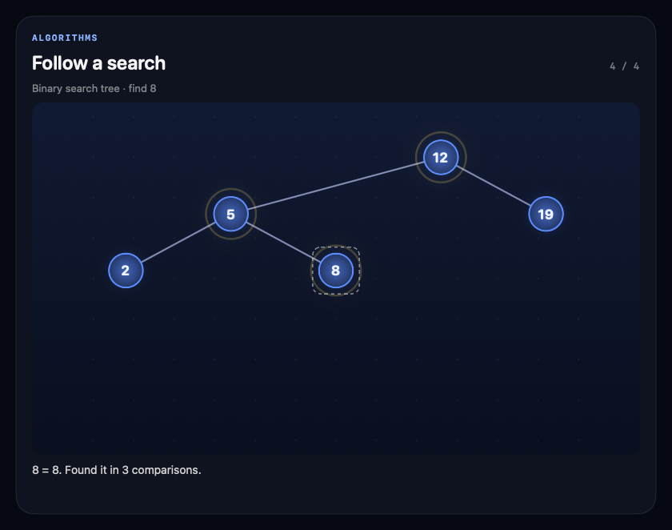</a> | Searching a binary search tree: 12 → 5 → 8 in three comparisons | Built-in `bst` template | [tree.json](../Examples/Showcase/Sources/MartyShowcase/Scenes/tree.json) |
| <a href="assets/native/two-pointers.gif">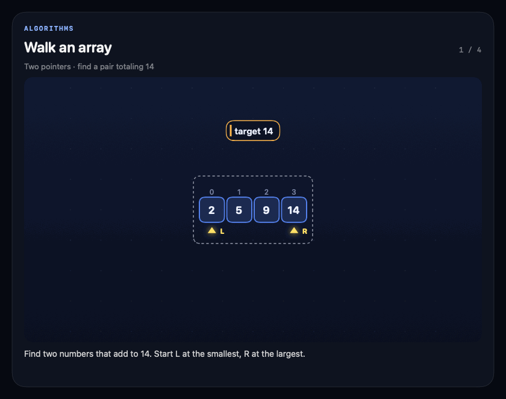</a> | The two-pointer pair search in a sorted array | Built-in `two_pointers` template | [two-pointers.json](../Examples/Showcase/Sources/MartyShowcase/Scenes/two-pointers.json) |
| <a href="assets/native/handoff.png">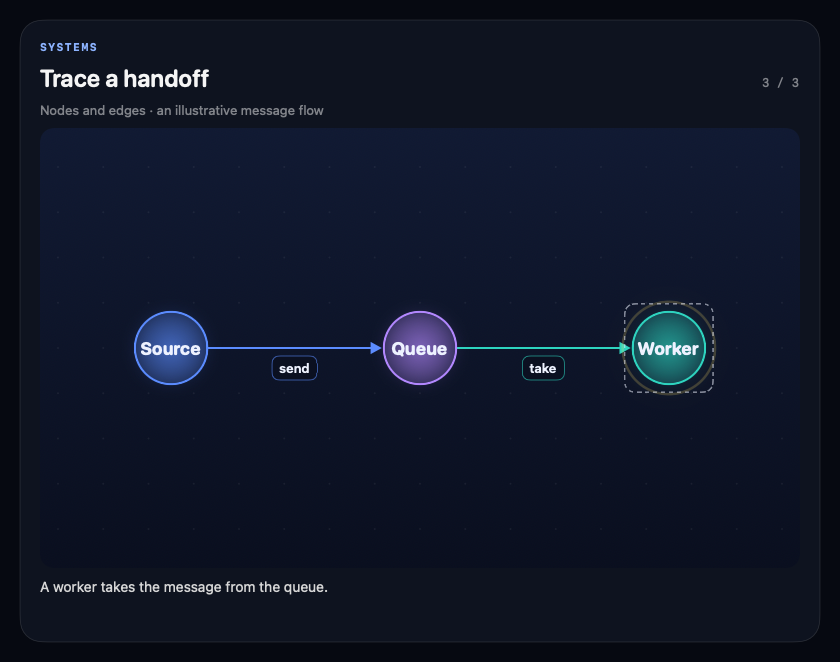</a> | A message passing from a source through a queue to a worker | `node`, directed `edge`, a `highlight` moved by step edits | [handoff.json](../Examples/Showcase/Sources/MartyShowcase/Scenes/handoff.json) |
| <a href="assets/native/function.png">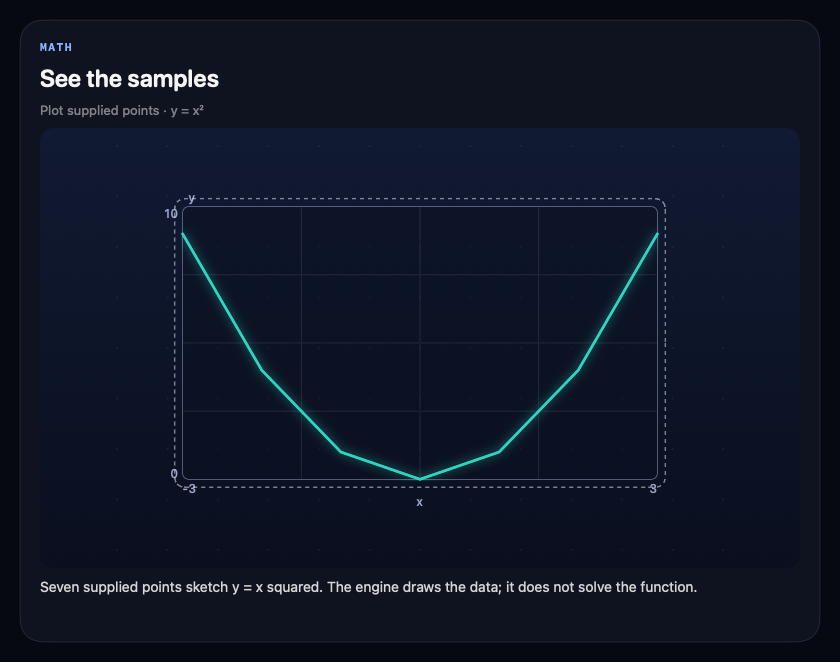</a> | Sampling y = x² at seven points | `plot` of supplied points (no solver) | [function.json](../Examples/Showcase/Sources/MartyShowcase/Scenes/function.json) |
| <a href="assets/native/counts.png">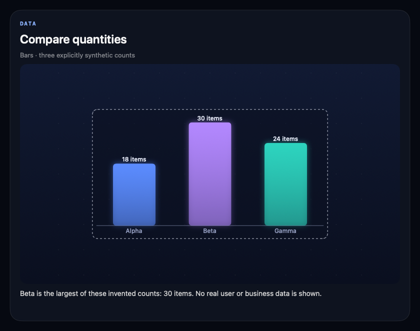</a> | Comparing three quantities | `bars` with a unit | [counts.json](../Examples/Showcase/Sources/MartyShowcase/Scenes/counts.json) |
| <a href="assets/native/motion.gif">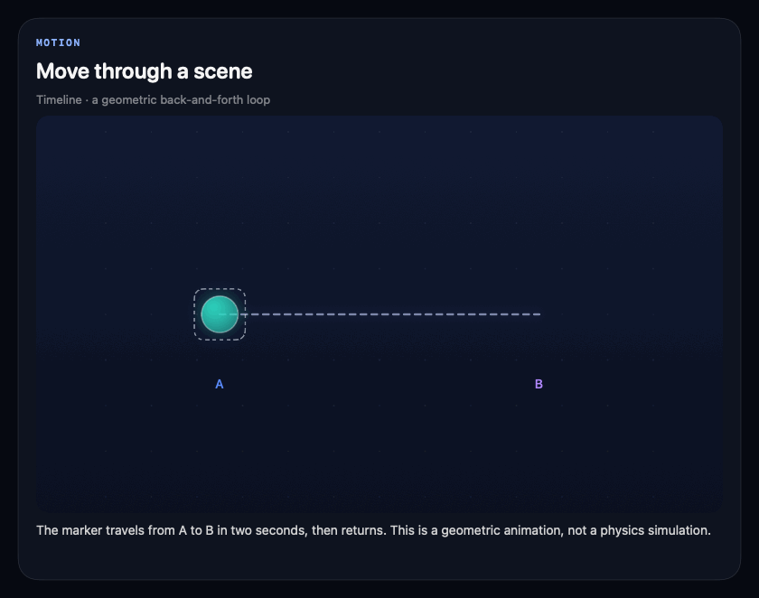</a> | A timed move from A to B and back | `body` with `move`; a dashed `path` | [motion.json](../Examples/Showcase/Sources/MartyShowcase/Scenes/motion.json) |
| <a href="assets/native/shortest-path.gif">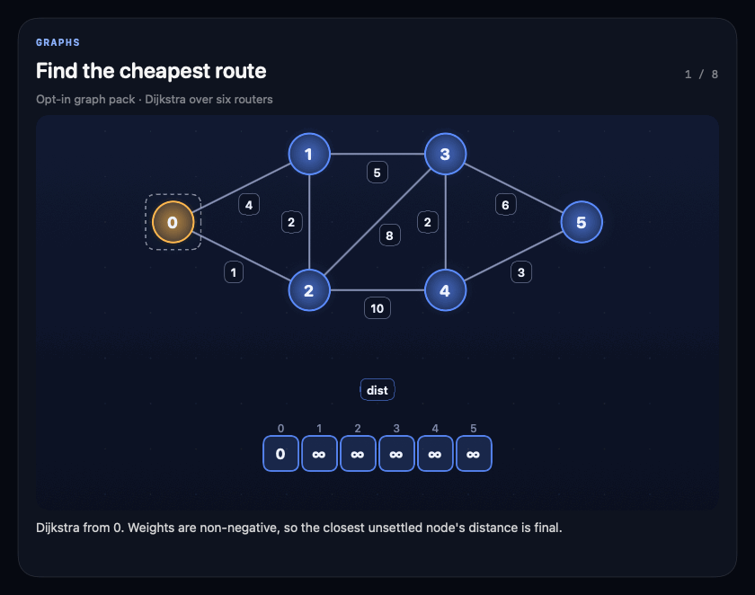</a> | Dijkstra's shortest path over six routers (cost 13) | Opt-in `shortest_path` graph pack | [shortest-path.json](../Examples/Showcase/Sources/MartyShowcase/Scenes/shortest-path.json) |

All seven on one image: [overview](assets/native/overview.png) · [capture receipt](assets/native/provenance.json).
For short scenes to copy and change, see the [cookbook](COOKBOOK.md).

## Lessons and explainers

| Example | Teaches | Engine feature | Source |
| --- | --- | --- | --- |
| <a href="assets/lessons/rotation-loop.gif">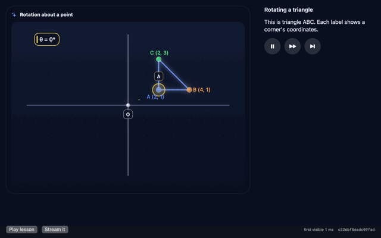</a> | Rotation about the origin: coordinates change, distances do not | Beat-by-beat lesson: engine-computed labels, a learner slider, checks that must hold before a line is shown. Hand-built. | [Lesson demo](../Examples/LessonDemo/README.md) · [JSON](fixtures/v1/rotation.lesson.json) |
| <a href="assets/explainer/gears-mixed-beat-1.png">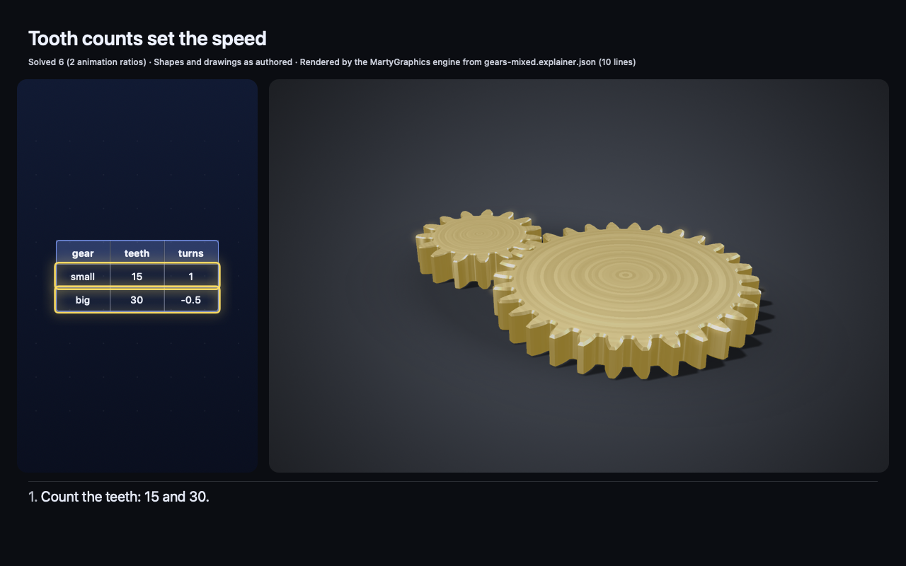</a> | Two meshing gears with 15 and 30 teeth: the big one turns half as fast, the other way | Explainer document: one beat timeline over a 2D table and a 3D solid; captions filled from solved facts. Hand-built. | [Explainer examples](../Examples/Explainers/README.md) |

## 3D mechanisms (hand-built)

The idler gearbox and winch images were rendered by `marty-solid render` from their JSON assemblies. The others came
from example programs: the turbofan images from `marty-turbofan --export`, the path-traced gearbox from
`marty-pathtrace`, and the planetary and slider-crank images from `marty-solid3d --export` (the slider-crank from its
Swift model builder, with the same crank radius and rod length as `slider-crank.json`). Each image folder's
`provenance.json` has the receipt. These are schematic teaching models, not engineering designs.

| Example | Teaches | Engine feature | Source |
| --- | --- | --- | --- |
| <a href="assets/turbofan/labelled.png">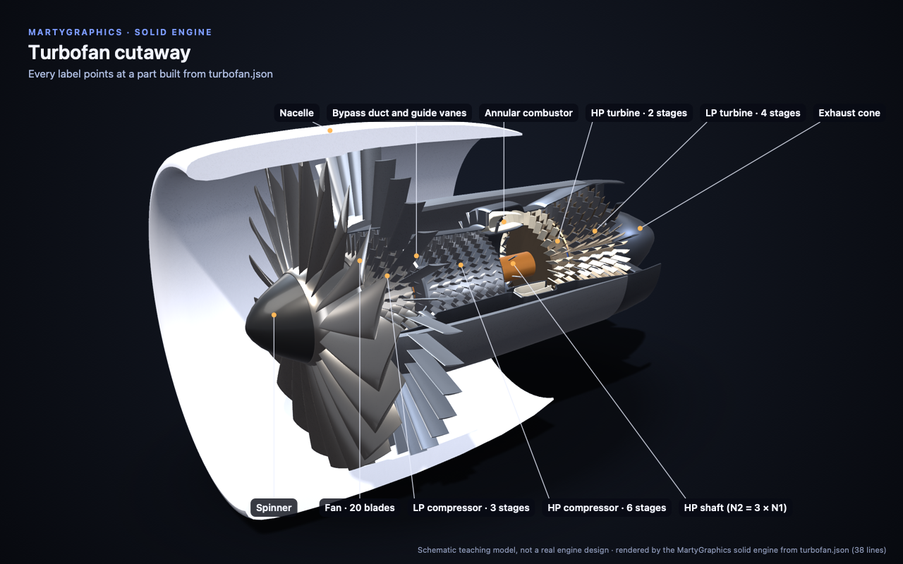</a> | The parts of a two-spool turbofan: fan, compressors, combustor, turbines, two shafts | Blade rows, capped partial-revolve cutaways, two authored input drives, a clearance check | [Turbofan](../Examples/Turbofan/README.md) · [loop](assets/turbofan/turbofan-loop.gif) · [exploded](assets/turbofan/exploded.png) |
| <a href="assets/cutaway/cut.png">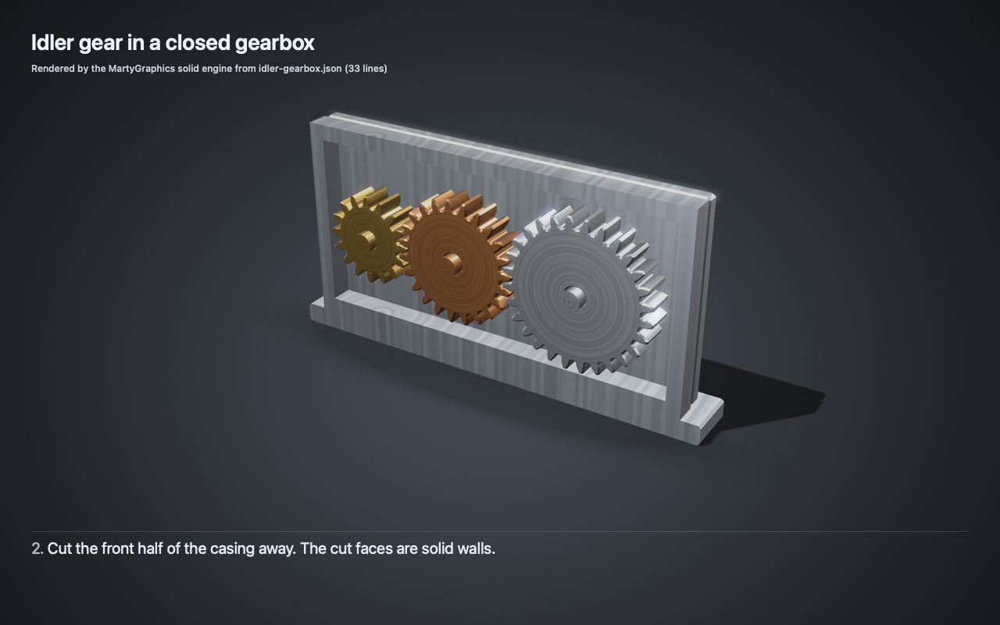</a> | The 28-tooth output turns in the same direction as the 16-tooth input, at 16/28 of its speed. | Section cut with capped walls, a see-through casing, caption numbers filled from solved gear speeds | [idler-gearbox.json](../Examples/Solid3D/Sources/MartySolid3D/Models/idler-gearbox.json) · [section](SHOWCASE.md#cutaways-and-honest-numbers) |
| <a href="assets/annotations/winch-dimension.png">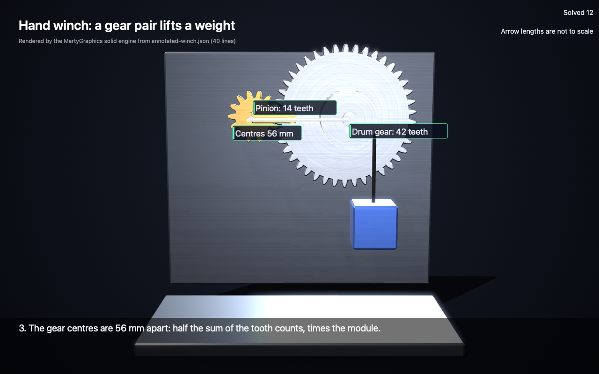</a> | A hand winch: the 14-tooth pinion turns the 42-tooth drum at 1/3 of the crank speed, the other way | Labels, turn arrows whose direction the engine checks, a measured dimension | [annotated-winch.json](../Examples/Solid3D/Sources/MartySolid3D/Models/annotated-winch.json) · [section](SHOWCASE.md#labels-arrows-and-measured-dimensions) |
| <a href="assets/solid/exploded-labelled.png">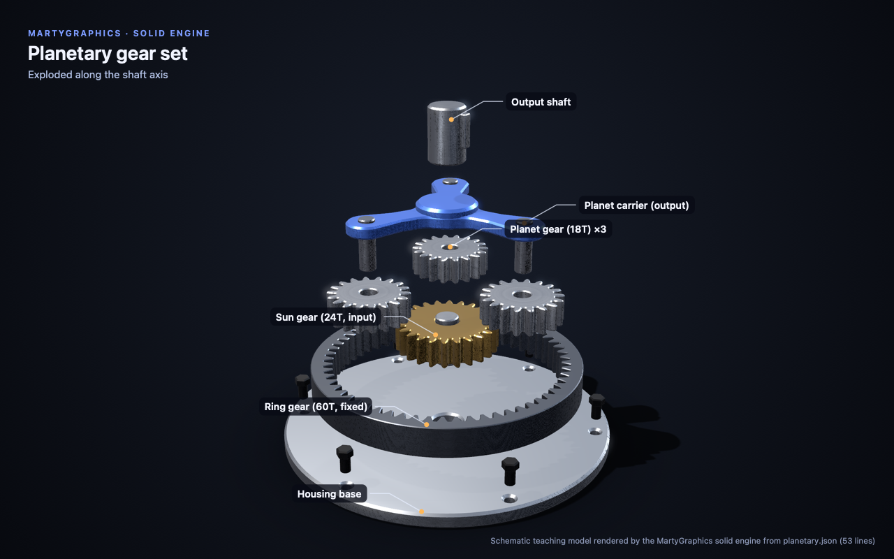</a> | A planetary gear set: sun 24, planets 18, ring 60, carrier output at 3.5 : 1 | Gear meshes solved from one input; an exploded view | [planetary.json](../Examples/Solid3D/Sources/MartySolid3D/Models/planetary.json) · [loop](assets/solid/planetary-loop.gif) |
| <a href="assets/solid/slider-crank-section.png">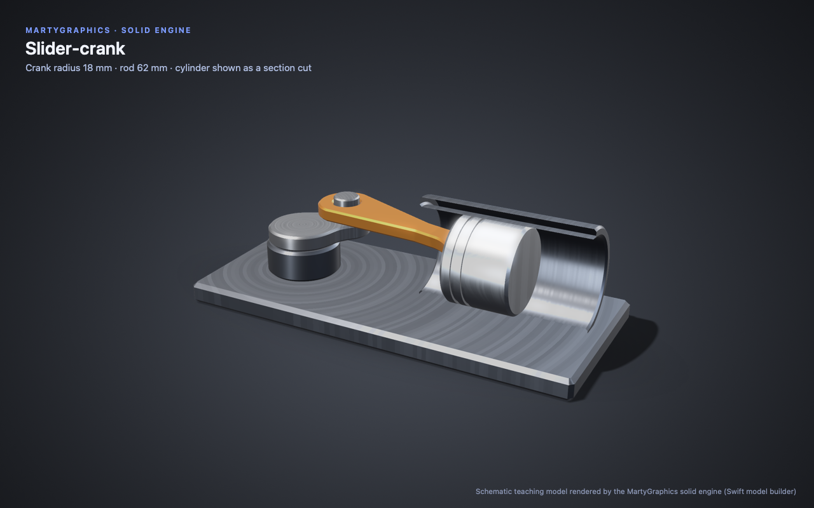</a> | How a slider-crank turns rotation into back-and-forth motion | Slider-crank motion solved by the engine; the uncapped compatibility section clip (`MGStudioOptions.section`) | [slider-crank.json](../Examples/Solid3D/Sources/MartySolid3D/Models/slider-crank.json) |
| <a href="assets/pathtrace/hero.png">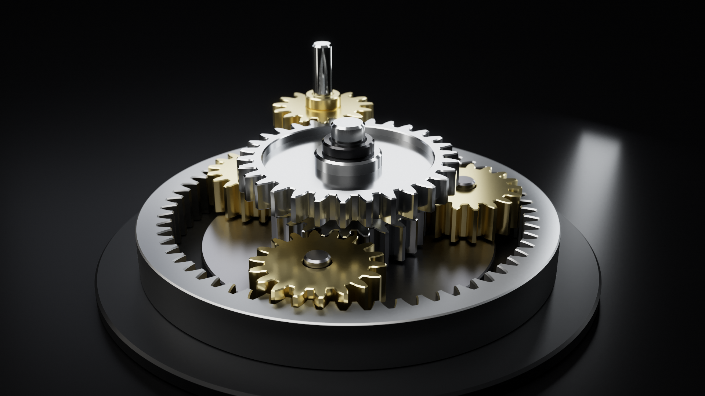</a> | A two-stage gearbox: 2 : 1, then a 3.5 : 1 planetary stage, 7 : 1 overall | The separate `MartyGraphicsPathTracer` library (Metal); procedural geometry | [Path tracer](../Examples/PathTrace/README.md) |

More models (compound spur reduction, ring-driven planetary, cam and follower, four-bar, plunger, quadcopter arm) are
in [`Examples/Solid3D`](../Examples/Solid3D/README.md); they have check goldens but no published stills. The four-bar
uses authored rotation ratios, and the cam example drives its follower with a `crankSlider` drive; the engine has no
general linkage solver and no cam-contact solver.

## Fact-checked explainers (hand-built)

| Example | Teaches | Engine feature | Source |
| --- | --- | --- | --- |
| <a href="assets/drone-aviation/quadcopter/poster.jpg">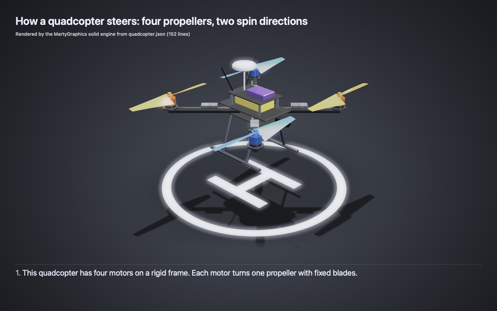</a> | How a quadcopter steers with propeller speed and reaction torque | Turn arrows with checked senses; a weight arrow | [Quadcopter](SHOWCASE.md#quadcopter-steering) |
| <a href="assets/drone-aviation/payload-cg/poster.jpg">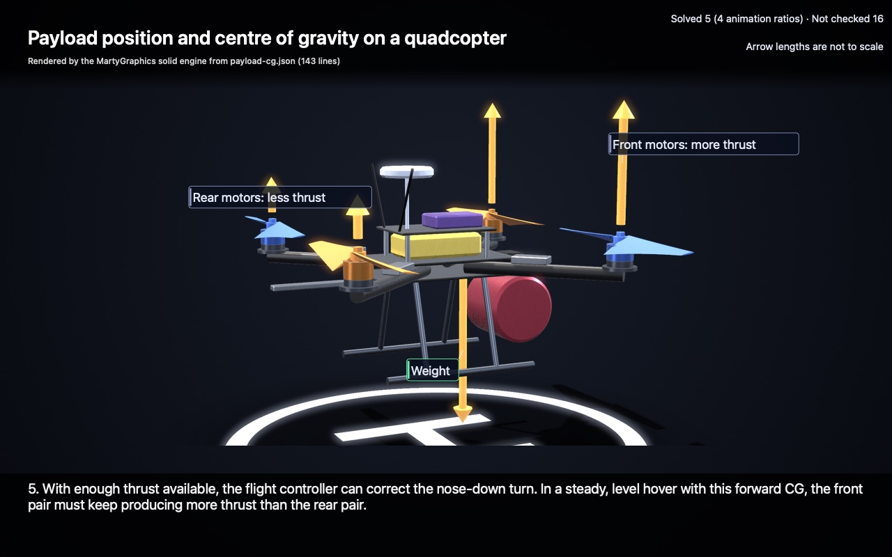</a> | How payload position moves the centre of gravity | Poses, arrows, a weight arrow | [Payload and CG](SHOWCASE.md#payload-position-and-centre-of-gravity) |
| <a href="assets/drone-aviation/brushless-motor/poster.jpg">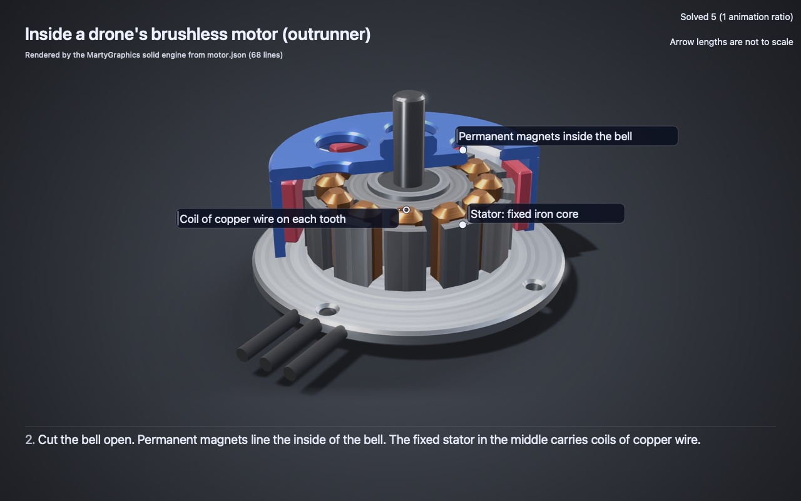</a> | Inside a brushless outrunner motor | Cutaway, labels, spin | [Brushless motor](SHOWCASE.md#brushless-outrunner-motor) |
| <a href="assets/drone-aviation/gimbal/poster.jpg">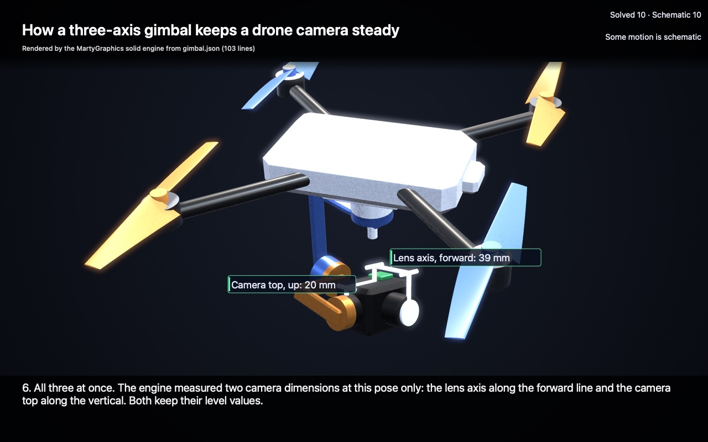</a> | How a three-axis gimbal keeps a camera level | Joint poses, measured dimensions | [Gimbal](SHOWCASE.md#three-axis-camera-gimbal) |
| <a href="assets/drone-aviation/landing-gear/poster.jpg">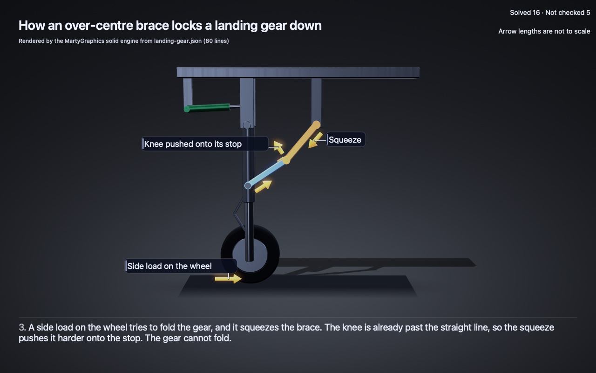</a> | How an over-centre lock holds a landing gear down | Linked parts, arrows, steps | [Landing gear](SHOWCASE.md#landing-gear-over-centre-lock) |
| <a href="assets/jet-suit/hero.png">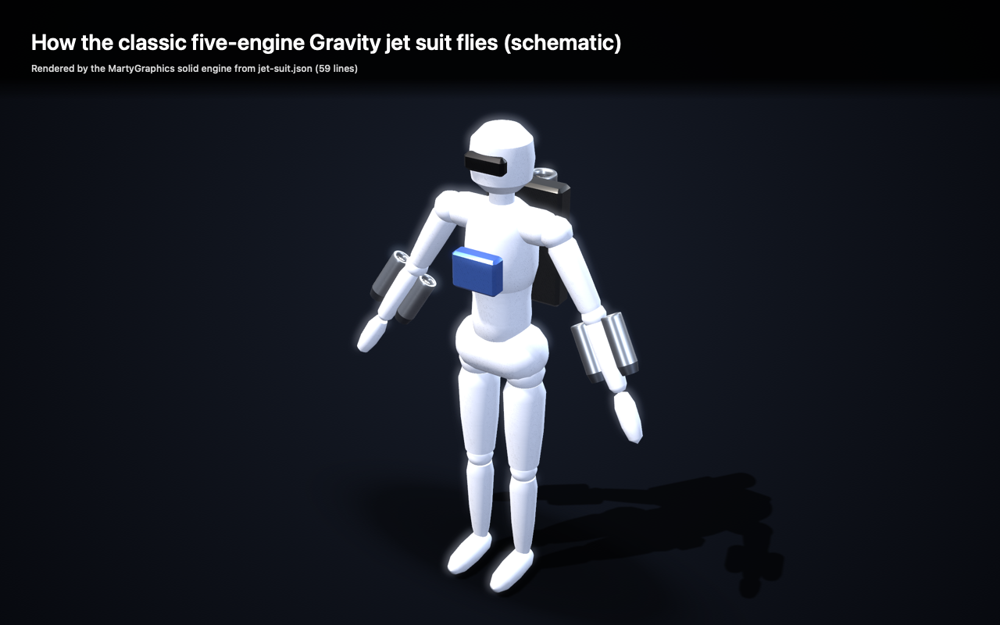</a> | How a five-engine jet suit makes and steers thrust | A 76-part lesson in 7 steps, with sources | [Jet suit](SHOWCASE.md#jet-suit-hand-built-fact-checked) · [sources](assets/jet-suit/SOURCES.md) |

The five drone and aviation explainers were checked by two independent AI model fact checks, and their fixes were
applied ([fact list](assets/drone-aviation/FACTS.md), [what the engine could not show](assets/drone-aviation/GAPS.md)).
An AI fact check is not an engineer's review.

## From a prompt (AI-written)

| Example | Teaches | Engine feature | Source |
| --- | --- | --- | --- |
| <a href="assets/from-a-prompt/robot-joint/hero.png">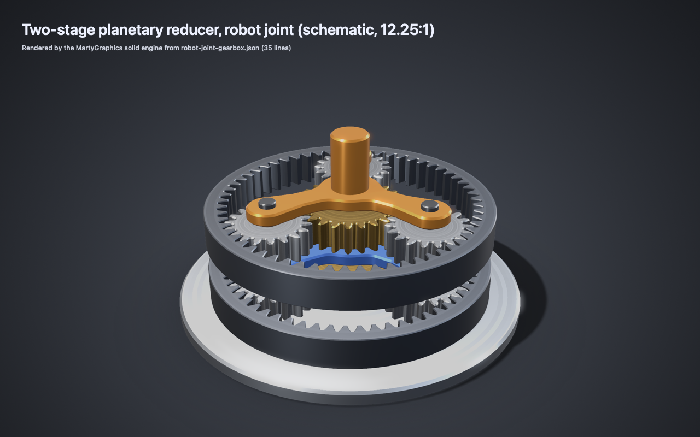</a> | A two-stage planetary reducer (12.25 : 1) | Refusal and repair: try 1 was refused with `constraint.gearMesh.phase` (20 + 56 is not divisible by 3 planets); try 2 was accepted | [Section](SHOWCASE.md#from-a-prompt) · [refused try](assets/from-a-prompt/robot-joint/attempt-1-refused.json) · [receipt](assets/from-a-prompt/robot-joint/provenance.json) |
| <a href="assets/jet-suit-ai/poster.png">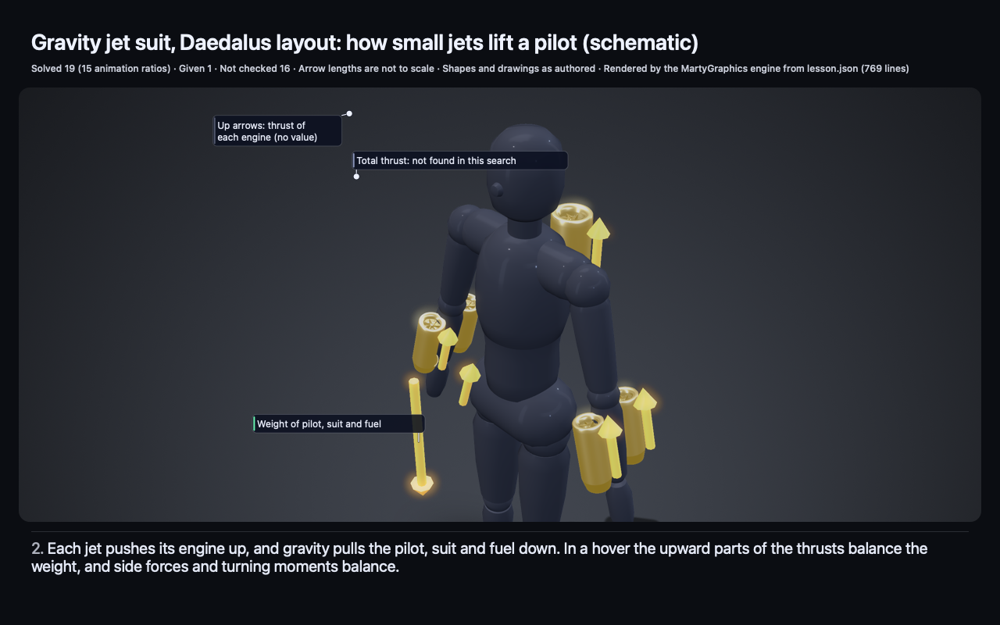</a> | How a jet suit works, as an AI model explained it | An unedited AI lesson beside its fact check (1 wrong sentence, 12 corrections): the engine checks motion and layout, not words | [Section](SHOWCASE.md#jet-suit-from-a-prompt-ai-written-unedited) · [fact check](assets/jet-suit-ai/FACT-CHECK.md) |

The refusal of the robot-joint try 1 is kept as a regression test in
[`MartySolidGLTFTests`](../Examples/Solid3D/Tests/MartySolidGLTFTests/MartySolidGLTFTests.swift). These runs were picked
after grading from the runs that passed; see the [limits](../README.md#what-it-checks-and-what-it-does-not).

## Without images

- **ML explainer boards** (opt-in `MartyGraphicsMLKit`): vision pipeline, next-token probabilities, temperature sweep,
  meaning map, picture to numbers, generation loop, simplified attention and agent loop. The JSON files are in
  [`Examples/Explainers`](../Examples/Explainers/README.md#ml-explainer-examples); no rendered stills are published in
  this repository.
- **3D inspection** of a schematic key switch: select, dim and orbit parts ([KeySwitch3D](../Examples/KeySwitch3D/README.md)).
