# Showcase: mechanism explainers first

MartyGraphics makes kinematically verified mechanism explainers: gear trains, slider-crank linkages and engine
cutaways. The mechanism examples come first on this page. The engine checks gear meshing (tooth phase, centre distance
and tooth interference), gear ratios, joint motion and layout. It does not check whether the words are true: it checks
motion and layout, not the truth of text claims. A "Solved" count in a legend counts animation ratios and engine
values computed from the model, not verified facts about the real object.

After the mechanisms come the AI-written jet-suit lesson with its fact check and the hand-built jet-suit lesson.
Between these two is a set of hand-built [drone and aviation explainers](#drone-and-aviation-explainers-hand-built);
two independent fact checks found no wrong claim and asked for 16 fixes, which are applied.
Other parts of the repository are at the end, under [Also in this repo](#also-in-this-repo). None of the examples
implies a curriculum or a running service.

> **About the 3D loops on this page.** GitHub shows them as GIF images, not video. A GIF
> has at most 256 colours, and these previews are 480 to 640 pixels wide at 10 to 12 frames per
> second, so they look rougher and less smooth than the real output. The turbofan source video is
> 1280 pixels wide at 30 frames per second: <a href="https://morrowdock.app/mg/turbofan/turbofan-loop.mp4">turbofan (MP4)</a>.
> Run an example to see the engine live.

## Turbofan cutaway

A schematic two-spool, high-bypass turbofan built and rendered by the solid engine from
[38 lines of JSON](../Examples/Turbofan/Sources/TurbofanKit/Models/turbofan.json): a 20-blade
fan, 3 LP and 6 HP compressor stages, an annular combustor, 2 HP and 4 LP turbine stages, and
an LP shaft (blue) inside the HP shaft (orange). The model is JSON written for this example in
the documented format, not the output of a prompt run. It is a teaching model, not a real
engine design.

The HP spool turns three times for each turn of the fan. That ratio is authored as two input drives, not solved from
gears. The example's `--verify` check confirms that every mesh is closed, that both spools turn about one engine axis
and that no rotor touches a part that does not turn with it (smallest lower-bound gap 4.52 mm).

[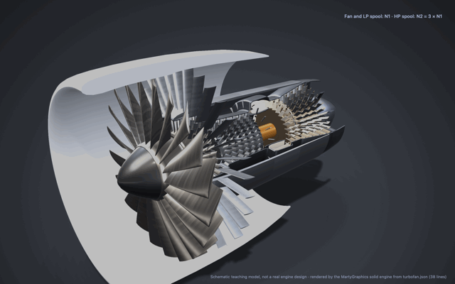](assets/turbofan/labelled.png)

[Path-traced still](assets/turbofan/pathtraced-hero.png) · [Labelled cutaway](assets/turbofan/labelled.png) ·
[Exploded](assets/turbofan/exploded.png) · [Loop (GIF, 640×400, 10 fps, 12 s)](assets/turbofan/turbofan-loop.gif) ·
[Video (MP4, 1280×800, 30 fps)](https://morrowdock.app/mg/turbofan/turbofan-loop.mp4) ·
[Run it](../Examples/Turbofan/README.md) · [Render receipt](assets/turbofan/provenance.json)

**How a turbofan works.** The big fan at the front pulls in a huge flow of air (suck). A small
part of it goes into the core, where rows of spinning blades and fixed vanes squeeze it to many
times its intake pressure (squeeze). Fuel burns steadily in the ring-shaped combustor, so the air
gets very hot and expands (bang). The hot gas rushes through the turbines and spins them (blow):
the HP turbine drives the HP compressor, and the LP turbine drives the fan through a shaft that
runs inside the HP shaft. Here the HP shaft turns three times as fast as the LP shaft. Most of the
fan's air goes around the core through the bypass duct, and in a high-bypass engine like this it
gives most of the thrust.

## From a prompt

The example in this section was written by an AI model from one question, as was the
[AI jet-suit lesson](#jet-suit-from-a-prompt-ai-written-unedited) further down this page. The other examples on this
page are hand-built: people and coding agents wrote their JSON or code for these examples, not a
model answering a prompt.

[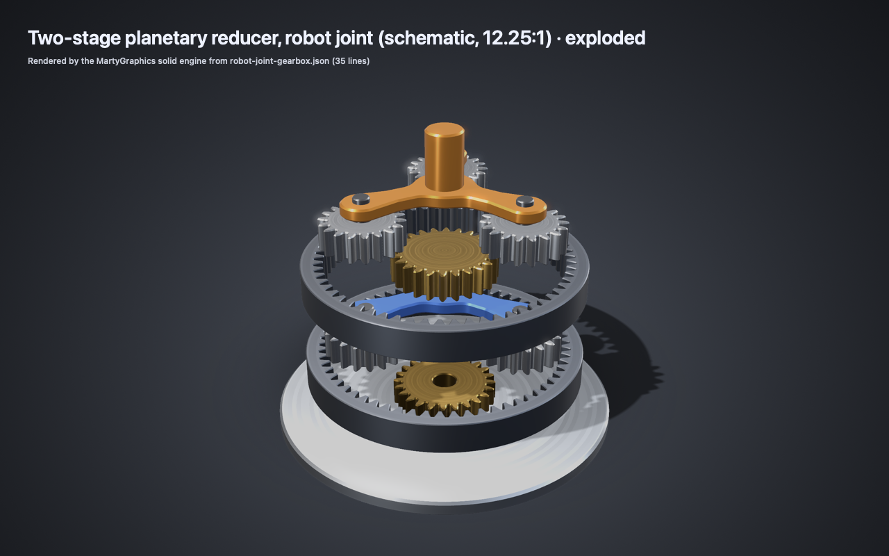](assets/from-a-prompt/robot-joint/loop.gif)

| | |
| --- | --- |
| Prompt | "Show a two-stage planetary gearbox like in a robot joint." |
| Model | Claude Haiku 5.5, fresh process, no tools, only the public docs and worked example models at commit `17396a2f` |
| Attempt 1 | Refused: `constraint.gearMesh.phase` on `ring1` (sun 20, ring 56: 76 ÷ 3 is not whole) |
| Attempt 2 | Accepted: sun 24, planets 18, ring 60 (the gear set of the worked example in its docs); 19 parts, 12 meshes, output 4/49 (12.25:1) |
| Time | 121 s for both attempts |
| Grader | Independent model, against pre-registered checks: mechanics, explanation and labels pass |

[Loop](assets/from-a-prompt/robot-joint/loop.gif) · [JSON](assets/from-a-prompt/robot-joint/robot-joint-gearbox.json) ·
[Refused first try](assets/from-a-prompt/robot-joint/attempt-1-refused.json) · [Run receipt](assets/from-a-prompt/robot-joint/provenance.json)

**What the full test found.** Haiku answered 50 pre-registered questions. All 40 in-scope ones
were accepted within three repairs (median 25 s over all 50), but only 29 of 40 were fully correct in
mechanics, and 4 of 50 explanations had a critical error. The main failures: the model quietly
swapped bevel, worm or crown gears for flat spur gears; its text sometimes gave a number the solved
model did not have; and it skipped or misused features whose conventions the docs did not show clearly. Our plan is
to change the engine and docs from recorded failures like these.

## Cutaways and honest numbers

A closed gearbox hides its gears. This example opens it in three steps: the closed casing, a cut that removes the
front half of the casing, and a ghost step that makes the casing see-through. The model is
[`idler-gearbox.json`](../Examples/Solid3D/Sources/MartySolid3D/Models/idler-gearbox.json). **It was written by hand for
these docs. It is not the output of an AI model from a prompt.** The stills are unedited output of
`marty-solid render`.

[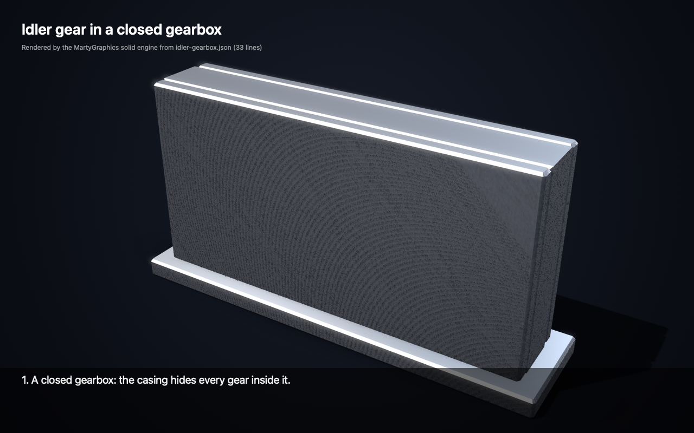](assets/cutaway/closed.png)

[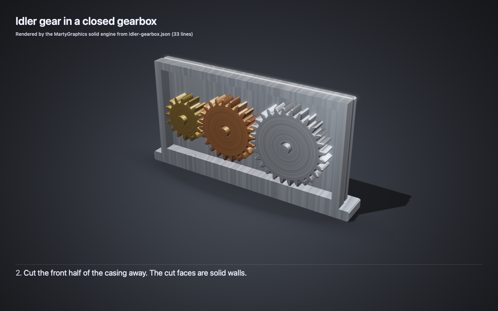](assets/cutaway/cut.png)

[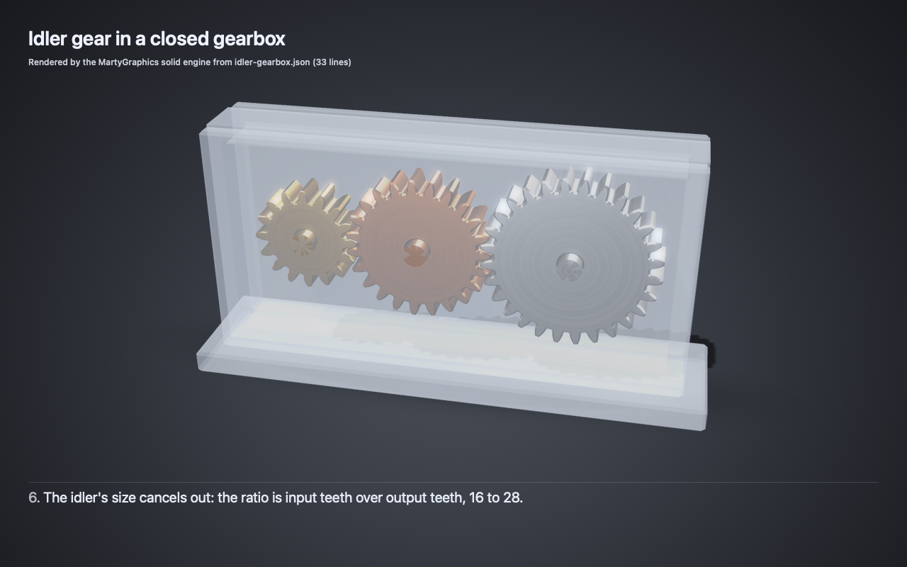](assets/cutaway/ghost.png)

In step 2 the engine cuts the casing at a plane and caps the cut, so the walls look solid and not hollow. For this
model `marty-solid check --strict` reports the capped casing with `closed: true`, 3 cap loops and 34 cap triangles
(step 2 to 5). In step 6 the same casing is a ghost: it stays in the scene but is drawn see-through.

**How an idler works.** The input gear has 16 teeth, the idler has 23 and the output has 28. The idler meshes with both.
It turns the other way, at 16/23 of the input speed (`idler.speed` = -0.6956521739130435, the minus sign is the
direction). The output meshes with the idler, so it turns the same way as the input, at 16/28 = 4/7 of the input speed
(`output.speed` = 0.5714285714285714). The idler does not change that overall ratio: its 23 teeth cancel, because
16/23 × 23/28 = 16/28. (The cancelling is arithmetic. The engine solves each gear's speed from its mesh; the words of
step 6 say the cancelling, and the engine does not check those words.)

**Honest numbers.** The captions do not hold typed numbers. Step 4 is written in the model as

`The idler turns the other way, at {idler.speed|abs|frac} of the input speed.`

and the engine fills it in as **"The idler turns the other way, at 16/23 of the input speed."** The placeholder reads
the fact `idler.speed` (source `gearMesh`, tier `solved`). A check in the same step, `idler.speed < 0`, proves the
sign that `abs` drops; the check output lists it as `Checked`. The check report gives the step tier `solved` (`stepTiers`)
and lists the facts the step used (`stepFacts`). The legend line for the whole model reads **"Solved 9 (3 animation ratios)"**: three
motions, four captions with engine numbers and two checks. Its Built count is 0. A caption badge says "Numbers solved"
and the reason says "Its numbers are engine facts; its words are not checked". The engine does not check the gears'
3D tooth contact, load, strength, wear, friction or efficiency (`notChecked`). All of this is in
[`check-strict.json`](assets/cutaway/check-strict.json), the strict check output for this model.
[Capture receipt](assets/cutaway/provenance.json)

## Labels, arrows and measured dimensions

A model can put labels, arrows and dimension lines on its parts. This example is a hand winch:
[`annotated-winch.json`](../Examples/Solid3D/Sources/MartySolid3D/Models/annotated-winch.json), 40 lines. **It was written
by hand for these docs. It is not the output of an AI model from a prompt.** The stills are unedited output of
`marty-solid render`, and the check output is from `marty-solid check --strict`.

[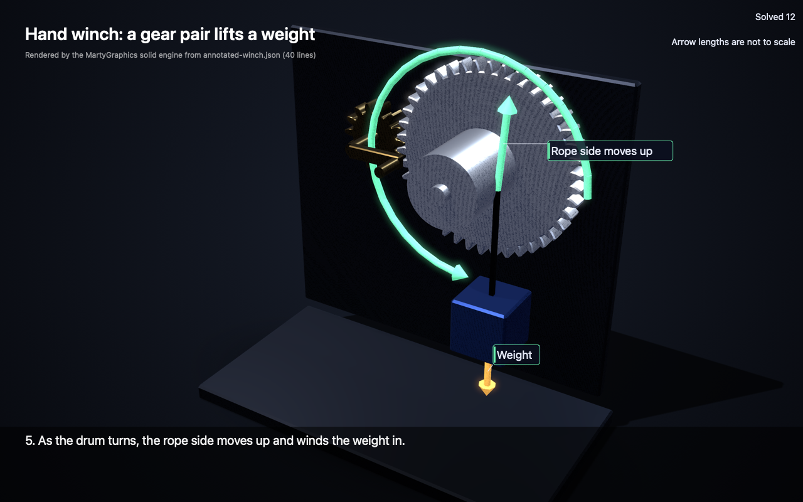](assets/annotations/winch-lift.png)

[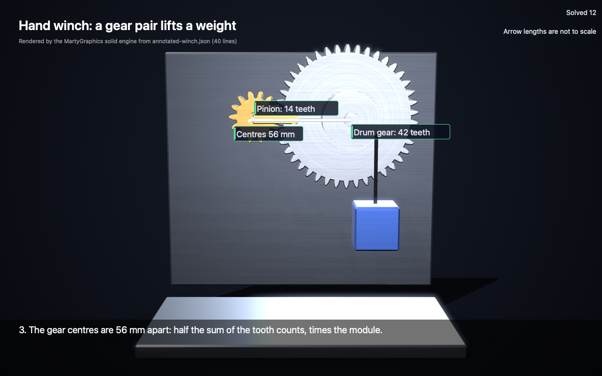](assets/annotations/winch-dimension.png)

Step 5 is the first still. Step 3 is the second still. The pinion's turn arrow shows in step 1 (not kept here).
[Check output](assets/annotations/check-strict.json) · [Capture receipt](assets/annotations/provenance.json)

Archival note: these stills and the check output were rendered at commit `35b9e0a` (after PR #31). The current engine
sizes motion arrows to the step's focus, so it draws a shorter "Rope side moves up" arrow in step 5 (about 22 mm instead
of 40 mm), and its check output places that arrow's text a little differently (`placements`, step 5).

**How a hand winch works.** You turn the crank, and the small pinion (14 teeth) turns with it. The pinion meshes with the
larger drum gear (42 teeth), so the drum turns slower and the other way: `pinion.speed` is 1 (source `input`) and
`wheel.speed` is -0.3333333333333333 (source `gearMesh`). The minus sign is the direction. The step 2 caption says
"1/3 of a turn, the other way". The rope is on the drum, on the side that moves up (the arrow "Rope side moves up"), so
the turning drum winds the rope in and lifts the weight. The two gear centres are 56 mm apart (`dim.centres` = 56,
unit `mm`, source `dimension`). That is half the sum of the tooth counts, (14 + 42) / 2 = 28, times the module 2 mm
(`pinion.module` and `wheel.module` are both 2 mm).

**What the engine guarantees here.**

* The dimension is measured by the engine. The model does not contain the number 56: the label text is
  `Centres {dim.centres}` and the engine fills in "Centres 56 mm".
* A turn arrow takes its direction from the engine: the sign of the part's turn rate (`wheel.worldSpeed` is
  -0.3333333333333333). The model states `cw` for the drum and `ccw` for the pinion, and the engine refuses a stated
  sense that is wrong. The motion arrow "Rope side moves up" takes its direction from the engine's exact velocity at
  its anchor, and the model's expected direction (up) is refused if it is more than 30 degrees off.
* A motion arrow or a turn arrow is allowed only where the motion has a constant rate, so that its direction is true for the
  whole step. A chain with a crank-slider or crank-rod drive is refused with the reason
  `annotation.motion.nonlinear.<id>`.
* A gravity arrow (`"cause": "gravity"`) is refused unless it points within 10 degrees of straight down. In a step with
  `spin`, it is also refused if the part it sits on turns (both its anchors must be world-fixed or move together). Here
  it sits on the weight, which does not move (`partTiers`: `static`).
* Arrow lengths are not to scale. The legend says so, and the engine prints this note: "Arrow lengths are not to scale"
  (`legend.notes`). It is drawn in the top right corner of each still.

The legend line for the whole model reads "Solved 12 (2 animation ratios)" (`legend.text`): two motions, two labels, five arrows, one dimension
and two captions with engine numbers, plus one check. Its Built count is 0. Label and caption words are not checked, only their
numbers. The engine does not check the gears' 3D tooth contact, load, strength, wear, friction or efficiency, or what
drives the input (`notChecked`).

## Solid 3D from JSON

A planetary gear set built and rendered in real time by the solid engine from
[53 lines of JSON](../Examples/Solid3D/Sources/MartySolid3D/Models/planetary.json).

[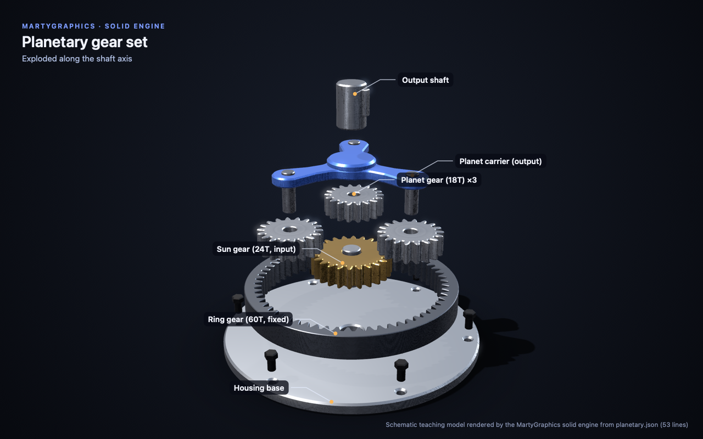](assets/solid/exploded-labelled.png)

[Assembled](assets/solid/hero.png) · [Slider-crank cutaway](assets/solid/slider-crank-section.png) ·
[Loop (GIF, 480×300, 10 fps, 12 s)](assets/solid/planetary-loop.gif) · [Run it](../Examples/Solid3D/README.md) ·
[Render receipt](assets/solid/provenance.json)

**How a planetary gear set works.** The sun gear (24 teeth) sits in the middle and is the
input. Three planet gears (18 teeth) mesh with it and with the ring gear (60 teeth) around
them. The ring is held still, so when the sun turns, the planets are pushed around inside
the ring. Their pins sit on the blue carrier, and the carrier is the output. It turns once
for every (24 + 60) ÷ 24 = 3.5 turns of the sun: slower, but with 3.5 times the torque.
The labelled exploded view shows each part, in the order they stack on the shaft.

## Jet suit from a prompt (AI-written, unedited)

**Asked: "How does the Gravity jet suit work?" — an AI wrote this lesson; the engine rendered it.** Claude Opus 5.5,
through the [Marty](https://github.com/morrowdock/marty) app with web research on, wrote the lesson JSON. MartyGraphics
refused its first two tries, each with one reason, and accepted the third. Then the engine rendered 9 beats and a
78-second story video. **The lesson is shown unedited, with its errors listed.** Nobody changed the JSON, the stills
or the video. An independent fact check found 1 wrong sentence and 12 other corrections; they are in the
[panel below](#independent-fact-check), not fixed in the lesson. We asked the same question in 4 runs: 3 lessons were
accepted, and **1 of the 4 runs met our showcase bar** (this one).

| | |
| --- | --- |
| Prompt (exact) | `How does the Gravity jet suit work?` |
| Follow-up (exact) | `How does the pilot steer?` |
| Model | `claude-cli:claude-opus-5-5` (Claude Opus 5.5 through the `claude -p` adapter) |
| Marty | `morrowdock/marty` main `f2d7c5a` (PR #27) |
| Engine | MartyGraphics `dfc521a` (PR #46), strict check, at most 3 repairs |
| Research | On: web search and web fetch, 12 turns, quote check on |
| Tries | 3: refused `text.number.beat.1`; refused `annotation.anchor.hidden.lShaft` (after 4 engine suggestions were applied); accepted |
| Check | `marty-solid check --strict` passes at `dfc521a` ([check output](assets/jet-suit-ai/check-strict.json)) and again at main `5bae049`, with no warnings. The published render and check are at engine `dfc521a`; newer engines drop two beat-4 arrows whose engines are hidden. |

[Story video (MP4)](assets/jet-suit-ai/story.mp4): 78 seconds, 9 beats, 1280×800 at 30 frames per second, H.264,
17.4 MB, the engine's file byte for byte (not re-encoded). GitHub does not play it inside this page; click to open it.
[The lesson JSON](assets/jet-suit-ai/lesson.json) · [Prompt, setup and every try](assets/jet-suit-ai/PROMPT.md) ·
[Fact check](assets/jet-suit-ai/FACT-CHECK.md) · [Follow-up answer](assets/jet-suit-ai/followup-answer.txt) ·
[Render receipt](assets/jet-suit-ai/provenance.json)

### The 9 beats

Each still is the engine's file, unedited. The caption under each still is the model's exact text. The "Fact check"
line says what the [panel](#independent-fact-check) corrects in that beat.

**Beat 1.** "A pilot wears small jet engines on each forearm and on the back, all nozzles pointing down. This is the
Daedalus layout; the newer suit differs."
Fact check: the five-engine layout (two per arm, one on the back) is verified, not only claimed. "Daedalus" is a press
codename, not a confirmed model name (C4). Gravity's page gives the Mk4 "micro jet arm engines" and three back
turbines, but no per-arm count (C10).

**Beat 2.** "Each jet pushes its engine up, and gravity pulls the pilot, suit and fuel down. In a hover the upward parts
of the thrusts balance the weight, and side forces and turning moments balance."
Fact check: the checkers found the hover balance correct. Total thrust is public: about 144 kgf (317 lbf), reported by AOPA in 2020
(C2). The weight acts at the combined centre of mass; the arrow beside the arm shows direction only (C13).

[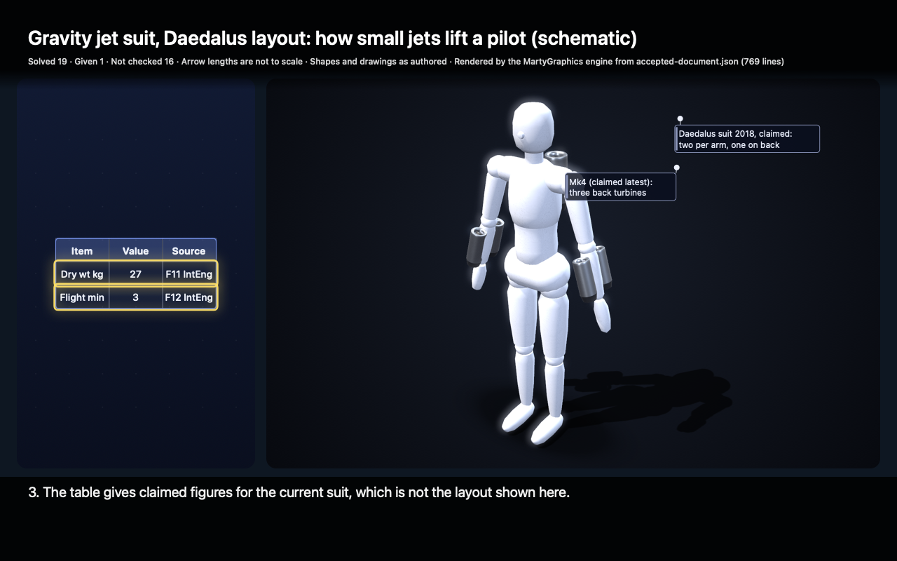](assets/jet-suit-ai/beat-3.png)

**Beat 3.** "The table gives claimed figures for the current suit, which is not the layout shown here."
Fact check: the sources do not name a suit version, so these are not "current suit" figures. Readable source cells:
"About 27 kg before fuel — Interesting Engineering, 28 Oct 2026" and "About 3 min — Gravity, Defence page" (C5).

[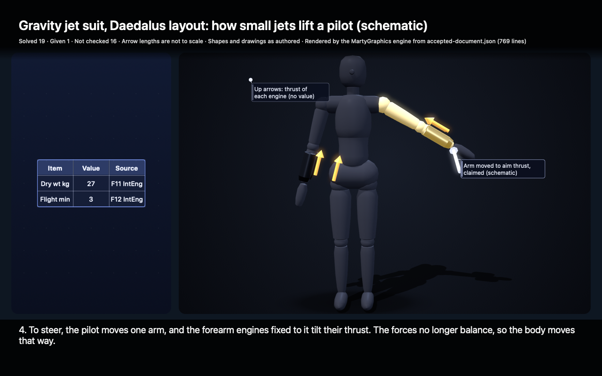](assets/jet-suit-ai/beat-4.png)

**Beat 4.** "To steer, the pilot moves one arm, and the forearm engines fixed to it tilt their thrust. The forces no
longer balance, so the body moves that way."
Fact check: steering with the arms is verified, not only claimed. Moving an arm changes the total force and the turning
moment; the lesson does not calculate the resulting motion, so it should not state a direction (C6).

[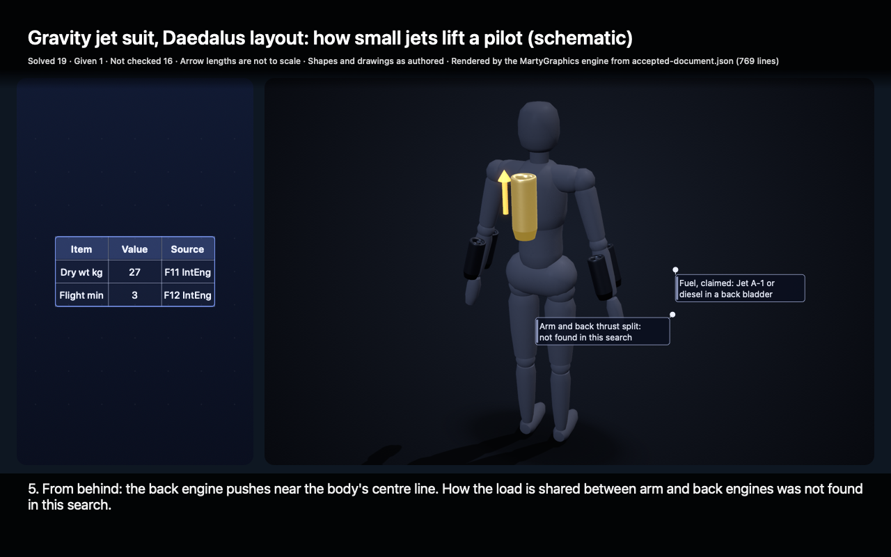](assets/jet-suit-ai/beat-5.png)

**Beat 5.** "From behind: the back engine pushes near the body's centre line. How the load is shared between arm and
back engines was not found in this search."
Fact check: ASME (2019) reports a tripod of thrust, roughly one third on each arm and one third on the back, for the
older suit; approximate, and it changes with throttle and arm angle (C3). The fuel is Jet A-1 or diesel, carried in
bladders beside the back engine on the older suit (C9).

[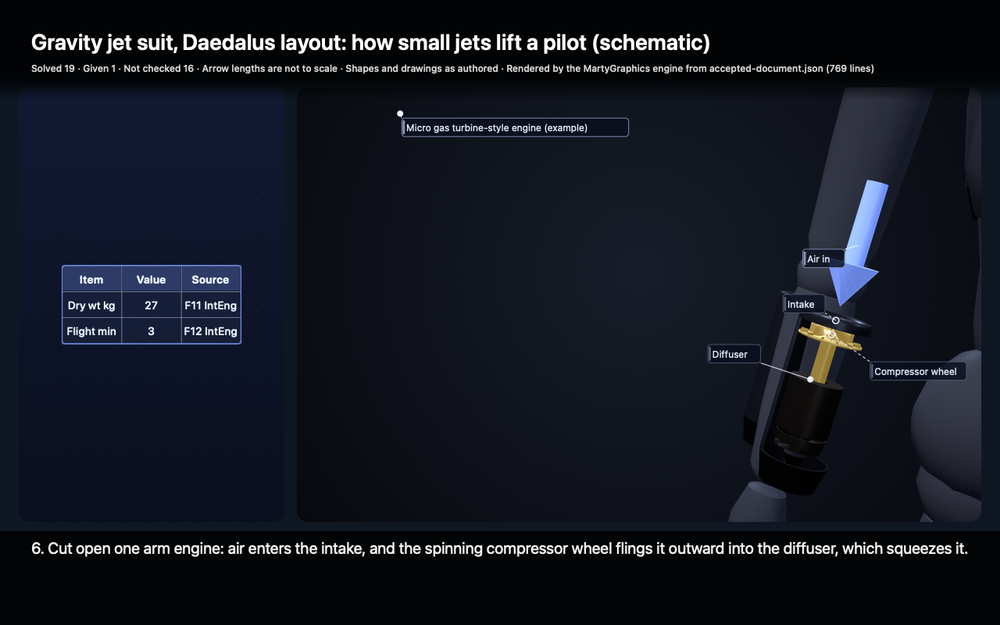](assets/jet-suit-ai/beat-6.png)

**Beat 6.** "Cut open one arm engine: air enters the intake, and the spinning compressor wheel flings it outward into
the diffuser, which squeezes it."
Fact check: the compressor wheel speeds the air outward and raises its pressure; the diffuser slows the air and raises
its static pressure (C7). The cutaway is a generic single-shaft turbojet, not a drawing of a Gravity engine (C8).

[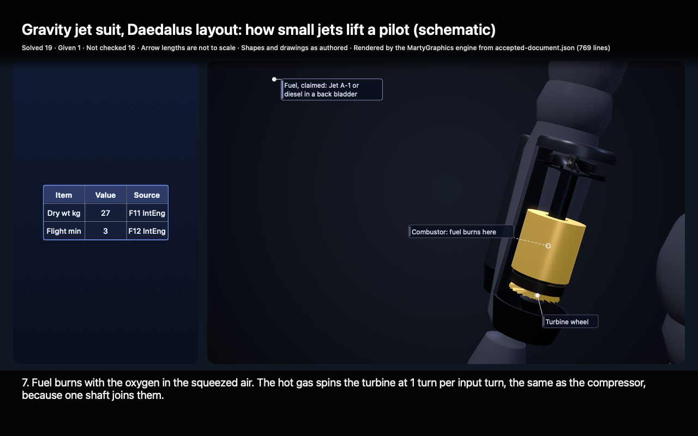](assets/jet-suit-ai/beat-7.png)

**Beat 7.** "Fuel burns with the oxygen in the squeezed air. The hot gas spins the turbine at 1 turn per input turn,
the same as the compressor, because one shaft joins them."
Fact check: **this is the wrong sentence (C1).** "1 turn per input turn" is the engine's solved animation ratio: the
compressor and the turbine are on one shaft, so they turn together (1:1). The engine does not calculate gas flow or
engine speed. Correct: the hot gas expands through the turbine and turns it, and the turbine drives the compressor.

[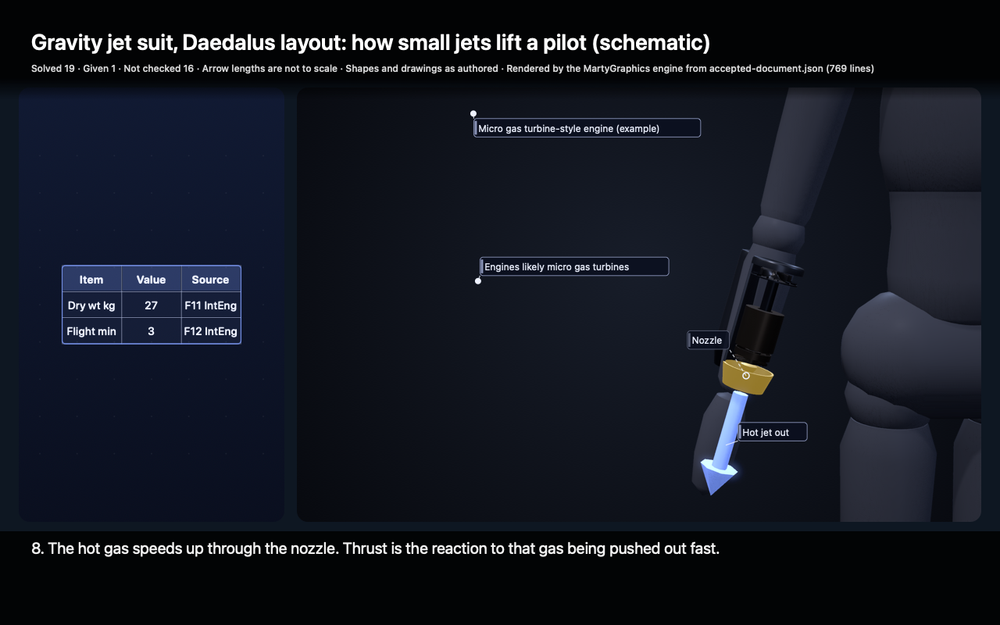](assets/jet-suit-ai/beat-8.png)

**Beat 8.** "The hot gas speeds up through the nozzle. Thrust is the reaction to that gas being pushed out fast."
Fact check: no correction to this caption. Gravity uses small gas-turbine jet engines; that is verified, so the label's "likely" under-claims it (C8).

[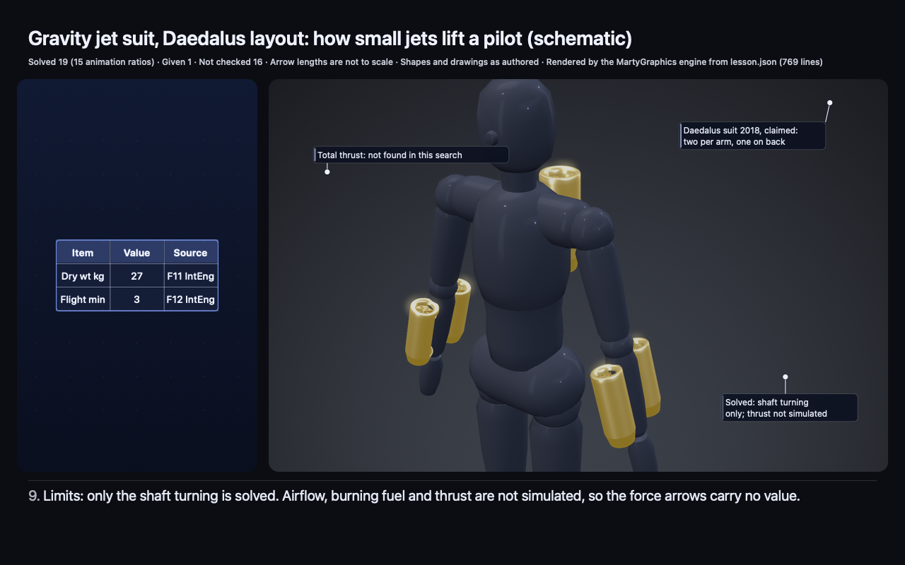](assets/jet-suit-ai/beat-9.png)

**Beat 9.** "Limits: only the shaft turning is solved. Airflow, burning fuel and thrust are not simulated, so the force
arrows carry no value."
Fact check: no correction to this caption. The legend line "Solved 19 · Given 1 · Not checked 16" can read as 19 verified facts; the solved
items are animation ratios and one arrow direction, and no flight force is calculated (C12).

### The follow-up

**Question:** "How does the pilot steer?" The model kept the lesson unchanged (`{"document": null}`); beat 4 already poses the arms.
Its answer, exactly ([file](assets/jet-suit-ai/followup-answer.txt)):

> The pilot steers by pointing the arms, which aims the thrust of the arm engines (F9, Interesting Engineering 2026,
> claimed, not checked). Beat 4 shows this: one arm is raised more than the other, so the forearm engines on it tilt
> their thrust. Once the thrust is tilted, the forces and turning moments no longer balance, so the suit moves or turns
> that way instead of hovering.

The answer agrees with beat 4: the left arm is raised (60°, the right 15°), and its engine and thrust arrows tilt.
Fact check (C6): arm steering is verified, not only claimed. The lesson does not calculate which way the suit moves.
"F9" is a row of the model's own research table, which is not published.

### Independent fact check

Two AI models with web access checked the lesson on 2026-11-09: **GPT-6.1 Sol** (61 claims) and **Gemini 4 Argon**
(19 claims, blind: it saw only the lesson, its summary, the follow-up answer and the stills). Neither saw the grader's
fact key or the grading. Claude Opus 5.5 merged the two reports. **Where they disagree, the stricter label wins.**
Verdict of both: public with fixes. The core is not wrong (layout, hover balance, arm steering, gas-turbine path, one
shaft). These are model checks, not a review by a jet-suit engineer. Full table with the checkers' disagreements:
[FACT-CHECK.md](assets/jet-suit-ai/FACT-CHECK.md).

| # | Where | The lesson says | The correct statement | Label | Sources |
| --- | --- | --- | --- | --- | --- |
| C1 | Beat 7 | "The hot gas spins the turbine at 1 turn per input turn" (marked solved) | **WRONG.** The engine solves only the animation ratio: compressor and turbine turn together on one shaft (1:1). It does not calculate gas flow or engine speed. The hot gas expands through the turbine and turns it; the turbine drives the compressor. | WRONG (both) | The lesson's own limits; JetCat P220 catalogue; NASA Glenn |
| C2 | Beat 2, label "Total thrust" | "not found in this search" | A public figure exists: about 144 kgf (317 lbf) total for the five-engine suit, reported by AOPA, 8 Oct 2020. Reported, not measured independently. Not calculated by the lesson. | WRONG as a gap (Gemini) / misleading (Sol) | AOPA 2020-10-08 |
| C3 | Beat 5, label "thrust split" | "not found in this search" | ASME (12 Jul 2019) reports a tripod of thrust: roughly one third on each arm and one third on the back, for the older suit. Approximate; changes with throttle and arm angle. Mk4 split not confirmed. | WRONG as a gap (Gemini) / misleading (Sol) | ASME "Iron Man Lives" 2019-07-12 |
| C4 | Title, label "Daedalus suit 2018" | "Daedalus layout", "claimed" | Name the layout by what is documented: "five-engine layout reported in 2018 (two per arm, one on the back)". The layout is VERIFIED, not only claimed. "Daedalus" is a press codename (The Manual, 2018), not a confirmed model name; "Mk2/Mk3" has no primary source either. | VERIFIED layout; name CLAIM | WIRED 2018-11-09; TIME 2018-11-15; AOPA 2020; The Manual 2018-08-02 |
| C5 | Board table, beat 3 | "Dry wt kg 27 · F11 IntEng"; "Flight min 3 · F12 IntEng"; figures "for the current suit" | Readable source cells: "About 27 kg before fuel — Interesting Engineering, 28 Oct 2026" and "About 3 min — Gravity, Defence page (accessed 9 Nov 2026)". The sources do not state the suit version; they are not "current suit" figures. | CLAIM (both); scope misleading | Interesting Engineering 2026-10-28; gravity.co Defence page |
| C6 | Beat 4, arrow text, follow-up answer | Steering "claimed, not checked"; "the body moves that way" | Arm steering is VERIFIED. Moving the arms aims the arm-engine thrust; this changes the total force and the turning moment. The lesson does not calculate the resulting motion, so it should not state a direction. | VERIFIED method; direction not calculated (Sol, stricter) | Gravity Defence page; WIRED 2018; NASA Glenn |
| C7 | Beat 6 | The diffuser "squeezes" the air | The compressor wheel speeds the air outward and raises its pressure; the diffuser slows it and raises its static pressure. | Imprecise (Sol) | FAA-H-8083-32B glossary; JetCat |
| C8 | Label | "Engines likely micro gas turbines" | Gravity uses small gas-turbine jet engines (VERIFIED). The cutaway is a generic single-shaft turbojet, not a verified drawing of a Gravity engine; every cutaway beat should say so. | VERIFIED class; geometry schematic | Browning interviews; JetCat |
| C9 | Label "Fuel" | "Jet A-1 or diesel in a back bladder", shown beside the arm-engine cutaway | Fuel: Jet A-1 or diesel (reported). The older suit carries fuel in bladders beside the back engine; the model does not show them. It is not a store inside the engine. | VERIFIED fuel; location scoped | WIRED 2018; ASME 2019 |
| C10 | Label "Mk4 per arm" | "not found in this search" | Gravity's page says the Mk4 has "micro jet arm engines" and "three additional micro turbines in the back". It does not state a per-arm count. Two per arm is PLAUSIBLE from secondary coverage only. | PLAUSIBLE (stricter: Sol) | gravity.co/innovation |
| C11 | Summary text (Marty's run summary; not in the stills) | Mentions power and the 2019 speed record | Neither appears in the lesson; remove them. (If added: Guinness 85.06 mph / 136.891 km/h, 14 Nov 2019, a measured record.) | WRONG for this document (Gemini) | Guinness |
| C12 | Legend line | "Solved 19 · Given 1 · Not checked 16" | Can read as 19 verified facts. The solved items are animation ratios only; no flight force is calculated. | Misleading framing (Sol) | — |
| C13 | Beat 2 still | Weight arrow drawn beside the arm | Weight acts at the combined centre of mass; the arrow shows direction only. | Visual (both) | NASA Glenn |

### What the engine checked vs. what it did not

* **Solved (the engine computed it):** the shaft ratios. In each of the 5 engines, the compressor wheel, the shaft and
  the turbine wheel turn together, 1:1 (15 parts). Also the weight arrow's direction (straight down), the number in beat 7's
  caption (checked against the engine's value), and beat 7's two checks that the turbine and the compressor turn at 1:
  15 + 1 + 1 + 2 = 19. That is the "Solved 19" in the legend.
* **Given 1:** the board table (27 kg, 3 min), shown as the model gave it, with its source note.
* **Not checked 16:** 8 labels and 8 arrows. **The arrows show direction only.** Their lengths are as the model drew
  them, not to scale, and they carry no value.
* **Not computed at all:** thrust, airflow, burning fuel, engine speed, the load split, the hover balance and the
  steering motion. The strict check tests the geometry, that every label and arrow can be seen in its beat, and that
  every number in a caption is an engine value. It does not test whether a sentence is true. That is why the beat 7
  sentence passed: its number is the solved shaft ratio, but the sentence ties it to the hot gas (C1).

### All 4 runs (every try counted)

| # | Run | Model | Result | Try 1 | Try 2 | Try 3 | Try 4 |
| --- | --- | --- | --- | --- | --- | --- | --- |
| 1 | `r2j-opus-1` (this lesson) | Claude Opus 5.5 | **Accepted, try 3; met the showcase bar** | Refused `text.number.beat.1` | 4 auto-fixed, then refused `annotation.anchor.hidden.lShaft` | **Accepted** | — |
| 2 | `r2j-sonnet-1` | Claude Sonnet 5.5 | Accepted, try 3 (Marty's lint fallback) | 8 auto-fixed, then refused `annotation.anchor.off.lBackT` | 1 auto-fixed; engine ok; Marty lint | Engine ok; Marty lint again; kept as the fallback | — |
| 3 | `r2j-opus-2` | Claude Opus 5.5 | **Refused** | Refused `component.use.unknown.name` | 4 auto-fixed, then refused `annotation.anchor.off.lExample` | Refused `annotation.arrow.hidden.aSteer` | Refused (same) |
| 4 | `r2j-sonnet-2` | Claude Sonnet 5.5 | Accepted, try 2 (by the auto-fix) | Refused `section.miss.b2.intakeLip` | 13 auto-fixed, then accepted | — | — |

4 runs, 3 accepted, 1 refused. Only run 1 met the bar: 0 errors against the grader's fact key, an honest follow-up,
every named engine visible, no hard cut and no "not published" text. The independent fact check above came after that
grading and found more. Details: [PROMPT.md](assets/jet-suit-ai/PROMPT.md).

### Next to the hand-built lesson

| AI-written (this lesson, beat 2) | Hand-built reference (step 2) |
| --- | --- |
| [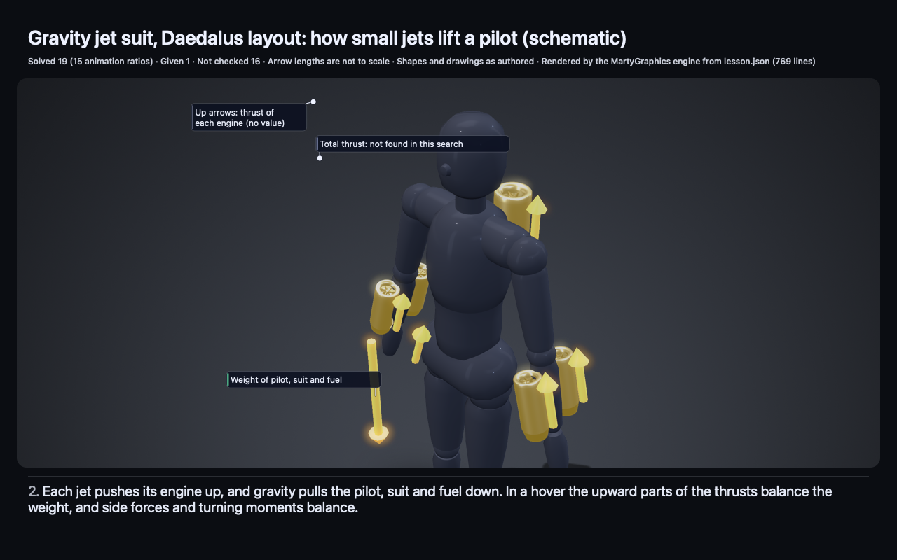](assets/jet-suit-ai/beat-2.png) | [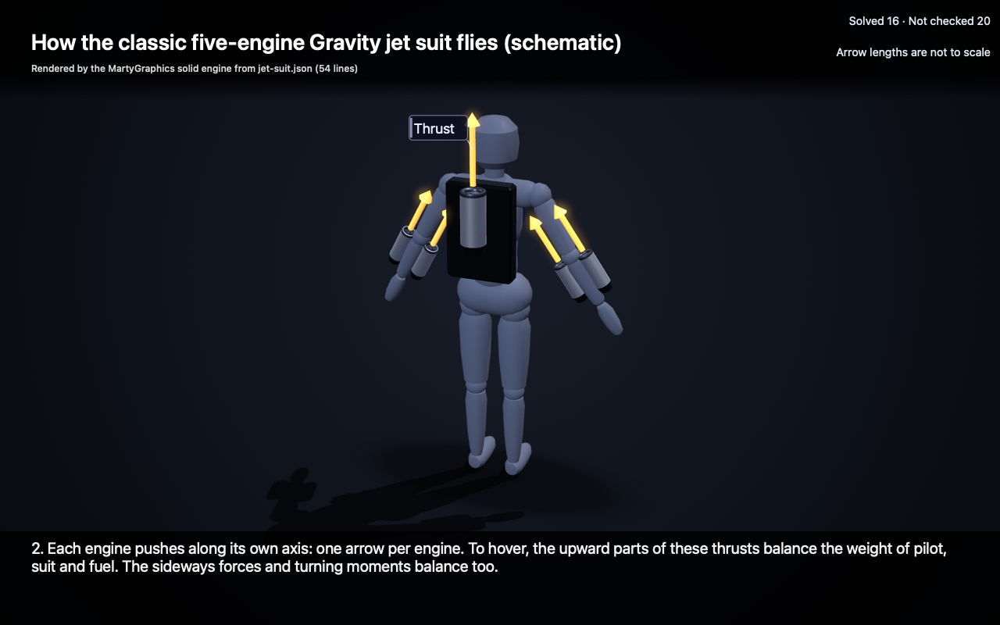](assets/jet-suit/step-2.png) |
| Written by Claude Opus 5.5 from the question, with its own web research. Shown unedited; the fact check is listed beside it. | Written by a Claude agent by hand from fact-checked research; corrections were applied before publishing. |

The hand-built lesson below gives the total thrust (about 144 kgf, AOPA 2020) and Browning's load split, the two gaps
that the AI lesson left as "not found in this search".

## Drone and aviation explainers (hand-built)

**Status: fact-checked on 2026-11-11 by two independent checks (Sol and Gemini); no claim failed, and all 16
fixes are applied** ([fact list](assets/drone-aviation/FACTS.md)). Five explainers
made with the solid engine as it is at main, with no engine change. A Claude agent (Claude Fable 5.2) wrote each
document by hand from a short brief; they are not the output of a prompt run through Marty. The engine checked every
attempt (39 in all: 14 refused, 2 of them deliberate negative controls; the last attempt of each document applies
the fact-check fixes) and rendered the accepted files. Stills and
videos are unedited engine output, re-encoded only for size. [Index, attempts and hashes](assets/drone-aviation/README.md) ·
[Engine gaps found](assets/drone-aviation/GAPS.md)

### Quadcopter steering

[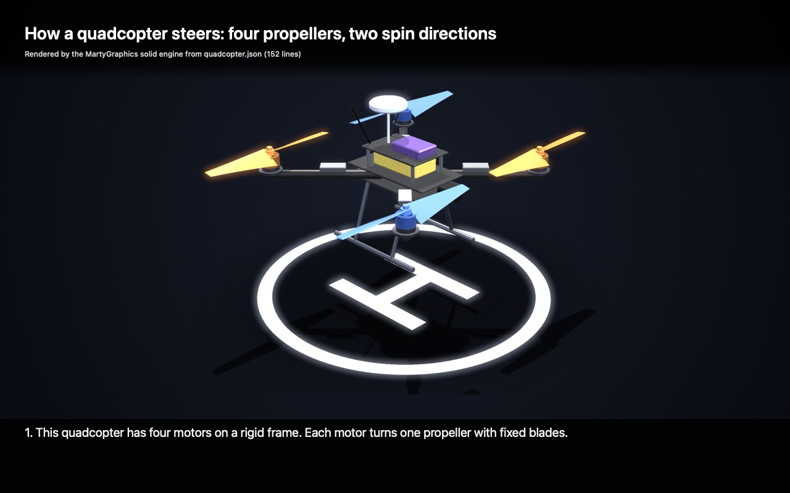](assets/drone-aviation/quadcopter/story.mp4)

[Story video (MP4)](assets/drone-aviation/quadcopter/story.mp4): 87 seconds, 10 beats, 1280×800 at 30 frames per second ·
[Loop (MP4)](assets/drone-aviation/quadcopter/loop.mp4) · [JSON](assets/drone-aviation/quadcopter/quadcopter.json) ·
[Brief and all 11 attempts](assets/drone-aviation/quadcopter/PROMPT.md) · [Check output](assets/drone-aviation/quadcopter/check-strict.json)

[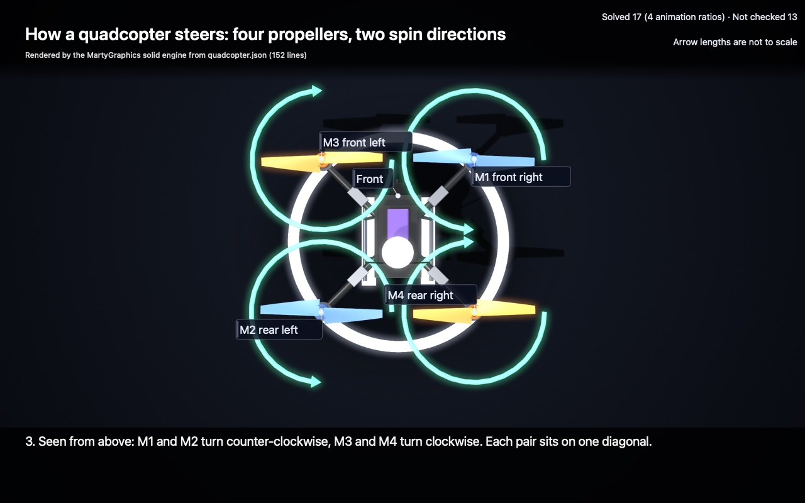](assets/drone-aviation/quadcopter/step-3.jpg)

[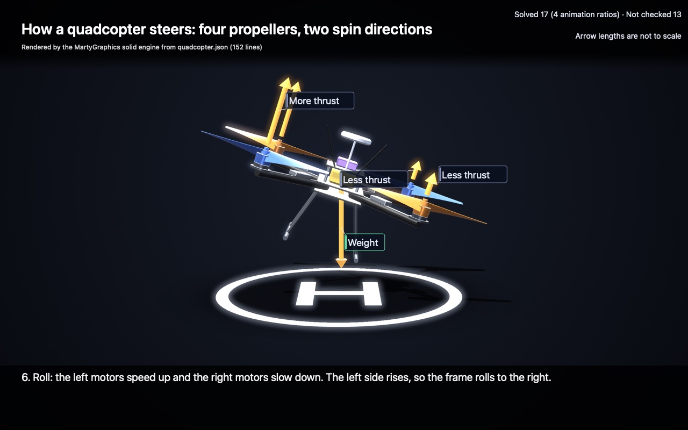](assets/drone-aviation/quadcopter/step-6.jpg)

**How it steers.** The motors are in the ArduPilot "QUAD X" order: M1 (front right) and M2 (rear left) turn
counter-clockwise, M3 (front left) and M4 (rear right) turn clockwise. Each motor applies an opposite reaction
torque to the frame; the clockwise and counter-clockwise reaction torques cancel when their totals are equal. Roll
and pitch come from more thrust on one side and less on the other; the tilted thrust then has a sideways or forward
part. For a clockwise yaw turn the controller increases the thrust of M1 and M2 and reduces the thrust of M3 and M4,
so the reaction torques no longer balance. It can choose these changes to keep the total thrust nearly constant.

**What the engine checked.** The turn direction of every propeller (four turn arrows with a stated sense, and eight
checks on the signs of the speeds) and the direction of the weight. The weight arrow starts at the volume centre of
all drawn parts, with the ground marking; this is not the aircraft's centre of gravity. Legend: "Solved 17 (4 animation ratios) · Not
checked 13". The thrust arrows and the tilted poses are the author's; no airflow or force is computed. Attempt 2 was
refused (`annotation.unused.s2`: an arrow that no step showed), and four more refusals were hidden label anchors.
The story video has two camera cuts (beats 4 and 5, into and out of the close-up of a turning propeller).

### Payload position and centre of gravity

[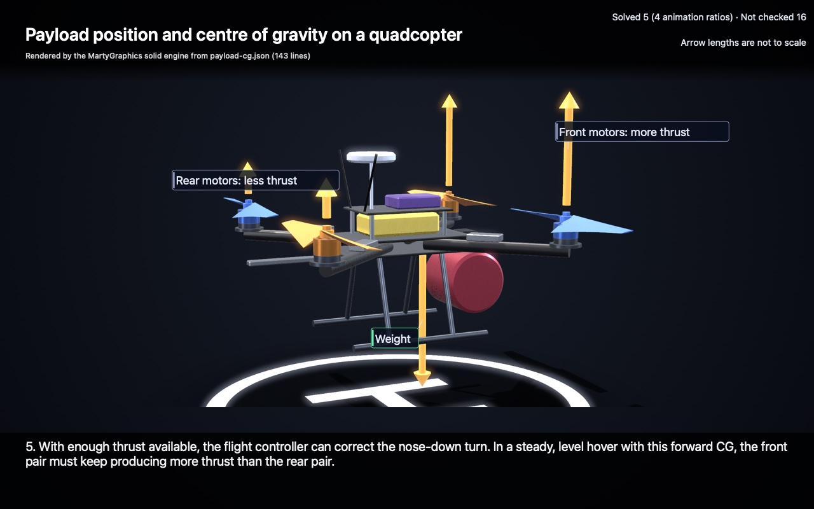](assets/drone-aviation/payload-cg/story.mp4)

[Story video (MP4)](assets/drone-aviation/payload-cg/story.mp4): 81 seconds, 9 beats · [JSON](assets/drone-aviation/payload-cg/payload-cg.json) ·
[Brief and all 5 attempts](assets/drone-aviation/payload-cg/PROMPT.md) · [Check output](assets/drone-aviation/payload-cg/check-strict.json)

[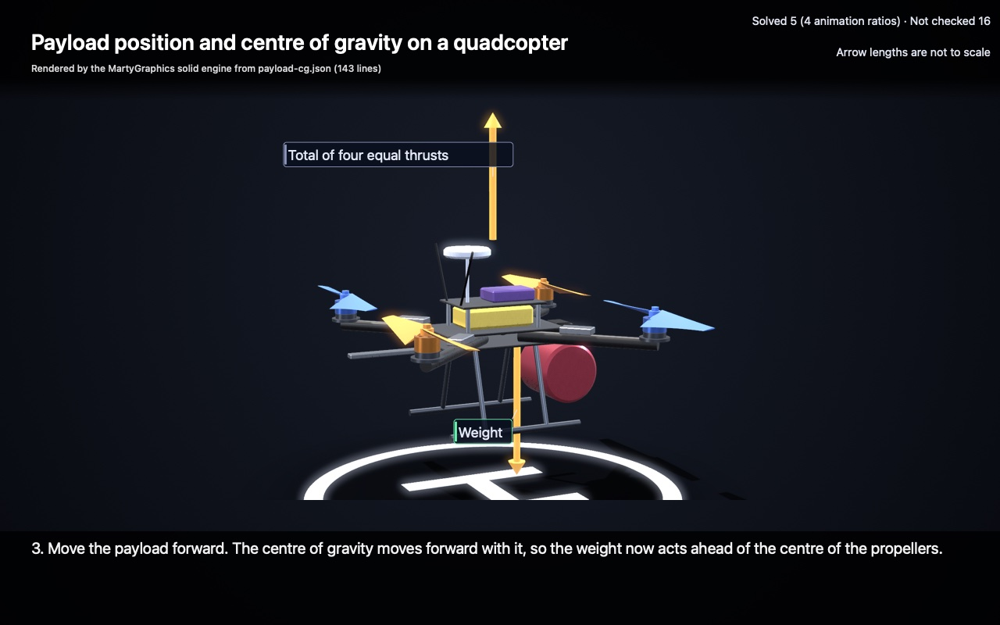](assets/drone-aviation/payload-cg/step-3.jpg)

**How it works.** The weight acts at the centre of gravity (CG). For an ideal hover with the payload in the middle,
assume the CG is exactly below the centre of the four propellers; four equal thrusts can then balance the weight
without a pitch or roll moment. Move the payload forward and the CG moves forward. Four equal thrusts would now let
the nose drop. With enough thrust available, the flight controller can correct the turn. In a steady, level hover
with this forward CG, the resultant thrust line passes through the CG, and the front pair must keep producing more
thrust than the rear pair, so the front motors have less additional thrust available before their upper limit. If
the thrust needed for a steady, level hover is outside the motor-thrust limits, that hover is not possible (step 8
shows this as an assumed limit case).

**What the engine checked.** Where the weight arrow starts: the engine's volume centre of all drawn parts (one
density for all parts, the ground marking included), worked out again for each payload position. This is not the
aircraft's CG. The thrust arrows, the total-thrust arrow's place and the tilts are the author's. The engine does not
calculate the thrust balance or the margin, and no flight is simulated. Legend: "Solved 5 (4 animation ratios) · Not checked 16". The scene makes no regulation claim.

### Brushless outrunner motor

[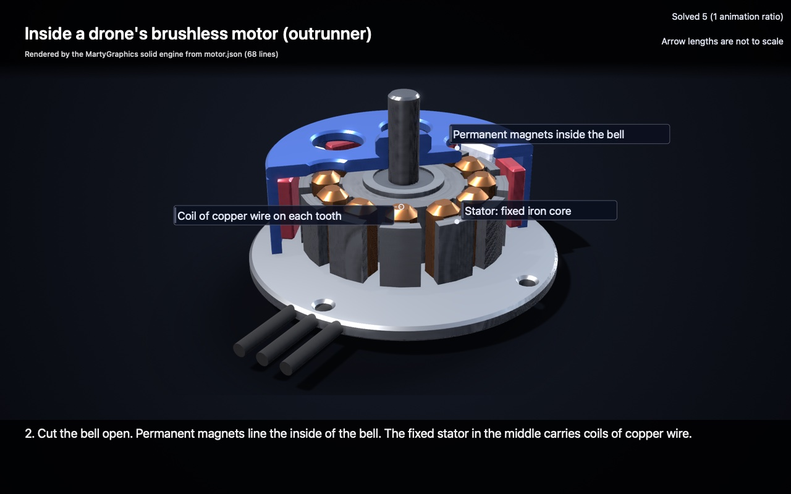](assets/drone-aviation/brushless-motor/story.mp4)

[Story video (MP4)](assets/drone-aviation/brushless-motor/story.mp4): 91 seconds, 11 beats ·
[Loop (MP4)](assets/drone-aviation/brushless-motor/loop.mp4) · [JSON](assets/drone-aviation/brushless-motor/motor.json) ·
[Brief and all 6 attempts](assets/drone-aviation/brushless-motor/PROMPT.md) · [Check output](assets/drone-aviation/brushless-motor/check-strict.json)

[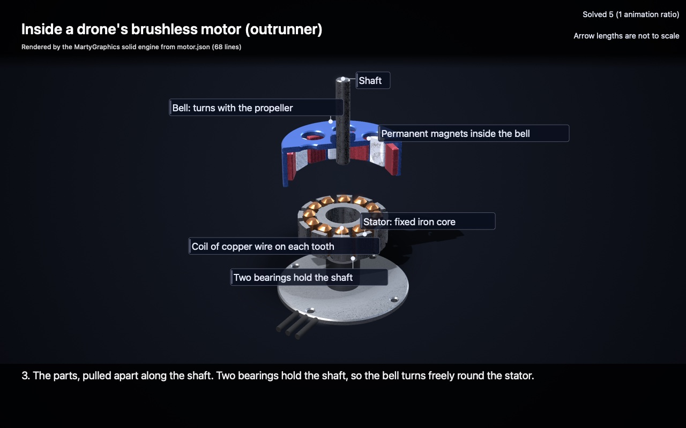](assets/drone-aviation/brushless-motor/step-3.jpg)

[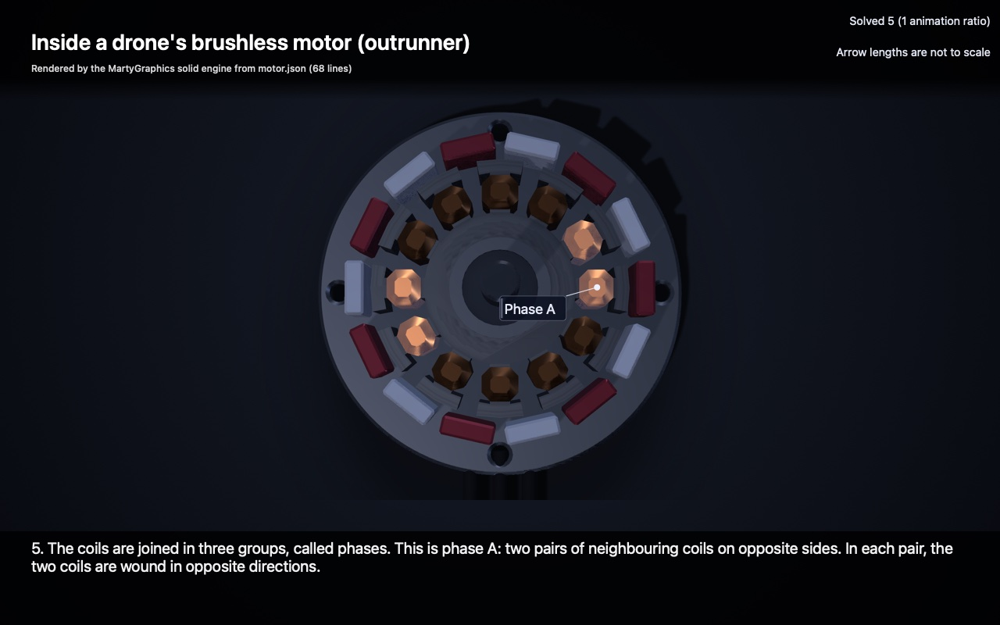](assets/drone-aviation/brushless-motor/step-5.jpg)

**How it works.** In an outrunner the outer shell (the bell) carries the magnets and turns; the stator in the
middle carries the coils and is fixed. The 12 coils are joined in three phases (winding pattern AabBCcaABbcC: the
two neighbouring coils of each pair are wound in opposite directions, so one is a north pole and one a south pole).
In six-step control the speed controller energizes two phases at a time and changes the pair in a repeating order;
the stator's field turns, and the magnets follow. One turn of the
bell takes 7 electrical cycles, one for each pair of magnets. Swap any two of the three wires and the motor turns
the other way.

**What the engine checked.** The bell's rotation, and the counts in the captions: 12 coils, 7 and 7 magnets (they
are `repeat` counts, not typed numbers). Legend: "Solved 5 (1 animation ratio)". Currents, magnetic forces and
torque are not computed. Attempt 2 was refused with `step.hide.fact`: a caption gave the magnet count while its
cutaway step hid seven magnets. The count moved to a step that hides none.

### Three-axis camera gimbal

[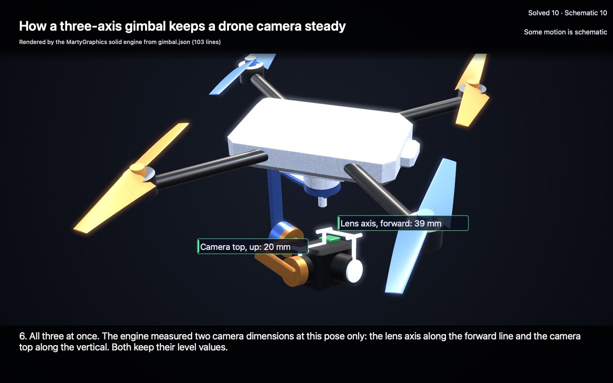](assets/drone-aviation/gimbal/story.mp4)

[Story video (MP4)](assets/drone-aviation/gimbal/story.mp4): 70 seconds, 8 beats · [JSON](assets/drone-aviation/gimbal/gimbal.json) ·
[Brief and all 6 attempts](assets/drone-aviation/gimbal/PROMPT.md) · [Check output](assets/drone-aviation/gimbal/check-strict.json)

[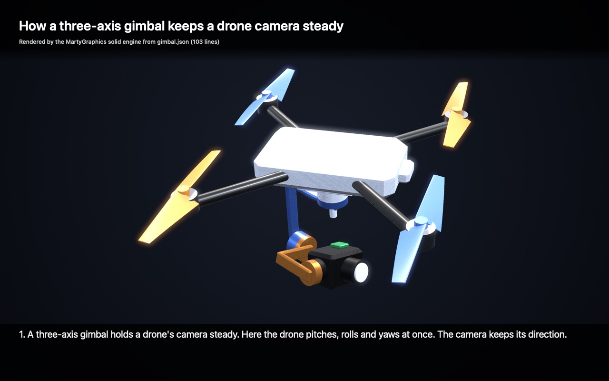](assets/drone-aviation/gimbal/step-1.jpg)

**How it works.** Three motors hold the camera: yaw, then roll, then pitch. When the drone turns about one of these
axes, the motor on that axis turns its arm the other way by the same angle, so the camera keeps its direction. A
motion sensor on the camera measures the camera's turn, and the controller drives the motors to cancel it. A gimbal
holds direction only: it does not remove movement up, down or sideways.

**What the engine checked.** At four poses (yaw, roll, pitch, and all three), two measured dimensions on the camera
keep their values at that pose: the lens axis along the forward line and the camera top along the vertical. The
equal and opposite motor angles cancel the drone's turn exactly because the model nests the drone's pitch, roll and
yaw pivots in the reverse order of the gimbal's joints; for a general 3-D turn they would not. A deliberate wrong
pose (the yaw motor does not cancel the yaw) was refused with `step.pose.fact`. The motion itself is schematic: the
author set each motor to follow the drone's turn with ratio -1, and the legend says "Solved 10 · Schematic 10" with
the note "Some motion is schematic". The drone turns about the camera's centre in this model. No control loop is
modelled.
The story video has one camera cut (beat 2, from the wide view into the close-up).

### Landing gear over-centre lock

[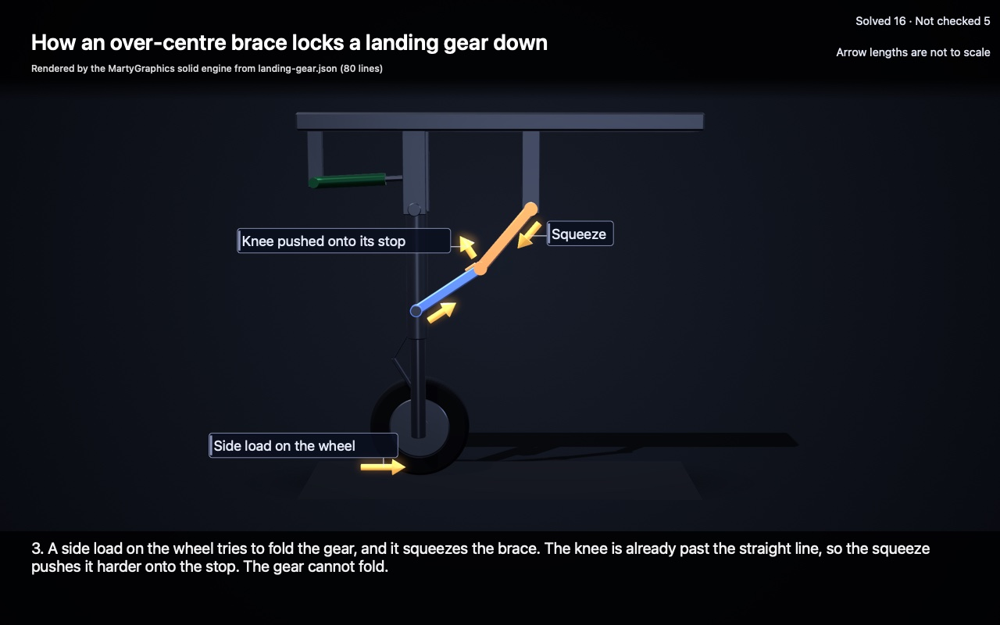](assets/drone-aviation/landing-gear/story.mp4)

[Story video (MP4)](assets/drone-aviation/landing-gear/story.mp4): 78 seconds, 11 beats · [JSON](assets/drone-aviation/landing-gear/landing-gear.json) ·
[Brief and all 11 attempts](assets/drone-aviation/landing-gear/PROMPT.md) · [Check output](assets/drone-aviation/landing-gear/check-strict.json)

[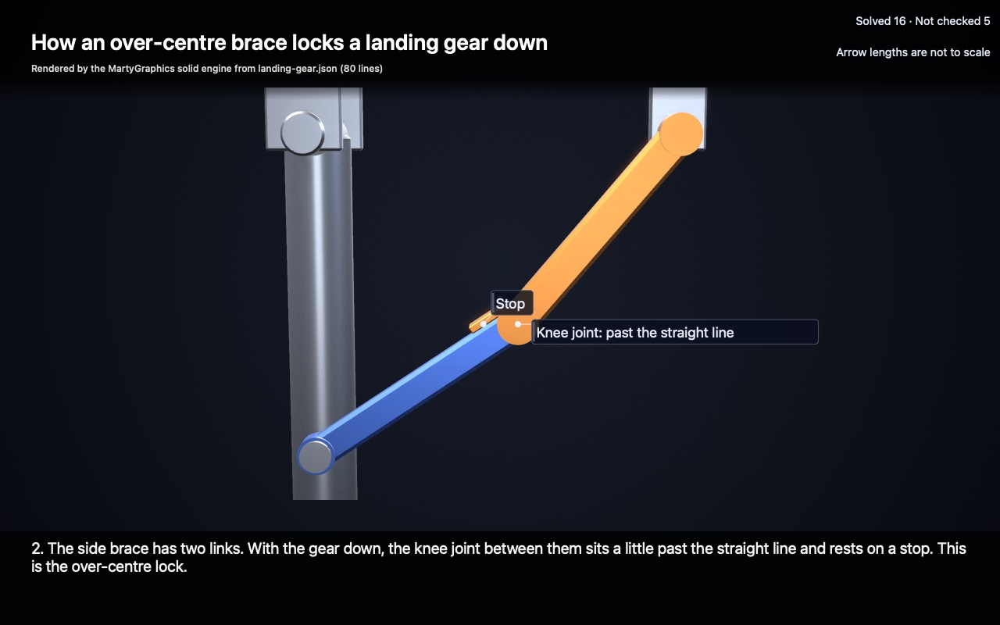](assets/drone-aviation/landing-gear/step-2.jpg)

[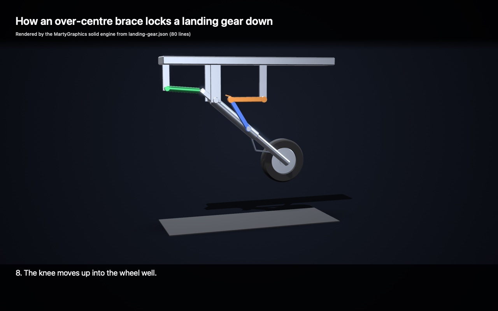](assets/drone-aviation/landing-gear/step-8.jpg)

**How it works.** The leg turns about its trunnion. A side brace of two links holds it down. With the gear down,
the knee between the links sits a little past the straight line and rests on a stop. A load that tries to fold the
gear squeezes the brace, and the squeeze pushes the knee harder onto the stop, so the gear cannot fold. In this
example, an unlock actuator moves the knee back through centre before retraction (one design, US 5,022,609); then
the retract actuator turns the leg up and the brace folds.

**What the engine checked.** The engine has no linkage solver, so the author computed the link angles for seven
poses outside the engine. The engine then checked the two pin-to-leg distances at each shown pose (100 mm and
500 mm). The two distances alone do not prove that the pin is in its hole: they have a second, mirror solution
(GAPS.md, gap 14). A deliberate wrong angle was refused with
`step.pose.fact`. Legend: "Solved 16 · Not checked 5". Between two poses the video blends the angles, and the engine
does not check the blend. Loads and hydraulics are not computed. The model is schematic: real designs can use lock
links, springs and actuators; use the aircraft maintenance manual for its geometry and adjustments.

## Jet suit (hand-built, fact-checked)

**Hand-built example (written by a Claude agent from fact-checked research, not generated from a prompt by the
engine's AI loop).** The lesson explains the classic five-engine Gravity jet suit, as described 2020–2022, in 7
steps. The current Mk4 has three back turbines and is not shown. The model is
[`jet-suit.json`](assets/jet-suit/jet-suit.json), 59 lines, 76 parts. The stills and the story video are unedited
output of `marty-solid render` at 1280×800; `marty-solid check --strict` passes with no warnings
([check output](assets/jet-suit/check-strict.json)).

This is the sixth version of the lesson. Step 5 now poses the pilot: both arms swing back, and the engines move with
them. Exhaust plumes (an illustration, not measured) show only in steps 2 and 5. Highlights take whole engines, the
exploded view moves whole engines, the helmet and the packs, long labels take two lines, and step 7 has a turn arrow
on the shaft. It keeps the two label anchors that the strict anchor check (every label dot must land on its part and show in its
still) moved on 2026-11-08: step 6's "Combustion chamber" dot is inside the chamber, and step 1's "Schematic pilot"
dot is on the back of the helmet. The 7 stills, the hero still, the poster, the story video and the check output come
from one build (see the [render receipt](assets/jet-suit/provenance.json)).

[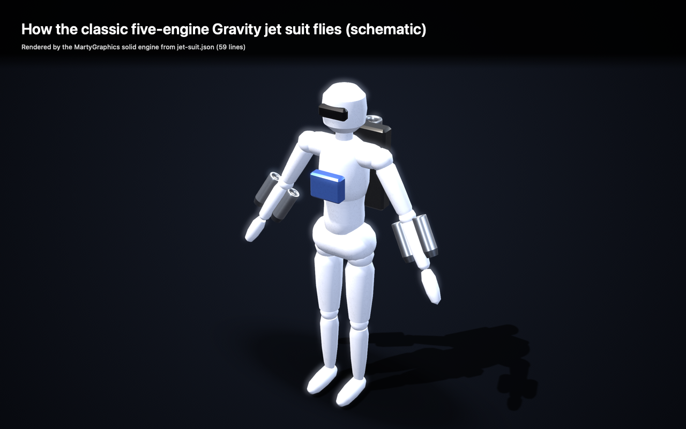](assets/jet-suit/hero.png)

[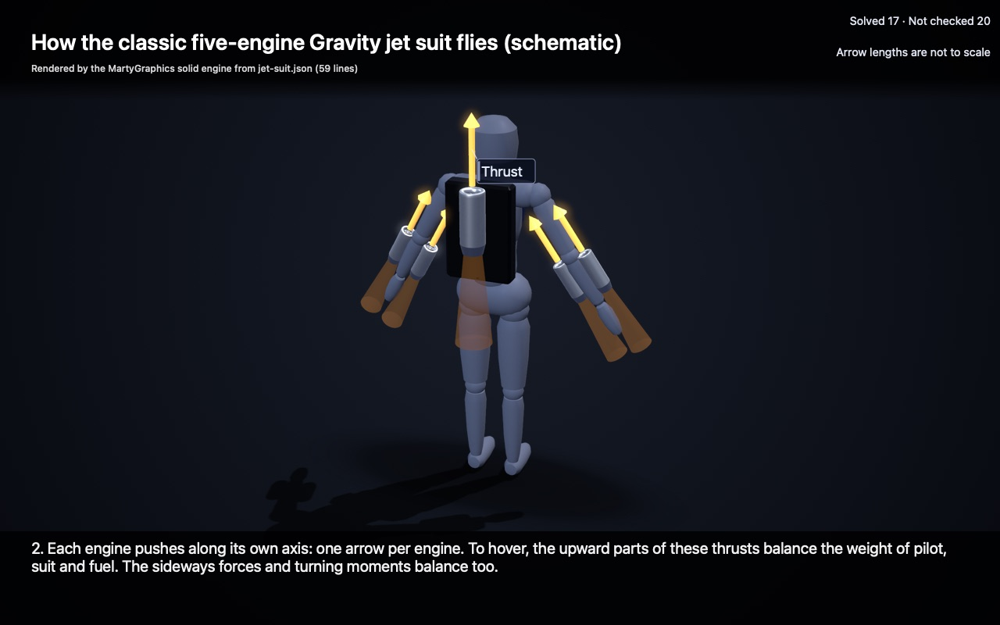](assets/jet-suit/story.mp4)

[Story video (MP4)](assets/jet-suit/story.mp4): 63 seconds, 7 beats of 9 seconds, 1280×800 at 30 frames per
second, re-encoded with AVFoundation to 5.7 MB (the engine's file is 13.1 MB; both hashes are in the
[render receipt](assets/jet-suit/provenance.json)). GitHub does not play it inside this page; click to open it.

[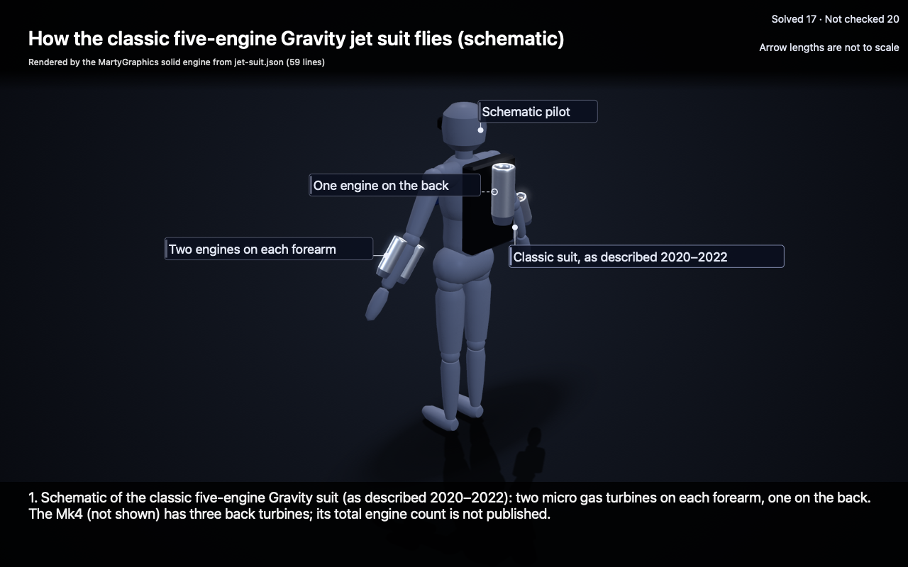](assets/jet-suit/step-1.png)

[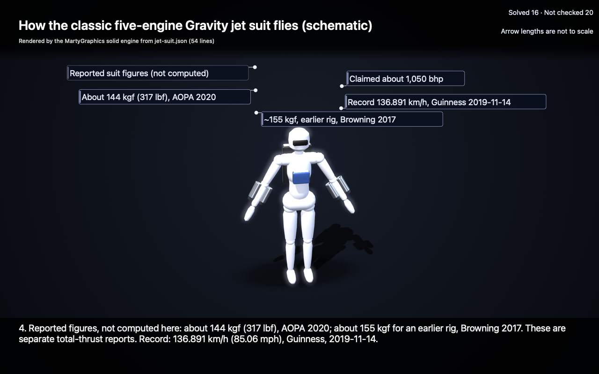](assets/jet-suit/step-4.png)

[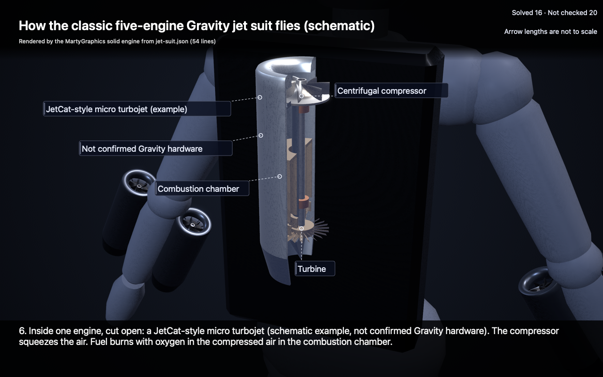](assets/jet-suit/step-6.png)

**How the classic five-engine suit flies.** The suit has five micro gas turbines: two on each forearm and one on the
back. To hover, the upward components of their thrusts balance the weight of pilot, suit and fuel, and the sideways
forces and turning moments balance too. In Browning's 2021 description, the back engine carries the equipment plus
about one third of his body weight, and the arms about two thirds. The pilot steers by moving the arms, which aims the
thrust. In step 5 the pilot moves both arms back, so the arm engines' exhaust is aimed back and gives a forward
component of thrust (the pose is schematic, not a worked manoeuvre). Inside a JetCat-style micro turbojet (a schematic example, not confirmed Gravity hardware), the compressor
squeezes the air, fuel burns with oxygen in the compressed air, the hot gas drives the turbine, which turns the
compressor on the same shaft, and the gas leaves the nozzle fast; the reaction is thrust.

**Sources.** Every fact in the lesson is in [SOURCES.md](assets/jet-suit/SOURCES.md) with its fact-key row (F1 to
F20), its label (VERIFIED, CLAIM or PLAUSIBLE), its source URL and its date. Two independent AI model fact-checks
(GPT-6.1 Sol and Gemini 3.8 Flash) checked the claims on 2026-11-08. They caused these corrections to an earlier
draft: the version is named, hover is a balance of upward components (not "thrust equals weight"), 144 kgf and 155
kgf stay separate reports, a claimed thrust loss at altitude was removed, the cutaway is labelled as an example, and
1,050 bhp is marked as a claim. These are model checks with web access, not a review by a jet-suit engineer.

**What the legend means.** Each step still reads **Solved 17 · Not checked 20**.

* **Solved 17:** the engine computed these: the motion of 15 rotating parts (the impeller, turbine wheel and shaft
  of each of the 5 engines), the direction of the weight arrow (straight down) and the turn sense of the shaft's turn
  arrow in step 7 (from the shaft's motion).
* **Not checked 20:** 8 labels and 4 captions that give a reported number, a quote or a version, and 8 arrows whose
  direction and length are as authored. The engine shows them but does not check them; their facts come from the
  sources table, not from the engine.
* The engine does not compute thrust, rpm, the load split or the hover balance. "Arrow lengths are not to scale" is
  printed in each step still. Engine sizes, the pack, the poses and the exhaust plumes are schematic.

**Review.** An independent read-only review of the sixth version gave PUBLIC-OK for these 7 stills and the hero
still. It checked the story video at its 7 hold frames and at one frame of the move into step 5; two frames of the
move out of step 5 were checked after it. It did not check every transition frame. That review saw renders with the
two earlier label anchors; the published files use the moved anchors (see the
[render receipt](assets/jet-suit/provenance.json)). The exploded view is not published.

## Also in this repo

These sections show other parts of the repository: beat-by-beat lessons, the path tracer and the 2D scene engine with
its packs. They are not part of the mechanism pitch.

### Beat-by-beat lessons

A short rotation lesson on the lesson layer: triangle ABC turns about the origin O in five beats, with one angle
slider. The lesson was written by hand as part of the [example](../Examples/LessonDemo/README.md), like the other
hand-built examples on this page; it is not the output of a prompt run. The lesson JSON is [`rotation.lesson.json`](fixtures/v1/rotation.lesson.json); the format is in
[LESSONS.md](LESSONS.md).

[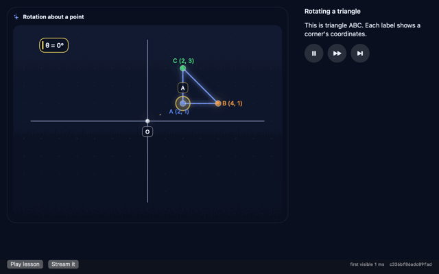](assets/lessons/rotation-loop.gif)

| Beat | Line (numbers filled by the engine) | Still |
| --- | --- | --- |
| 1 | This is triangle ABC. Each label shows a corner's coordinates. | [beat-1.png](assets/lessons/beat-1.png) |
| 2 | Now we turn the triangle about the origin O by 90°. | [beat-2-turning.png](assets/lessons/beat-2-turning.png) (engine keyframe at 45°, in the turn) |
| 3 | A moved from (2, 1) to (-1, 2). Its distance to O is still 2.24. | [beat-3.png](assets/lessons/beat-3.png) |
| 4 | Your turn. Drag the slider. The engine moves the triangle and updates every label. | [beat-4.png](assets/lessons/beat-4.png) (slider bound at 90°), [learner-slider-45.png](assets/lessons/learner-slider-45.png) (slider moved to 45° by the scripted learner) |
| 5 | At 180° every coordinate changes sign. A is now at (-2, -1). | [beat-5.png](assets/lessons/beat-5.png) |

[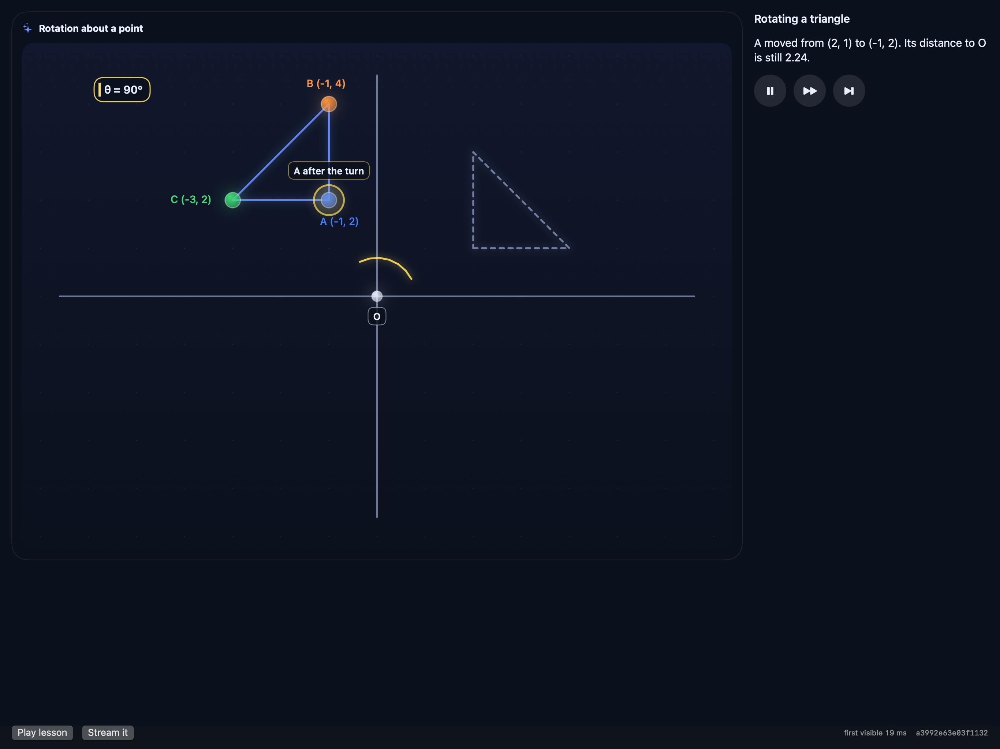](assets/lessons/beat-3.png)

[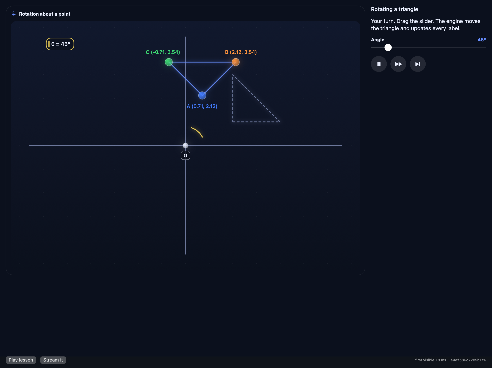](assets/lessons/learner-slider-45.png)

**How it teaches rotation.** The engine computes each rotated corner in Swift. The coordinate labels and the numbers
in the lines are engine values, not typed text. The 90° turn plays as 18 engine keyframes at most 5° apart, and each
keyframe is a true rotation with its own labels. In beat 4 the learner drags the slider (in these images, a scripted
learner). A slider move sends the same `params` command that a scripted beat sends. In beat 5 the lesson
turns the triangle from the learner's angle to 180°, and the beat's checks (A = (-2, -1)) must hold on the engine
values before its line is shown.

**How the images were made.** The stills are 1366×1024-point offscreen captures of the live demo view
(`lesson-demo --render` for beats 1, 3, 4 and 5; `lesson-demo --capture` for the in-turn frame and the learner
frame). The loop comes from `lesson-demo --capture` at 1024×640 points, scaled to 640×400 so that labels stay
readable. It shows each beat state, the start scene and engine keyframes of each turn, and a scripted learner's
slider ticks, each for the time the demo's default pacing (2.5 words per second) schedules it: 26.8 s in all,
including a 2 s hold at the end. The live view also blends between neighbouring keyframes and draws new items on;
the capture shows only settled frames. Labels can touch a dot, an edge or the highlight ring in some frames
([a known limit](LESSONS.md#what-is-not-checked)).
[Capture receipt](assets/lessons/provenance.json)

The footer of the demo view ("first visible 18 ms" in the stills) is the live view's own reading in the capture
window. It is not the benchmark. The benchmark (`lesson-demo --timing`, release build, on an Apple M1 Mac, not an
iPad): a scene statement reaches the first offscreen frame (1024×768) in 0.52 ms, median of 30 runs. A slider tick
commits new state in 0.14 ms, median of 500 runs. The first figure needs 136 bytes of stream.
See [measured timing](LESSONS.md#measured-timing-this-mac-only).

### Path-traced gearbox

A procedurally generated two-stage gearbox, path traced on an
Apple M1 GPU by `MartyGraphicsPathTracer`: 1920×1080, 768 samples per pixel, about
2.5 minutes per still. No images, models or stock assets.

[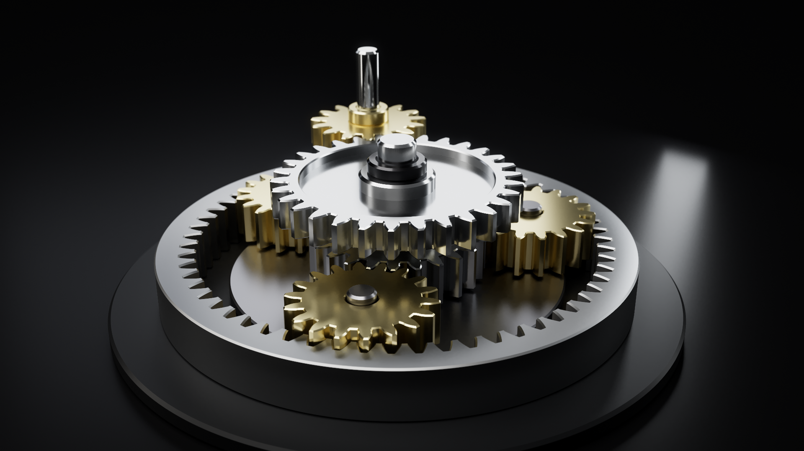](assets/pathtrace/hero.png)

[Exploded view](assets/pathtrace/exploded.png) · [Code beside the render](assets/pathtrace/side-by-side.png) ·
[Loop (GIF, 480×270, 12.5 fps, 9.6 s)](assets/pathtrace/gearbox-loop.gif) ·
[Video (MP4, 1280×720, 24 fps)](https://morrowdock.app/mg/pathtrace/gearbox-loop.mp4) ·
[Run it](../Examples/PathTrace/README.md) · [Render receipt](assets/pathtrace/provenance.json)

**How it works.** The input shaft turns the small 15-tooth pinion. It drives a 30-tooth gear,
which turns half as fast (30 ÷ 15 = 2:1). That gear spins the 24-tooth sun gear in the middle
of a planetary set. Three 18-tooth planet gears mesh with the sun and with the 60-tooth ring
around them. The ring is fixed, so the planets roll around inside it and turn the carrier that holds
them, slowly. The carrier turns once for every 1 + 60 ÷ 24 = 3.5 turns of the sun.
Together: 2 × 3.5 = 7 turns of the input for one turn of the output. Planetary sets are
used where a big reduction must fit in a small space, such as in car automatic
transmissions, power drills and helicopter rotor gearboxes.

### Native scenes

| Example | In `--preview` | What to notice | Source |
| --- | --- | --- | --- |
| Tree search | Follow a search | Follow comparisons through a binary search tree. | [tree.json](../Examples/Showcase/Sources/MartyShowcase/Scenes/tree.json) |
| Two pointers | Walk an array | Move through an array to find two numbers totaling 14. | [two-pointers.json](../Examples/Showcase/Sources/MartyShowcase/Scenes/two-pointers.json) |
| Message handoff | Trace a handoff | A step changes the highlighted node in a directed diagram; no queue is executed. | [handoff.json](../Examples/Showcase/Sources/MartyShowcase/Scenes/handoff.json) |
| Sampled function | See the samples | Seven supplied points sketch y = x²; the engine does not derive them. | [function.json](../Examples/Showcase/Sources/MartyShowcase/Scenes/function.json) |
| Synthetic counts | Compare quantities | Compare Alpha 18, Beta 30, Gamma 24. Every value is invented. | [counts.json](../Examples/Showcase/Sources/MartyShowcase/Scenes/counts.json) |
| Geometric motion | Move through a scene | A marker takes two seconds from A to B, then returns. No force model is implied. | [motion.json](../Examples/Showcase/Sources/MartyShowcase/Scenes/motion.json) |
| Shortest path | Find the cheapest route | Dijkstra settles six routers one at a time; the cheapest route 0→2→1→3→4→5 costs 13. Opt-in graph pack. | [shortest-path.json](../Examples/Showcase/Sources/MartyShowcase/Scenes/shortest-path.json) |

### Run or reproduce

Follow the [native showcase instructions](../Examples/Showcase/README.md).
The [exporter source](../Examples/Showcase/Sources/MartyShowcase/Showcase.swift)
uses `MGTimeline.items`, `MGTimeline.frame`, `MGViewport`, and `MGCanvasRenderer`,
then renders the native frames with SwiftUI `ImageRenderer`.

All examples are original synthetic material under [Apache-2.0](../LICENSE).
No private course fixture, premium pack, browser screenshot, concept, or external
artwork belongs to this set.

### Native versus browser demonstrations

- Native exports are engine frames with a small SwiftUI card/caption wrapper,
  not screenshots of the full Morrowdock application.
- [Morrowdock's website](https://morrowdock.app) can demonstrate related ideas
  using browser code. A browser recreation is separate from Swift execution.
- A concept or private/unmerged pack is not evidence of a public capability.
  This gallery uses the two current built-ins, the public opt-in graph pack and
  generic primitives only.

### Accepted capture inventory

The [machine-readable receipt](assets/native/provenance.json) pins the capture commit
`9b4ba89780af54d7de7f7e4fd209625a2db24f33` and the SHA-256 of every scene, tool and engine source
file, so it stays checkable after a squash merge. It also records commands, platform,
dimensions, stored timing and artifact digests. Build, 95 tests (zero failures), scene
verification and native export passed on macOS 27.2 / Apple Swift 6.4.2, arm64, SwiftPM debug,
renderer scale 1. Later documentation/CI changes do not change the captured Swift source.

| Asset | Pixels | Size | Timing |
| --- | --- | --- | --- |
| [Overview](assets/native/overview.png) | 1172 × 2116 | 570 KiB | Still; individual views have clearer small labels |
| [Tree](assets/native/tree.png), [array](assets/native/two-pointers.png), [handoff](assets/native/handoff.png), [function](assets/native/function.png), [counts](assets/native/counts.png), [motion](assets/native/motion.png), [shortest path](assets/native/shortest-path.png) | 840 × 662 each | 90–159 KiB each | Stills; motion sampled at one second |
| [Two pointers](assets/native/two-pointers.gif) | 840 × 662 | 53 KiB | 4 frames × 1.2 s = 4.8 s |
| [Shortest path](assets/native/shortest-path.gif) | 840 × 662 | 125 KiB | 8 frames × 1.2 s = 9.6 s |
| [Motion](assets/native/motion.gif) | 840 × 662 | 124 KiB | 32 frames × stored 0.13 s = 4.16 s (about 7.69 fps) |

All eleven images total **1,807,710 bytes (about 1.72 MiB)**. The README leads with the mechanism examples and
links to this gallery for the 2D scenes. Stills are single-column and can
be opened at full resolution. GitHub controls GIF playback; choose the static
gallery below to avoid the animations. Descriptions and values remain available
as text rather than relying on small image labels alone.

These are offscreen native captures with a caption wrapper. No full-app screenshot,
video, live interactive playback, accessibility, performance or adopter receipt is
claimed. See the [remaining quality work](QUALITY.md).

### Static gallery

Each source link above is runnable in the [same local showcase](../Examples/Showcase/README.md):
pick a scene by its preview title from the table above in `--preview`, or export
the complete set with `--export`.
The accepted receipt covers export; interactive controls still need validation.

#### Tree search

Search 12 → 5 → 8, finding 8 in three comparisons.
[Source](../Examples/Showcase/Sources/MartyShowcase/Scenes/tree.json) · [Run](../Examples/Showcase/README.md)

[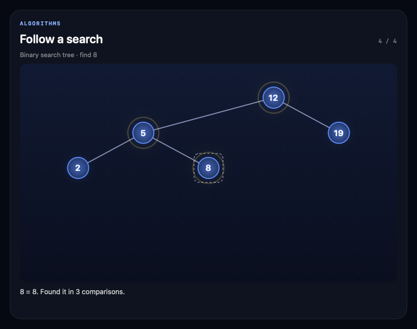](assets/native/tree.png)

#### Two pointers

The final step selects 5 + 9 = 14 from [2, 5, 9, 14].
[Source](../Examples/Showcase/Sources/MartyShowcase/Scenes/two-pointers.json) · [Run](../Examples/Showcase/README.md)

[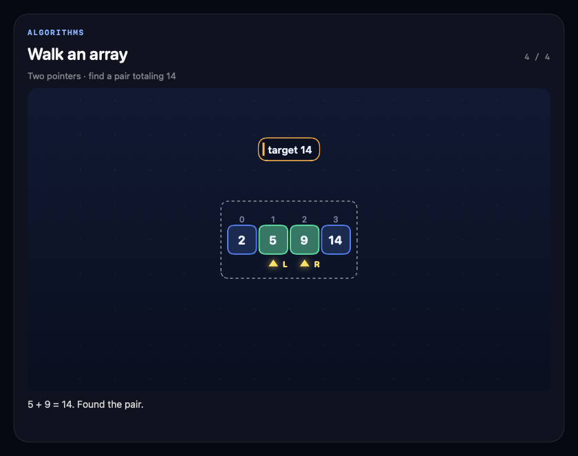](assets/native/two-pointers.png)

#### Message handoff

Source → Queue → Worker; the final step highlights Worker. This is a diagram.
[Source](../Examples/Showcase/Sources/MartyShowcase/Scenes/handoff.json) · [Run](../Examples/Showcase/README.md)

[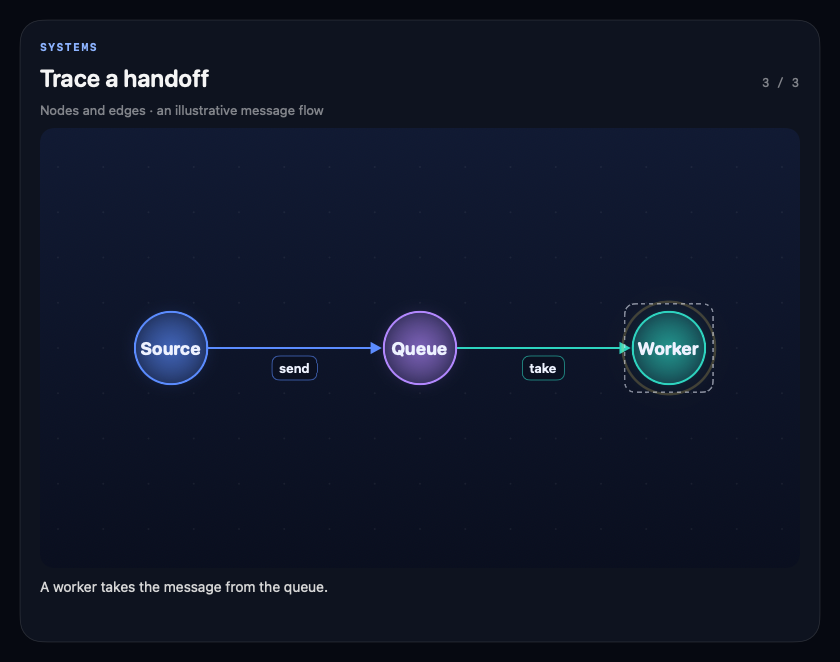](assets/native/handoff.png)

#### Sampled function

Seven supplied points sketch y = x² from x = −3 to 3, without a solver.
[Source](../Examples/Showcase/Sources/MartyShowcase/Scenes/function.json) · [Run](../Examples/Showcase/README.md)

[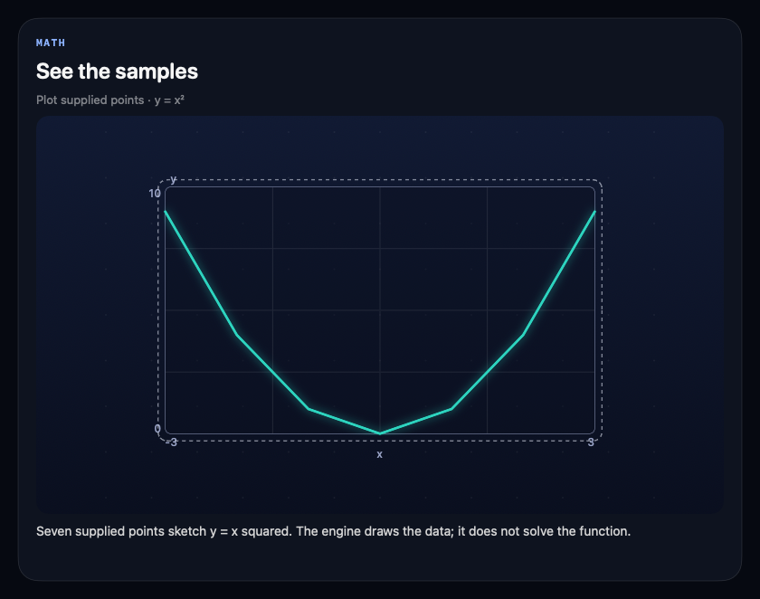](assets/native/function.png)

#### Synthetic counts

Alpha 18, Beta 30, Gamma 24. Every quantity is invented.
[Source](../Examples/Showcase/Sources/MartyShowcase/Scenes/counts.json) · [Run](../Examples/Showcase/README.md)

[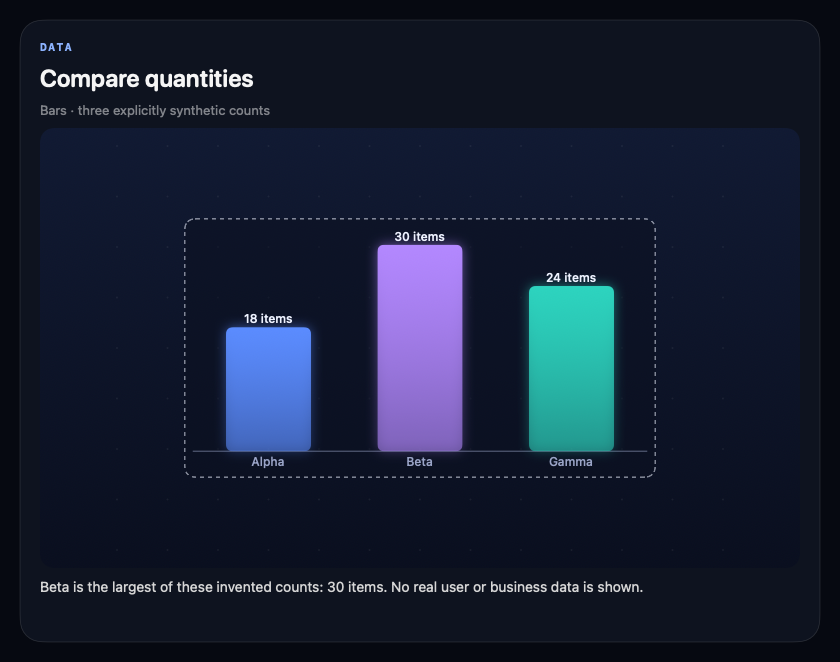](assets/native/counts.png)

#### Geometric motion

A still sampled at one second between A and B. The timeline animates position;
it does not simulate forces.
[Source](../Examples/Showcase/Sources/MartyShowcase/Scenes/motion.json) · [Run](../Examples/Showcase/README.md)

[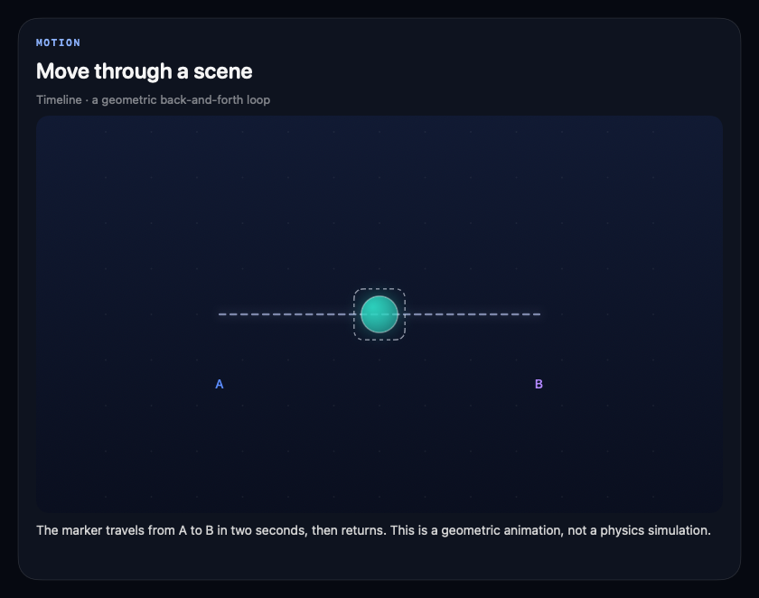](assets/native/motion.png)

#### Shortest path

Dijkstra over six routers with link latencies in milliseconds. The final step
highlights 0→2→1→3→4→5 at cost 13, the only route at that cost.
[Source](../Examples/Showcase/Sources/MartyShowcase/Scenes/shortest-path.json) · [Run](../Examples/Showcase/README.md)

[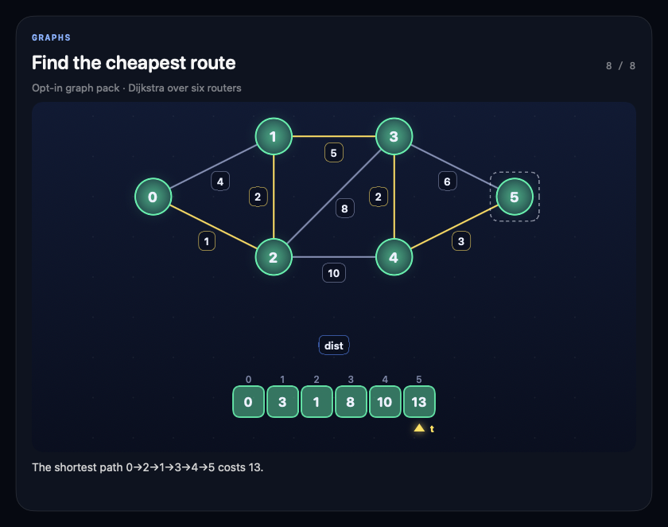](assets/native/shortest-path.png)

[Seven-scene overview](assets/native/overview.png) · [Asset license](../LICENSE) · [Exact provenance](assets/native/provenance.json)
