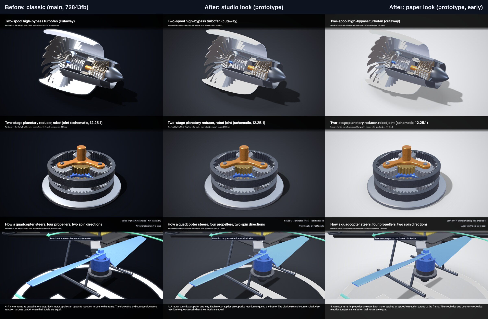

# Visual audit of the built-in renderer (round 0)

Date: 2026-11-11. Base: `72843fb` (main). Scope: what the built-in renderer draws, in the SwiftUI views and in
`marty-solid render`. The style this audit leads to is in [VISUAL-STYLE.md](VISUAL-STYLE.md).

The work that follows is cosmetic only. It changes pixels and nothing else: no geometry, motion, solved value, check,
reason code or JSON vocabulary, and no byte of a `check` report, a `snapshot.json` or a decided `manifest.json`.

## First evidence

A quick prototype of the backdrop, tone and fill only (no material, label or motion work yet), rendered by the
`Showcase` workflow on a hosted Mac (run 43126446831) from a prototype branch that is not kept. Left: `classic`, the renderer on main. Middle: the `studio` look. Right: the `paper` look, an
early variant. Rows: the turbofan, the robot-joint gearbox and step 4 of the quadcopter explainer, 1280 × 800 each.
The prototype is not proposed for merge; pull request (a) builds the look properly.

What the sheet shows: dark parts keep their outline, shadows land on a floor, and whites keep their form. What it
also shows: the fuller environment flattens the metals (the fan blades read grey, not metallic). The path-traced
turbofan in [assets/turbofan](assets/turbofan/pathtraced-hero.png) gets its metal from high-contrast reflections, so
the next round keeps the lit backdrop and returns contrast to the environment. Bands, labels and the legend are
untouched here and now look heavy against the new backdrop (T3, T4).

## What is already there

The renderer is not on SceneKit defaults. `MGSolidRenderer` already has physically based materials, a procedural
studio environment for image-based lighting, key, fill and rim lights, a soft key shadow on a shadow catcher, a
contact shadow, screen-space ambient occlusion, HDR with bloom, 4× multisampling and 2× supersampling for stills.
The picture is plain because of how those parts are tuned and presented, and because the overlay and the board were
built for correctness first. That is good news: most of the gain is tuning and drawing, with little new machinery.

## Two limits found in the code

1. **The light rig is part of a JSON output.** `snapshot.json` stores `MGStudioLighting.studio` (`lighting`) and
   every part's `MGMaterialParameters` (`materials`). Retuning either in place changes snapshot bytes. So the new
   look is a renderer-only layer (`MGSolidLook`) that scales the rig inside the renderer; `MGStudioLighting.studio`
   and `MGMaterialPreset.parameters` stay as they are.
2. **Label boxes are part of a JSON output.** `MGAnnotationLayout` sizes each text box (`0.58 × f` per scalar plus
   fixed 6 px and 4 px padding) and the placement records go into the snapshot and the manifest. The typography work
   can change how a box is drawn, not its size or place.

There are no committed pixel goldens for the 3D view. The cross-process test bounds the pixel difference between
three fresh runs and compares the decided manifest with a golden ([Determinism](SOLID-3D.md#determinism)). The
"image goldens" a look change regenerates are the published images under `docs/assets`.

## Defects and fixes

Each row names where the defect comes from and the pull request that fixes it: (a) lighting, tone mapping and
anti-aliasing, (b) materials, (c) background, shadows and occlusion, (d) labels, callouts and board typography,
(e) motion and camera.

### Lighting, tone and colour

| # | Defect | Where | Fix | PR |
| --- | --- | --- | --- | --- |
| L1 | The environment is dark and contrasty (zenith 0.10 to 0.16, floor 0.05). Metals reflect black with hot streaks, and the undersides of parts go black. | `MGSolidSnapshot.swift` (`MGStudioLighting.studio`) | A look scales the environment levels and the soft boxes inside the renderer: a fuller, more even studio with floor bounce. | a |
| L2 | Whites clip. The white nacelle and the lit landing pad lose all detail, and bloom (0.22 above 0.92) puts a halo on them. | `MGSolidRenderer.swift`, camera setup | A white point above 1, a small negative exposure offset, bloom at 0.06 or less. | a |
| L3 | SceneKit's vignette (0.35) darkens the subject near the frame edge, not the backdrop. | camera setup | Vignette the backdrop only. | a |
| L4 | No control of the tone curve beyond SceneKit's built-in HDR mapping. | camera setup | Per-look white point, contrast and saturation. A grading table for still quality is evaluated after the first results. | a |
| L5 | The backdrop gradient is drawn in 8 bits with no dither, so it bands, and H.264 makes the bands worse. | `MGSolidRenderer.composite` | A per-pixel backdrop with a fixed half-level dither (CPU, byte-identical in every run). | a, c |
| L6 | The live view and the export differ. `SceneView` shows a transparent (black) scene background, `MG3DView` a flat navy, and the export a radial gradient. | `MartyGraphicsExplainerView.swift`, `MG3DView.swift` | One backdrop per look, used by the live view and the export. | c |
| L7 | The live view has no quality level: shadow map 4096 with 24 samples, occlusion and bloom always on. | `buildLights`, camera setup | Quality levels (see the style), with a default that keeps an iPad smooth. | a |

### Background, shadows and occlusion

| # | Defect | Where | Fix | PR |
| --- | --- | --- | --- | --- |
| B1 | The backdrop is nearly black. Rubber, carbon composite, black oxide and dark steel lose their outline against it. | `lighting.background`, `composite` | A studio sweep with a pool of light under the subject, in a dark and a light variant. | c |
| B2 | Shadows do not show. The shadow catcher and the contact shadow darken a floor that is already black, so the model floats. | `updateGround` | The lit floor makes both visible. Their strength is set per look. | c |
| B3 | Occlusion at 0.9 speckles rough plastics (the blue motor in the quadcopter stills). | camera setup | Lower intensity per look; more samples at still quality. | c |
| B4 | The model and its shadow are clipped at the safe window with a hard edge. On a black floor this is hidden; on a lit floor it would show. | `render(width:height:clip:)` | Feather the clip edge over a few pixels, under the band scrims. | c |

### Materials

| # | Defect | Where | Fix | PR |
| --- | --- | --- | --- | --- |
| M1 | Flat gear faces show radial streaks (the brass gears of `gears-mixed`). The cause is not confirmed: the candidates are normals smoothed across a shallow chamfer, and shading precision on long thin fan triangles. | `MGMesh.renderMesh`, `MGSolidRenderer.geometry` | Find the cause with a showcase run. A renderer-side fix is in scope; a change to `renderMesh` changes snapshot normals and needs a maintainer decision. | b |
| M2 | The brushed-steel roughness texture uses per-vertex angle coordinates, which smear across triangles and leave a seam at ±180°. | `geometry` (texture coordinates), `brushedRoughness` | Compute the turning marks per fragment from the part-local position. | b |
| M3 | Plastic and anodised parts take the board's neon colours as base colour, which reads as a toy. | `MGMaterialPreset.parameters` (kept), `scnMaterial` | A renderer-side mapping from colour role to a calibrated surface colour of the same hue. The role and the snapshot values do not change. | b |
| M4 | Glass is a flat 22 % alpha blend. | `scnMaterial` | Stronger Fresnel reflection and a clear specular layer. | b |
| M5 | Carbon composite is a plain black clearcoat. Rubber is a flat near-black. | `scnMaterial` | A procedural weave and a fine grain at still quality. | b |
| M6 | A ghosted part becomes a flat grey slab. | `restyle` | A ghost that is brighter at grazing angles, so its shape reads while the parts behind show. | b |
| M7 | A highlight dims the other parts to 20 to 30 % (nearly black) and washes the highlighted part with flat emission. | `restyle` | A milder dim and an emphasis that keeps the material's shading. | b |
| M8 | Arrows and dimensions are flat emissive tubes that bloom. | `buildAnnotations` | A matte finish with a thin dark edge, the same colours. | b, d |

Parts look boxy mostly because of their geometry (sharp unbevelled edges). Geometry is the checked model, so it stays.
Softer light, visible contact shadows and occlusion remove most of the harshness.

### Labels, callouts, bands and the board

| # | Defect | Where | Fix | PR |
| --- | --- | --- | --- | --- |
| T1 | Label plates use fixed pixel metrics (4 px radius, 1 px stroke, 3 px tier bar) at every output size. | `MGSolidOverlayView.swift` | Every drawn metric becomes a multiple of the font size, inside the same box. | d |
| T2 | Leader lines are 1.2 px white with no casing and vanish over white parts (the turbofan nacelle). | same | A dark casing under a light line, and an anchor dot with a ring. | d |
| T3 | The legend and the honesty notes ("Solved 17 · Not checked 13", "Arrow lengths are not to scale") are bare right-aligned text. | `MGSolidOverlay.draw`, `caption` | A legend group with tier dots and clear weight, in the same rectangle. | d |
| T4 | The title band is an 88 % black bar and the caption band an 84 % black slab across the frame. | `titleBackdrop`, `caption` in `main.swift` | Scrims that keep the measured 4.5:1 contrast with less weight, per look. | d |
| T5 | One type size per role, no tabular numerals, and the step number is part of the sentence. | `caption` | A type scale, tabular numerals for values, a step badge. | d |
| T6 | Ink is always white, so a light look cannot work. | `MGSolidOverlay.ink` | Ink and plate colours come from the look. | d |
| D1 | The board glows: every arrow, body and highlight has a coloured shadow, which softens edges. | `MGCanvasRenderer.swift` | Glow only for emphasis; crisp strokes elsewhere. | d |
| D2 | Tables are small in their pane (about 200 px wide in a 550 px pane) and board text has fixed pixel sizes. | `MGCanvasRenderer`, `MGExplainerLayout` | Scale type with the pane. A change of the fitted viewport is checked for JSON effects first. | d |
| D3 | The composite frame is a flat fill with two panes that have different backgrounds and no edge. | `composite` in `main.swift`, `MartyGraphicsExplainerView` | One surface colour, pane edges and spacing from the style. | d |

### Motion and video

| # | Defect | Where | Fix | PR |
| --- | --- | --- | --- | --- |
| A1 | Captions, labels and highlight dimming pop in at the start of a hold. | story loop in `main.swift`, explainer view | Short fades, in pixels only; the story plan and its timing do not change. | e |
| A2 | A blocked camera move is a hard cut. | story loop | A short dip through the backdrop on a cut; the plan still records a cut. | e |
| A3 | The MP4 files carry no colour tags, so a player may guess the colour space. | `MovieWriter` | Tag BT.709 primaries, transfer and matrix. | e |
| A4 | The loop GIF's palette bands a smooth backdrop. | loop writer | Check after the backdrop lands; dither if needed. | e |
| A5 | The live view does not refine a still frame. | `SceneView` options | Jittered anti-aliasing when the camera rests. | a, e |

## Open questions

None of these is done until answered.

1. **Record the look in `manifest.json`?** A `look` member changes manifest bytes and the render goldens. Proposal:
   leave the manifest as it is for now.
2. **`snapshot.json` keeps `MGStudioLighting.studio`.** Other renderers then light by the rig, not by the look. Is
   that the intended split with the Blender path?
3. **When does the new look become the default?** Proposal: opt-in (`--look`) in pull request (a), default in (c),
   after the cross-process pixel bounds are measured again on the hosted Mac. Published images are regenerated then.
4. **Course fixture.** A non-public course explainer is not fetched by the workflow. The showcase uses the public
   drone explainers.
5. **Story timing** (`transitionSeconds` and the routed variant) is in the manifest. Pull request (e) leaves it and
   adds fades only.
6. **Label padding** is in the layout, so it is in JSON. Making padding scale with the font needs a layout change.
7. **M1**, if the cause is in `renderMesh`.
